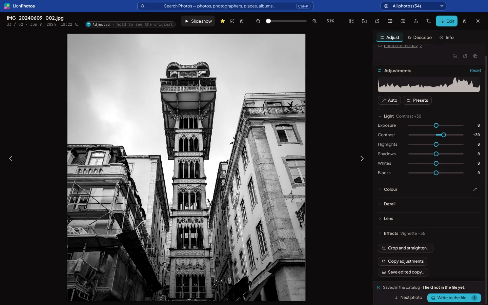
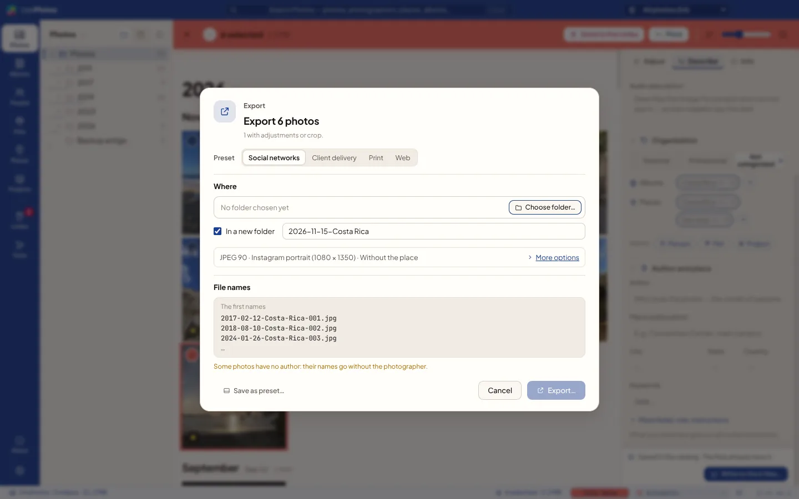

<div align="center">


# LionPhotos

**Browse, search and organize collections of photos and videos — fast.**<br>
Works on your folders as they are: small thumbnails made once, the metadata that matters, and safe organizing tools.

<sub>by the <b>LionPhotos Team</b> · created and conceived by <b>Daniel Michelon De Carli</b> · a sibling of <a href="https://github.com/danielcarli/lionorganizer">LionOrganizer</a></sub>

**English** · [Português (Brasil)](docs/README.pt-BR.md) · [Português (Portugal)](docs/README.pt-PT.md) · [Español](docs/README.es.md) · [Français](docs/README.fr.md) · [Deutsch](docs/README.de.md) · [Italiano](docs/README.it.md) · [简体中文](docs/README.zh-CN.md) · [日本語](docs/README.ja.md) · [한국어](docs/README.ko.md)


<p>
  <a href="https://github.com/danielcarli/lionphotos/releases/latest/download/LionPhotos-Setup.exe"></a>
  <a href="https://github.com/danielcarli/lionphotos/releases/latest/download/LionPhotos-mac-universal.dmg"></a>
  <a href="https://github.com/danielcarli/lionphotos/releases/latest/download/lionphotos_amd64.deb"></a>
  <a href="https://github.com/danielcarli/lionphotos/releases/latest/download/lionphotos.x86_64.rpm"></a>
  <a href="https://github.com/danielcarli/lionphotos/releases/latest/download/LionPhotos-x86_64.AppImage"></a>
</p>

<sub><a href="https://github.com/danielcarli/lionphotos/releases">All versions</a> · <a href="#download">How to install</a></sub>


</div>

> **Beta test.** LionPhotos is complete for daily use and is tested on a real collection of about 15,000 photos and videos, but it is still in beta: expect rough edges, and keep a backup of your collection before you reorganize it for the first time. [What beta means here](#beta-test).

## What it solves

Photo collections grow faster than anyone can sort them: years of shoots spread over folders and external drives, the same picture in three places, raw files most viewers cannot open, and the work of sorting them locked inside one program on one computer. LionPhotos is made for that situation:

- **"I can't find that photo."** Search by name, folder, camera, author, description, album, project, person, pet or place. Faces and pets are recognized on your computer, and places fill in by themselves from the GPS or the place written in the photo.
- **"Opening the collection takes forever."** No import, no copy of your photos: LionPhotos browses the folders as they are, makes each thumbnail once and remakes it only when the file changes. 100,000 items scroll like 100.
- **"My folders are a mess."** *Reorganize the collection* reads the folders and proposes one clear structure on the disk (`2025/2025-12-24-Christmas`, themes, an inbox, camera tests), for review before anything moves — and all of it can be undone.
- **"The disk is full of things I don't need."** Mark rejects as you go and send them to the Limbo; find repeated files by their content. Everything leaves through the Recycle Bin, never deleted for good.
- **"My work stays on one computer."** Albums, people, marks, descriptions, adjustments and crops are also kept in a hidden folder inside the collection, so the same external drive opens with all of it on another computer, under any drive letter.
- **"I need to deliver."** Quick edits and crops for each social network, captions and audio descriptions for accessibility, and exports with consistent file names and the metadata you choose. The originals never change.

## Who it is for

- **Photographers, professional and enthusiast,** who keep their work in folders and on external drives, shoot RAW + JPEG, and want to sort, find and deliver without importing everything into a catalog.
- **Communication teams, newsrooms and studios** that share a collection between computers and people, need consistent names, authorship and accessible descriptions, and organize the work by project and client.
- **Families and anyone with years of phone photos** scattered across folders, who want to find people, places and moments again and free up space safely.
- **Anyone who cares about privacy:** nothing is uploaded, there is no account and nothing goes over the network.

## Strengths

- **Your folders, as they are.** No import and no closed library: the photos stay where you put them, and your other programs keep working with them.
- **Local and private.** No account, no telemetry, no network; face and pet recognition run on your computer. It reads only the folder you choose and its subfolders.
- **Fast at any size.** The grid draws only what is on screen; thumbnails are small, kept in one cache file and made only once. Large collections on external drives stay fluid.
- **Every format, its own decoders.** JPEG, HEIC/HEIF, TIFF, PSD/PSB, camera raw from every major brand (CR3, CR2, NEF, ARW, RAF, DNG…) and videos (MP4, MOV, MTS, AVI…).
- **Safe by design.** Every change to files shows its plan first, asks for a typed 3-character code and can be undone; deleting always goes to the Recycle Bin.
- **The catalog travels with the photos,** in an open, documented JSON format that other programs can read.
- **Organizes for real.** Albums, projects, people, pets and places in the catalog — and, when you want, folders and file names on the disk, with the raw, JPEG and sidecar files of a shot kept together.
- **Free and open source** (MIT), for Windows, macOS and Linux, in 10 languages.

## Beta test

LionPhotos is in **beta**. What that means:

- It is used every day on a real collection, and every version passes more than 100 automated end-to-end checks, but it has not yet been used on many different computers and collections.
- Before you organize, rename or reorganize a collection for the first time, **keep a backup of it** (the Backup tab can make one). Every operation can be undone and nothing is deleted for good, but a backup is the safest net.
- The installers are not signed with a paid certificate yet (see [Download](#download)).
- Raw photos are edited, by default, on the JPEG the camera stores inside them (8 bits); the **develop mode** (a switch in Adjustments) edits the sensor data instead, developed on this computer in 16 bits with LibRaw — new and still being tuned (its colours are not the camera's or Lightroom's). It needs a graphics card with WebGL 2.
- Found a problem or have a suggestion? Open an [issue](https://github.com/danielcarli/lionphotos/issues) with the version (shown in the status bar) and what you did. LionPhotos never sends anything by itself.

## Download

Download the installer for your system. Every installer gets the **latest version** from GitHub, and every file is checked (SHA-256 and signed build provenance).

- **Windows 10/11** (x64, ARM): a setup wizard of about 2 MB that downloads and checks the app during installation. → [`LionPhotos-Setup.exe`](https://github.com/danielcarli/lionphotos/releases/latest/download/LionPhotos-Setup.exe)
- **macOS 11+** (Apple Silicon, Intel): open the `.dmg` and drag LionPhotos to Applications. → [`LionPhotos-mac-universal.dmg`](https://github.com/danielcarli/lionphotos/releases/latest/download/LionPhotos-mac-universal.dmg)
- **Linux** (x64): `.deb` for Ubuntu, Debian, Mint…, `.rpm` for Fedora, RHEL, openSUSE…, or the AppImage for any distribution, with no installation. → [`.deb`](https://github.com/danielcarli/lionphotos/releases/latest/download/lionphotos_amd64.deb) · [`.rpm`](https://github.com/danielcarli/lionphotos/releases/latest/download/lionphotos.x86_64.rpm) · [AppImage](https://github.com/danielcarli/lionphotos/releases/latest/download/LionPhotos-x86_64.AppImage)

> The installers are not signed with a paid certificate yet. On first launch, Windows may show "Windows protected your PC" (**More info › Run anyway**) and macOS asks you to allow the app in **System Settings › Privacy & Security › Open Anyway**.

**Prefer the terminal?** Windows (PowerShell, no administrator needed):

```powershell
irm https://github.com/danielcarli/lionphotos/releases/latest/download/install.ps1 | iex
```

macOS and Linux:

```bash
curl -fsSL https://github.com/danielcarli/lionphotos/releases/latest/download/install.sh | bash
```

[All versions](https://github.com/danielcarli/lionphotos/releases) · [Installation guide](docs/INSTALL.md): details, how it stays safe, updating and uninstalling.

## Features

| | |
|---|---|
| **Photos** | Grid by month or list with folder, type, dimensions, size, date and details; selection with click, Ctrl and Shift; zoom; filters by type, year, mark, category and subfolders, shown as chips you take off with one click. The folder tree (or the years) on the left, the info panel on the right — both can be hidden, or everything with focus mode (`\`). **Search in the title bar** (Ctrl+K or Ctrl+F) looks through the whole collection as you type — photos, albums, projects, people, places, photographers, cameras, keywords, folders — and, when filters hide everything, the page says which ones, with a button to take each off. Inside an album, a person, a pet, a place or a project: a mosaic, an even grid, a list or its highlights. |
| **Viewer** | Full size at once (the thumbnail first), raw files at full size through the JPEG the camera stored in them, ← → to move, `I` for info, zoom to actual size; videos play with controls. The zoom slider goes from the screen size to 400 %; the wheel zooms where the mouse is, dragging moves the picture, `Z` switches fit ↔ actual size. *Edit* (or `I`) shows or folds the same editing panel as the info panel — category, albums, adjustments, description, author and place; a photo moved to a category the filter hides stays in view, greyed, with a note naming where it now is. HEIC, HEIF and HIF open at full size too; HDR photos (PQ, HLG) are made ordinary for the screen, in the viewer and the thumbnails. A double click zooms to 100 % where it is clicked, and back. Delete sends a photo to the Limbo with a plain confirmation. |
| **Adjustments** | Exposure, contrast, shadows and saturation in the info panel, for one photo or many, with a histogram and a live preview (on the graphics card, or the processor when there is none); copy and paste them on other photos. The file never changes: the adjustments are in the catalog (undone with Ctrl+Z), the thumbnails and the viewer show them (hold `\` for the original), and *Save edited copy* writes a new JPEG next to the original with its metadata. *Export photos* (Ctrl+E) makes new files of the edited photos in any folder — JPEG, PNG or TIFF, the size of a social network or a print, output sharpening, names like `2026-07-24-Graduation-Ana-Souza-001.jpg`, all the metadata or without the place, an optional signature — with the sRGB profile; the originals never change. |
| **Editing** | Highlights, whites, blacks, white balance (temperature, tint and an eyedropper), vibrance, black & white with a mix per colour, vignette, and — on the graphics card — sharpness, texture and clarity; *Auto*, presets, and before/after in the viewer (`Y`). **Crop and straighten** (`C`): free or locked to a shape — the common ones and the social networks' (Instagram 4:5 and 3:4, Stories/Reels/TikTok 9:16, YouTube 16:9, link 1.91:1, Pinterest, X and LinkedIn headers) — 90° turns and straightening by a line along the horizon. Everything stays in the catalog; the file never changes. |
| **Lens correction** | The distortion, darker corners and colour fringes of the lens undone from its profile — the whole [Lensfun](https://lensfun.github.io) database, about 1,600 lenses, found from the name the camera wrote or chosen from a searchable list — and by hand: distortion, vertical and horizontal perspective (buildings that lean back), scale, corners and fringes. On the graphics card; the file never changes. |
| **Recycle Bin history** | Tools › *Recycle Bin history* (`Ctrl+5`) lists every file LionPhotos sent to the Recycle Bin — when, which, its size and from where (the Limbo, Repeated files, a selection) — and reports the space the Limbo freed, in all, this month and month by month. |
| **Info panel** | Every metadata field of the selection, the category, the albums, people, pets, places and projects it is in — added or removed right there. |
| **Description and metadata** | Headline, caption, audio description, author and role, place (sublocation, city, state, country), keywords and instructions, for one photo or many at once — only the catalog changes. What the file already says (EXIF, IPTC, XMP, a raw file's `.xmp`) shows as the hint and is used by exports. *Write to the files* (with the typed code) puts it into the JPEG itself, the previous version going to the Recycle Bin, or into a `.xmp` next to any other file. The JPEG also gets the same `.xmp` next to it, so the data goes with the photo when it is sent and stays readable beside it. Every change can be undone (Ctrl+Z) and redone (Ctrl+Shift+Z); writing to the files is undone from the notice or the recent operations, and the files go back byte for byte. |
| **Albums** | Cover, description and period; *Add to album…* on any selection, *Remove from album*, *Use as cover*; **albums from the folders** (the first level, the folders with photos, or the ones you pick), tied to the whole folder; full-screen slideshow. **Suggest albums**: the photos grouped as they were taken and named by what they are about — the folder, what the photos show (read on this computer from the thumbnails: beach, mountains, a cake, a wedding gown, food…), holidays by their date, the place, the person — plus albums of a subject across the years, for review before they are made. **Merge two albums** into one (the photos of both, under the name you choose; only the catalog changes, with undo). Shown as a mosaic, an even grid (every cover the same size), a list or highlights. |
| **Projects, people, pets, places** | Each in its own tab, as a grid or a list grouped by year. Opening one shows its photos, under its tab; a photo can be taken out of it with one click. A folder's label covers everything inside it. A project groups albums and has a sheet (status, for whom, place, team, due date) and a panel showing where the work stands: sorted, edited, chosen into albums, audio descriptions. Places fill in by themselves from the photos (the GPS position or the place written in them) and are shown on a **world map**, drawn on this computer. |
| **Faces and pets** | face-api (TensorFlow.js) for faces, COCO-SSD and MobileNet for animals, on the graphics card (WebGL). Groups of similar faces, suggestions you confirm or reject, "not them" remembered. Off by default; *Index now* or after each scan. |
| **Marks and Limbo** | Great, OK, candidate to delete — on the tile, the list, the viewer and the info panel; keys `1` `2` `3` `0`. The Limbo shows every candidate and how much space they take, and sends them to the Recycle Bin in one step. **Highlights**: albums, people, pets and projects with only their great and OK photos, one row each — the name large, one chosen photo big — like a portfolio page. Places too; and inside any of them, its chosen photos large, one per row. |
| **Open with** | The photo and video programs of the computer for the selected files (Photoshop, Lightroom Classic, Bridge, Premiere Pro, Capture One, DxO PhotoLab, Affinity, darktable, GIMP, VLC…), the last ones used first; on Windows also every program registered for the file type. |
| **Plugins** | Install `.lionplugin` packages that export albums and projects as a page (HTML, CSS and JavaScript) with the file names, descriptions and audio descriptions; nothing in them runs inside LionPhotos. See [docs/PLUGINS.md](docs/PLUGINS.md). Each plugin turned on has its own tab after Projects, with its page: pick the albums and projects and export. |
| **Overview** | Items, photos, videos, size and period; files by kind, by year, formats, cameras, codecs; the thumbnail cache. |
| **Organize** | Date folders (`2024/2024-07`, `2024-07`, `2024`, `2024/2024-07-14`, or `2024-07-14-theme`), folders by album (`2024/2024-07-14-album`), optionally with `Raw/` and `Img/` inside; *Move to folder* with subfolders by kind; the files of the same shot go along; recent operations with undo. The files really move on the disk, and can also be **renamed** (`{data}-{álbum}-{fotógrafo}-{nº}` by default, numbered by date; the raw, JPEG and `.xmp` of a shot keep the same name), or only renamed where they are. **Reorganize the collection** reads the folders as they are and proposes one structure on the disk — `2025/2025-12-24-Natal`, long themes in `Themes/`, what waits to be sorted in `_Inbox/`, camera tests in `_Gear/` — for review (rename or leave out any folder, see the tree as it will be) before whole folders move, with undo. **Related files left behind** (an `.xmp` or `.dop` alone after its photo moved) go back next to their photo, with its name. **Duplicate** (Ctrl+D): a copy next to the photo with its adjustments, crop, marks and albums, with the typed code and undo. |
| **Repeated files** | SHA-256 in three stages (size → first/last 64 KB → whole file), side by side with their thumbnails. |
| **Backup** | A master and a backup folder compared by content; verified copies of what is missing, in the same subfolders or in date folders. |
| **Convert** | HEIC/HEIF → JPG or PNG at full resolution, EXIF and colour profile kept, next to the original. |
| **Formats** | Photos: JPEG, PNG, GIF, WebP, AVIF, BMP, HEIC/HEIF, TIFF, PSD/PSB, camera raw (CR3, CR2, NEF, NRW, ARW, SR2, ORF, RW2, RAF, SRW, PEF, DNG, 3FR, IIQ, ERF, RWL). Videos: MP4, MOV, M4V, 3GP, WebM, MKV, MTS/M2TS, AVI. |
| **10 languages** | English, Português (Brasil), Português (Portugal), Español, Français, Deutsch, Italiano, 简体中文, 日本語, 한국어 — detected from the system, switchable in the status bar. |
| **Themes** | Blue (the teal of the logo), light, dark and automatic. |

## Safety first

The same rules as LionOrganizer:

- **Typed confirmation code.** Every change to files — Recycle Bin, organize, move, rename, convert, undo, clearing the cache — shows a 3-character code that must be **typed** (pasting is disabled). The code is generated and checked by the main process; five wrong attempts cancel.
- **Recycle Bin, not permanent delete.**
- **Scoped.** The interface reaches files only through library ids of the opened folder, never by path.
- **Read-only by default.** Browsing, metadata, thumbnails, previews, the duplicate check and "Open with" never modify your files. Albums, labels, marks and faces change only LionPhotos' own catalog. The one exception: what you make of the photos is also written, as plain JSON, in a hidden `.lionphotos` folder inside the collection (only once you made something; it can be turned off in Backup).

<div align="center">

</div>

## Screenshots

| | |
|---|---|
|  **Albums** — a mosaic by year, with descriptions |  **Highlights** — only the photos marked great or OK, like a portfolio |
|  **Inside an album** — mosaic, even grid, list or highlights |  **Search** — in the title bar, across the whole collection |
|  **Places** — on a world map drawn on this computer |  **Viewer** — with the editing panel (black & white) |
|  **Lens correction** — perspective straightened by hand |  **Crop** — for Instagram, Stories, YouTube… |
|  **Description** — IPTC metadata, saved as you type |  **Export photos** — consistent names, sizes for each network |
|  **List** — folder, type, dimensions, size, date |  **Repeated files** — found by their content |

## Getting started

### Run from source (Windows)

1. Install [Node.js LTS](https://nodejs.org).
2. Download or clone this repository.
3. Double-click **`start.bat`** — the first run installs the dependencies.

Or from a terminal:

```powershell
npm install
npm start
```

### Build an installer

Double-click **`build-installer.bat`** (or run `npm run dist`). The installers are created in `dist/`. Releases are built by GitHub Actions when a `vX.Y.Z` tag is pushed.

## Keyboard shortcuts

| Shortcut | Action |
|---|---|
| `Ctrl+O` | Open a folder |
| `F5` | Look for new and changed files |
| `Ctrl+K` · `Ctrl+F` | Search the whole collection (title bar) |
| `Ctrl+1` · `Ctrl+Shift+A` | Photos · Albums |
| `Ctrl+6` … `Ctrl+9` | Projects · People · Pets · Places |
| `Ctrl+L` | Limbo |
| `Ctrl+2` · `Ctrl+3` · `Ctrl+4` · `Ctrl+0` | Overview · Repeated files · Organize · Backup |
| `Alt+←` · `Alt+Home` | Back from an album, project or person · the whole collection, without filters |
| `Ctrl+B` · `\` | Show/hide the side bar · focus mode (only the photos) |
| `1` `2` `3` · `0` | Mark the selection great · OK · candidate to delete · clear |
| `Ctrl+A` · `Enter` · `I` · `Delete` · `F2` · `Esc` | Select all · open · info panel · Recycle Bin · rename · clear the selection |
| `Ctrl+E` | Export photos (the selection, or the photos shown) |
| `←` `→` · `Space` · `Esc` | Viewer: previous/next · play/pause · close |
| `P` · `F` · `A` | Viewer: slideshow · full screen · add to album |

## Languages

| Language | Code | | Language | Code |
|---|---|---|---|---|
| English | `en` | | Deutsch | `de` |
| Português (Brasil) | `pt-BR` | | Italiano | `it` |
| Português (Portugal) | `pt-PT` | | 简体中文 | `zh-CN` |
| Español | `es` | | 日本語 | `ja` |
| Français | `fr` | | 한국어 | `ko` |

The language follows the system by default and can be changed in the status bar. Numbers and dates follow the selected language. The catalogs are built from `tools/nls/*.py` into `src/nls/*.json`.

## Privacy

LionPhotos never connects to the network: no account, no telemetry, no update check. Face and pet recognition run on this computer with models bundled in the app.

The catalog and the thumbnails are a single file on your computer:

```
%APPDATA%\LionPhotos\library.sqlite
```

*Overview → Clear cache* empties the thumbnails. Your photos are never touched by it.

## How thumbnails stay fast

1. **Scan** — only the chosen folder and its subfolders, `readdir` + `stat` only; a file's content is never opened to list it. 20 000 files take about a second.
2. **Validity** — a thumbnail is stored with the size and modification date of its file; while they match, it is reused. A file moved or renamed outside the app keeps its thumbnail.
3. **Order** — what is on screen first, then the rest newest first; previews only after every thumbnail.
4. **Engine** — a hidden page at a lower priority decodes everything with LionPhotos' own code: pictures in Web Workers, raw files from their embedded JPEG preview, TIFF and PSD reading only every n-th row, HEIC with libheif in WebAssembly, videos with WebCodecs. The operating system's thumbnailer is never called.
5. **Storage** — 320 px WebP thumbnails (8–25 KB) in one SQLite file, with no orphan files.

## Architecture

Same layering as [LionOrganizer](https://github.com/danielcarli/lionorganizer) and [Visual Studio Code](https://github.com/microsoft/vscode): `base` knows nothing above it, `platform` provides main-process services, `workbench` builds the interface; the sandboxed renderer talks to the main process only through the `preload` bridge.

```
src/
  base/            events, formatting, i18n, DOM helpers, icons, charts
  platform/
    library/       SQLite catalog, folder scanner, metadata readers (EXIF, PNG, MP4/MOV, Matroska)
    thumbs/        thumbnail and preview engine + the hidden page (workers, WebM muxer)
    media/         lionthumb:// and lionmedia:// (by library id, with byte ranges)
    faces/         face and pet recognition (hidden page on the graphics card, who-is-who in main)
    labels/        albums, projects, people, pets, places, personal/professional
    operations/    typed-code operations: Recycle Bin, organize, move, rename, undo, clear cache
    openWith/      the photo and video programs of the computer
    duplicates/    SHA-256 finder (shared with LionOrganizer)
  code/            electron-main entry point, preload bridge
  nls/             en.json … ko.json (built from tools/nls)
  workbench/       layout parts, services and views
```

Security: `contextIsolation` and `sandbox` on, no `nodeIntegration`, a strict Content Security Policy, and every file-changing request is validated in the main process.

## Development

| Command | What it does |
|---|---|
| `npm start` | Run the app |
| `npm run dist` | Build the installers |
| `npm run test:e2e` | End-to-end test on a **disposable** folder (`npm run fixtures` makes one) |
| `npm run test:i18n` | Every key used exists, every language complete, placeholders match |
| `npm run test:faces` | Who-is-who with synthetic faces |
| `npm run test:openwith` | "Open with": registry, `.desktop` files, launching |
| `npm run test:plugins` | Plugin packages (what is refused) and exports |
| `npm run nls` | Build `src/nls/*.json` from `tools/nls/*.py` |
| `npm run release:assets` | Build the release assets used by the installers in `dist-release/` |

```powershell
# the end-to-end test changes files: always point it to a throwaway copy
$env:LIONPHOTOS_FOLDER="C:\temp\photos-copy"; npm run test:e2e
```

## Changelog

See [CHANGELOG.md](CHANGELOG.md) — current version: **1.37.2**.

## Credits

LionPhotos was **created and conceived by Daniel Michelon De Carli**, an architecture and urbanism student, and is maintained by the **LionPhotos Team** together with its contributors and translators.

## License

Copyright © 2026 LionPhotos Team.

LionPhotos is open source under the **[MIT License](LICENSE)**: use, copy, modify and distribute it freely, keeping the copyright notice. It is provided **"as is", without warranty** of any kind.

Bundled third-party components keep their own licenses:

| Component | License | Where |
|---|---|---|
| [libheif](https://github.com/strukturag/libheif) with libde265 (WebAssembly build from [libheif-js](https://github.com/catdad-experiments/libheif-js)) | GNU LGPL v3, unmodified | `src/platform/thumbs/electron-sandbox/vendor/libheif` |
| [face-api](https://github.com/vladmandic/face-api) with TensorFlow.js and its face models | MIT | `src/platform/faces/electron-sandbox/vendor/face-api` |
| [COCO-SSD and MobileNet](https://github.com/tensorflow/tfjs-models) models | Apache 2.0 | `src/platform/faces/electron-sandbox/vendor/pets` |
| [Natural Earth](https://www.naturalearthdata.com) country borders and names (1:50m) | Public domain | `src/platform/geo` |
| [GeoNames](https://www.geonames.org) — cities15000 | CC BY 4.0 | `src/platform/geo/node/cities.json` |
| [LibRaw](https://www.libraw.org) 0.22 (raw development), in WebAssembly via [libraw-wasm](https://github.com/colorhythm/libraw-wasm) and [typed-cstruct](https://github.com/ssssota/typed-cstruct) | LGPL-2.1 or CDDL-1.0 · MIT · MIT | `src/platform/raw/electron-sandbox/vendor` |
| [Lensfun](https://lensfun.github.io) lens database (lens correction profiles), converted by `tools/lensfun/build.py` | CC BY-SA 3.0 (data only; none of Lensfun’s code) | `src/workbench/services/adjust/common/lensfun.json` |
| [Plus Jakarta Sans](https://github.com/tokotype/PlusJakartaSans), [JetBrains Mono](https://github.com/JetBrains/JetBrainsMono) | SIL Open Font License 1.1 | fonts |

## Photos in the screenshots

The photos in the screenshots come from the [WordPress Photo Directory](https://wordpress.org/photos/) and are in the public domain ([CC0](https://creativecommons.org/publicdomain/zero/1.0/)): no attribution is required, and they are credited here with thanks. Their descriptions, cameras and dates are the photographers' own; the places on the map were added for the demonstration.

- **Rome:** [Isabel Gutierrez](https://wordpress.org/photos/photo/53469e1c45/), [salsel](https://wordpress.org/photos/photo/2456557419/), [Jupa](https://wordpress.org/photos/photo/3816aaf093/), Bigul Malayi ([1](https://wordpress.org/photos/photo/17168efb07/), [2](https://wordpress.org/photos/photo/616857a90c/), [3](https://wordpress.org/photos/photo/33768dc862/), [4](https://wordpress.org/photos/photo/42268dc85f/)), [karolishostinger](https://wordpress.org/photos/photo/35766e9c63/)
- **Lisbon:** [Isabel Gutierrez](https://wordpress.org/photos/photo/35669e1d6f/), [MelissaH](https://wordpress.org/photos/photo/31968ae275/), KafleG ([1](https://wordpress.org/photos/photo/687685d279/), [2](https://wordpress.org/photos/photo/852685d283/), [3](https://wordpress.org/photos/photo/468685d28f/), [4](https://wordpress.org/photos/photo/667685d2c4/), [5](https://wordpress.org/photos/photo/501685d2ca/)), [Jeff Golenski](https://wordpress.org/photos/photo/3016a7fb59/)
- **Costa Rica:** [Harlyn Luna Brenes](https://wordpress.org/photos/photo/626af3dce8/), [Francisco Herrera](https://wordpress.org/photos/photo/18764e77d3/), wenmirandav ([1](https://wordpress.org/photos/photo/2786aefef5/), [2](https://wordpress.org/photos/photo/2776aefeba/), [3](https://wordpress.org/photos/photo/2016aeffe6/)), [alexandrachacaltana2303](https://wordpress.org/photos/photo/3846aeeac8/), [dmoreno2003](https://wordpress.org/photos/photo/4466af376b/), [dangrijal](https://wordpress.org/photos/photo/3516af7648/), [xbullscm](https://wordpress.org/photos/photo/7066af7fae/)
- **Lake Garda:** xbullscm ([1](https://wordpress.org/photos/photo/836af4b8d6/), [2](https://wordpress.org/photos/photo/716af4b7c7/), [3](https://wordpress.org/photos/photo/1046af4b83/), [4](https://wordpress.org/photos/photo/8286af4b88/), [5](https://wordpress.org/photos/photo/3966af4b78/))
- **Architecture:** Joel Peralta ([1](https://wordpress.org/photos/photo/9656a6d336/), [2](https://wordpress.org/photos/photo/1866a70aeb/), [3](https://wordpress.org/photos/photo/8766a7044c/), [4](https://wordpress.org/photos/photo/9866a6d32f/), [5](https://wordpress.org/photos/photo/766a2f39b8/)), [Silvia Fernanda Marin Giraldo](https://wordpress.org/photos/photo/1656a972f2/), [dumanag](https://wordpress.org/photos/photo/7806a66cad/), [Manjil Aryal](https://wordpress.org/photos/photo/416a282c7f/), [Anup Kankale](https://wordpress.org/photos/photo/966a390efb/)
- **Night sky:** [shirishpoudel07](https://wordpress.org/photos/photo/8606a28c17/), Jeff Golenski ([1](https://wordpress.org/photos/photo/544620fdb6/), [2](https://wordpress.org/photos/photo/92361d465c/)), [vanessartavia](https://wordpress.org/photos/photo/3036ae9774/), [Natcha Boonroj](https://wordpress.org/photos/photo/512693d15a/), [Faisal Ahammad](https://wordpress.org/photos/photo/816ae8da24/)
- **Kyoto:** [Maruti Mohanty](https://wordpress.org/photos/photo/4746570441/), [Timi Wahalahti](https://wordpress.org/photos/photo/14766bbb55/), Wajari Velasquez ([1](https://wordpress.org/photos/photo/506a214832/), [2](https://wordpress.org/photos/photo/5236a216f0/), [3](https://wordpress.org/photos/photo/8366a216e4/), [4](https://wordpress.org/photos/photo/8976a21449/), [5](https://wordpress.org/photos/photo/296a2182a4/))
