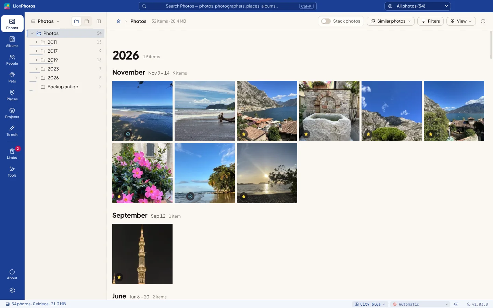
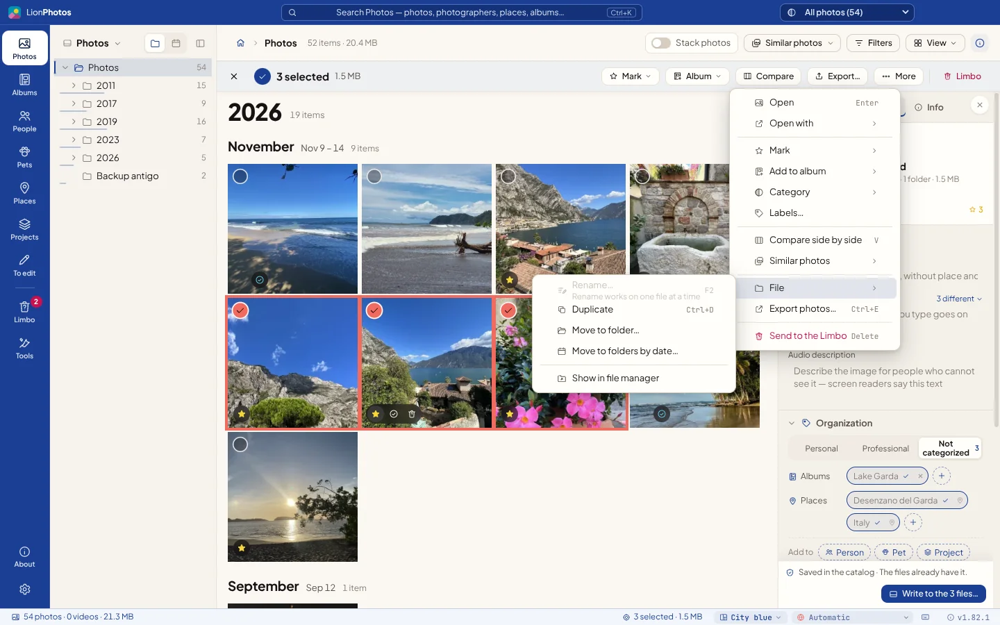

<div align="center">


# LionPhotos

### Jedes Foto, das Sie je gemacht haben — in Sekunden gefunden.

Riesige Foto- und Videosammlungen dort durchsuchen und ordnen, wo sie schon liegen: auf der Festplatte, einem externen Laufwerk oder in einem Cloud-Ordner. Schnell, privat und kostenlos.

<sub>vom <b>LionPhotos Team</b> · erdacht und entwickelt von <b>Daniel Michelon De Carli</b> · ein Geschwister von <a href="https://github.com/danielcarli/lionorganizer">LionOrganizer</a></sub>

[English](../README.md) · [Português (Brasil)](README.pt-BR.md) · [Português (Portugal)](README.pt-PT.md) · [Español](README.es.md) · [Français](README.fr.md) · **Deutsch** · [Italiano](README.it.md) · [简体中文](README.zh-CN.md) · [日本語](README.ja.md) · [한국어](README.ko.md)

<p>
  <a href="https://github.com/danielcarli/lionphotos/releases/latest/download/LionPhotos-Setup.exe"></a>
  <a href="https://github.com/danielcarli/lionphotos/releases/latest/download/LionPhotos-mac-universal.dmg"></a>
  <a href="https://github.com/danielcarli/lionphotos/releases/latest/download/lionphotos_amd64.deb"></a>
  <a href="https://github.com/danielcarli/lionphotos/releases/latest/download/lionphotos.x86_64.rpm"></a>
  <a href="https://github.com/danielcarli/lionphotos/releases/latest/download/LionPhotos-x86_64.AppImage"></a>
</p>

<a href="https://github.com/danielcarli/lionphotos/releases/latest"></a>

<sub><a href="https://github.com/danielcarli/lionphotos/releases">Alle Versionen</a> · <a href="#herunterladen">Installation</a></sub>


**Kein Import** · **Nichts verlässt Ihren Computer** · **100.000 Fotos scrollen wie 100** · **Kostenlos und Open Source**


</div>

> **Betatest.** LionPhotos ist für den täglichen Gebrauch fertig und wird mit einer echten Sammlung von rund 15.000 Fotos und Videos getestet, ist aber noch in der Beta: Mit Ecken und Kanten ist zu rechnen, und vor dem ersten Neuordnen einer Sammlung sollte eine Sicherung vorhanden sein. [Was Beta hier bedeutet](#betatest).

**Beeindruckender Umfang.** LionPhotos vereint bereits das Wesentliche des Bibliothek-Moduls von Lightroom (Katalog, Markierungen, IPTC, RAW+JPEG, nicht-destruktive Anpassungen) mit dem Besten von Google Fotos (Personen, Haustiere, Suche nach Inhalt, Stapel ähnlicher Fotos). Dazu kommen der Limbo, Plugins mit eigener Marke und 10 Sprachen.

**Aus echter Nutzung entstanden.** Viele Funktionen entstanden aus echten Problemen von Fotografierenden: ein langsames Google Drive, RAW+JPEG, Metadaten vergleichen, bevor man ein Foto verwirft. Das ergibt meist Software, die nützlich ist und nicht nur gut aussieht.

**Getestet mit einer großen Sammlung.** LionPhotos wird mit einer Sammlung von über 70.000 Fotos auf einer externen USB‑3.1‑Festplatte getestet, und die Oberfläche bleibt leicht zu bedienen und flüssig – auch wenn es länger dauert, die Miniaturen der ganzen Sammlung zu erstellen.

## So sieht es aus

Fotosammlungen wachsen schneller, als man sie sortieren kann: Jahre an Aufnahmen verteilt auf Ordner und externe Laufwerke, dasselbe Bild an drei Orten, RAW-Dateien, die die meisten Betrachter nicht öffnen, und die Sortierarbeit eingesperrt in einem Programm auf einem Computer. Genau dafür ist LionPhotos gemacht:

### Ihre Ordner, so wie sie sind

> *„Die Sammlung zu öffnen dauert ewig.“*

Kein Import, keine Kopie Ihrer Fotos: LionPhotos durchsucht die Ordner, wie sie sind, erstellt jede Miniatur einmal und erneuert sie nur, wenn sich die Datei ändert. 100.000 Elemente scrollen wie 100.

Alben, Personen, Markierungen, Beschreibungen, Anpassungen und Zuschnitte liegen auch in einem versteckten Ordner in der Sammlung: Dasselbe externe Laufwerk öffnet sich auf einem anderen Computer mit allem – unter jedem Laufwerksbuchstaben.

<p align="center"><br><sub><b>Fotos</b> — ein Raster nach Monaten, die Jahre griffbereit am Rand</sub></p>

<p align="center"> <br><sub><b>Liste</b> — Ordner, Typ, Abmessungen, Größe, Datum · <b>Ein Menü</b> — dasselbe unter Mehr und beim Rechtsklick; Datei ▸ sammelt, was die Festplatte ändert</sub></p>

### Jedes Foto in Sekunden

> *„Ich finde das Foto nicht.“*

Suche nach Name, Ordner, Kamera, Autor, Beschreibung, Album, Projekt, Person, Haustier oder Ort. Gesichter und Tiere werden auf Ihrem Computer erkannt, und Orte füllen sich selbst aus dem GPS oder dem im Foto eingetragenen Ort. Oder einfach nach dem, was das Foto zeigt: *Strand*, *Hund* oder *Geburtstagsfeier* eingeben.

<p align="center"><br><sub><b>Suche</b> — in der Titelleiste, über die ganze Sammlung</sub></p>

### Schnell bearbeitet, Original unberührt

Belichtung, Farbe, Schwarzweiß, Zuschnitt, Ausrichten, Objektiv- und Perspektivkorrektur, RAW-Entwicklung — live, auf der Grafikkarte. Alles bleibt im Katalog: Die Datei ändert sich nie, und `\` zeigt jederzeit das Original.

<p align="center"> <br><sub><b>Betrachter</b> — mit dem Bearbeitungsfeld (Schwarzweiß) · <b>Objektivkorrektur</b> — Perspektive von Hand begradigt</sub></p>

### Alben, die sich fast selbst machen

*Alben vorschlagen* gruppiert die Fotos so, wie sie aufgenommen wurden, und benennt sie nach dem, was sie zeigen — ein Strand, eine Hochzeit, ein Geburtstag — zur Durchsicht. Jedes Album hat Titelbild, Beschreibung und Zeitraum und öffnet als Mosaik, gleichmäßiges Raster, Liste oder Highlights; der Stift setzt es auf die Liste dessen, was noch *zu bearbeiten* ist.

<p align="center"> <br><sub><b>Alben</b> — Mosaik nach Jahr, mit Beschreibungen · <b>In einem Album</b> — Mosaik, gleichmäßiges Raster, Liste oder Highlights</sub></p>

### Ihre besten Fotos, wie ein Portfolio

Markieren Sie beim Durchsehen die sehr guten und die guten Aufnahmen mit `1` und `2`. *Highlights* zeigt nur diese — Alben, Personen, Orte und Projekte, je eine Zeile, das gewählte Foto groß — eine Portfolio-Seite aus Ihren eigenen Markierungen.

<p align="center"><br><sub><b>Highlights</b> — nur die mit Stern oder OK markierten Fotos, wie ein Portfolio</sub></p>

### Jede Reise auf einer Weltkarte

Orte füllen sich selbst aus dem GPS oder dem im Foto notierten Ort und erscheinen auf einer Weltkarte, die auf Ihrem Computer gezeichnet wird. Ein Klick auf einen Punkt, und die Fotos dieses Ortes sind da.

<p align="center"><br><sub><b>Orte</b> — auf einer Weltkarte, auf dem Computer gezeichnet</sub></p>

### Bereit für jedes Netzwerk

> *„Ich muss liefern.“*

Schnelle Bearbeitung und Zuschnitte für jedes soziale Netzwerk, Bildunterschriften und Audiodeskription für Barrierefreiheit, Export mit einheitlichen Dateinamen und den Metadaten Ihrer Wahl. Die Originale ändern sich nie.

<p align="center"> <br><sub><b>Zuschneiden</b> — für Instagram, Stories, YouTube… · <b>Fotos exportieren</b> — einheitliche Namen, Größen je Netzwerk</sub></p>

### Beschrieben für alle

Überschrift, Bildunterschrift, Audiodeskription, Urheber und Ort für ein Foto oder hundert auf einmal — beim Tippen gespeichert, von anderen Programmen lesbar (IPTC und XMP) und nur auf Wunsch in die Dateien geschrieben.

<p align="center"><br><sub><b>Beschreibung</b> — IPTC-Metadaten, beim Tippen gespeichert</sub></p>

### Platz schaffen ohne Risiko

> *„Die Platte ist voll mit Dingen, die ich nicht brauche.“*

Markieren Sie Ausschuss beim Durchsehen und schicken Sie ihn in den Limbo; finden Sie doppelte Dateien anhand ihres Inhalts und schicken Sie ihre überzähligen Kopien ebenfalls dorthin. Nur der Limbo verschiebt Dateien in den Papierkorb; nichts wird endgültig gelöscht. Schreiben Sie eigene Etiketten an die Fotos („zum Drucken“, „Portfolio“): Jedes sammelt seine Fotos unter *Etiketten*, wie ein Album.

<p align="center"><br><sub><b>Doppelte Dateien</b> — am Inhalt erkannt</sub></p>

### Ordnung auf der Festplatte — mit Rückgängig

> *„Meine Ordner sind ein Durcheinander.“*

*Sammlung neu ordnen* liest die Ordner und schlägt eine klare Struktur auf dem Datenträger vor (`2025/2025-12-24-Weihnachten`, Themen, ein Eingang, Kameratests) – zum Prüfen, bevor sich etwas bewegt, und alles lässt sich rückgängig machen.

<p align="center"></p>

**Bereit, Ihre Fotos wiederzufinden?** [LionPhotos herunterladen](#herunterladen) für Windows, macOS oder Linux — kostenlos, ohne Konto, in 10 Sprachen.

## Warum LionPhotos

- **Ihre Ordner, so wie sie sind.** Kein Import, keine geschlossene Bibliothek: Die Fotos bleiben, wo Sie sie abgelegt haben, und Ihre anderen Programme arbeiten weiter damit.
- **Lokal und privat.** Kein Konto, keine Telemetrie; ins Internet geht die App nur, wenn Sie nach einer neuen Version suchen lassen. Gesichts- und Tiererkennung laufen auf Ihrem Computer. Gelesen wird nur der gewählte Ordner mit seinen Unterordnern.
- **Schnell in jeder Größe.** Das Raster zeichnet nur, was sichtbar ist; Miniaturen sind klein, liegen in einer einzigen Cache-Datei und werden nur einmal erstellt. Große Sammlungen auf externen Laufwerken bleiben flüssig.
- **Alle Formate, mit eigenen Decodern.** JPEG, HEIC/HEIF, TIFF, PSD/PSB, RAW aller großen Hersteller (CR3, CR2, NEF, ARW, RAF, DNG…) und Videos (MP4, MOV, MTS, AVI…).
- **Sicher von Grund auf.** Jede Änderung an Dateien zeigt zuerst ihren Plan, verlangt einen eingetippten 3-stelligen Code und lässt sich rückgängig machen; Löschen geht immer in den Papierkorb.
- **Der Katalog reist mit den Fotos,** in einem offenen, dokumentierten JSON-Format, das andere Programme lesen können.
- **Ordnet wirklich.** Alben, Projekte, Personen, Haustiere und Orte im Katalog – und auf Wunsch Ordner und Dateinamen auf dem Datenträger, wobei RAW, JPEG und Begleitdateien einer Aufnahme zusammenbleiben.
- **Kostenlos und quelloffen** (MIT), für Windows, macOS und Linux, in 10 Sprachen.

## Für wen

- **Profi- und Amateurfotografen,** die ihre Arbeit in Ordnern und auf externen Laufwerken aufbewahren, RAW + JPEG fotografieren und sortieren, finden und liefern wollen, ohne alles in einen Katalog zu importieren.
- **Kommunikationsteams, Redaktionen und Studios,** die eine Sammlung zwischen Computern und Menschen teilen, einheitliche Namen, Urheberangaben und barrierefreie Beschreibungen brauchen und nach Projekt und Kunde arbeiten.
- **Familien und alle mit Jahren an Handyfotos** in verstreuten Ordnern, die Menschen, Orte und Momente wiederfinden und sicher Platz schaffen wollen.
- **Alle, denen Privatsphäre wichtig ist:** Nichts wird hochgeladen, es gibt kein Konto, und nichts geht über das Netzwerk.

## Was es ist — und was nicht

LionPhotos ist ein **Organizer und ein Katalog**. Seine Hauptaufgabe ist, die Arbeit zu ordnen und einen einfachen, zugänglichen und intuitiven Katalog zu führen: ein Foto finden, ein Shooting sortieren, Alben und Projekte anlegen und das Ergebnis liefern.

Es **bearbeitet und korrigiert** auch, für die schnelle, leichte Arbeit, die die meisten Fotos brauchen — Belichtung, Farbe, Schwarzweiß, Zuschnitt und Ausrichten, Objektivkorrekturen, RAW-Entwicklung — und ist darin schon recht leistungsfähig und liefert schnelle Ergebnisse.

Es **soll Lightroom, Photoshop und andere Editoren für die Entwicklung digitaler Fotos nicht ersetzen**. Arbeiten mit Bearbeitungsebenen, lokale Retusche und Montagen bleiben dieser stärker spezialisierten Software überlassen; LionPhotos öffnet das Foto darin (*Öffnen mit*) und holt das Ergebnis in den Katalog zurück.

## Herunterladen

Laden Sie das Installationsprogramm für Ihr System herunter. Die Links zeigen immer auf die **neueste Version**, und jede Datei wird geprüft (SHA-256 und signierte Build-Herkunft).

- **Windows 10/11** (x64, ARM): ein Setup mit der vollständigen App darin (etwa 150 MB): Während der Installation wird nichts heruntergeladen, sie dauert Sekunden. → [`LionPhotos-Setup.exe`](https://github.com/danielcarli/lionphotos/releases/latest/download/LionPhotos-Setup.exe) · [ARM](https://github.com/danielcarli/lionphotos/releases/latest/download/LionPhotos-Setup-arm64.exe) · [portables `.zip`, ohne Installation](https://github.com/danielcarli/lionphotos/releases/latest/download/LionPhotos-win-x64.zip)
- **macOS 11+** (Apple Silicon, Intel): die `.dmg` öffnen und LionPhotos in „Programme“ ziehen. → [`LionPhotos-mac-universal.dmg`](https://github.com/danielcarli/lionphotos/releases/latest/download/LionPhotos-mac-universal.dmg)
- **Linux** (x64): `.deb` für Ubuntu, Debian, Mint…, `.rpm` für Fedora, RHEL, openSUSE… oder das AppImage für jede Distribution, ohne Installation. → [`.deb`](https://github.com/danielcarli/lionphotos/releases/latest/download/lionphotos_amd64.deb) · [`.rpm`](https://github.com/danielcarli/lionphotos/releases/latest/download/lionphotos.x86_64.rpm) · [AppImage](https://github.com/danielcarli/lionphotos/releases/latest/download/LionPhotos-x86_64.AppImage)

> Die Installationsprogramme sind noch nicht mit einem kostenpflichtigen Zertifikat signiert. Beim ersten Start zeigt Windows eventuell „Der Computer wurde durch Windows geschützt“ (**Weitere Informationen › Trotzdem ausführen**), und macOS bittet, die App unter **Systemeinstellungen › Datenschutz & Sicherheit › Dennoch öffnen** zuzulassen.

**Lieber im Terminal?** macOS und Linux:

```bash
curl -fsSL https://github.com/danielcarli/lionphotos/releases/latest/download/install.sh | bash
```

[Alle Versionen](https://github.com/danielcarli/lionphotos/releases) · [Installationsanleitung](INSTALL.md) (Englisch): Details, Sicherheit, Aktualisieren und Deinstallieren.

## Betatest

LionPhotos ist in der **Beta**. Das bedeutet:

- Es wird täglich mit einer echten Sammlung benutzt, und jede Version besteht über 100 automatische End-to-End-Prüfungen, wurde aber noch nicht auf vielen verschiedenen Computern und Sammlungen eingesetzt.
- **Getestet mit einer großen Sammlung auf einer gewöhnlichen Festplatte:** mehr als 70.000 Dateien auf einer externen USB-3.1-Festplatte — einer normalen Festplatte, keiner SSD. In diesem Test hat sich die Leistung als zufriedenstellend erwiesen.
- Bevor Sie eine Sammlung zum ersten Mal ordnen, umbenennen oder neu ordnen, **legen Sie eine Sicherung an** (der Tab Sicherung kann das). Jeder Vorgang lässt sich rückgängig machen und nichts wird endgültig gelöscht – eine Sicherung ist aber das sicherste Netz.
- Die Installationsprogramme sind noch nicht mit einem kostenpflichtigen Zertifikat signiert (siehe [Herunterladen](#herunterladen)).
- RAW-Fotos werden standardmäßig auf dem JPEG bearbeitet, das die Kamera darin speichert (8 Bit); der **Entwicklungsmodus** (ein Schalter unter Anpassungen) bearbeitet stattdessen die Sensordaten, auf diesem Computer mit LibRaw in 16 Bit entwickelt – neu und noch in Abstimmung (die Farben sind weder die der Kamera noch die von Lightroom). Er braucht eine Grafikkarte mit WebGL 2.
- Ein Problem gefunden oder eine Idee? Öffnen Sie ein [Issue](https://github.com/danielcarli/lionphotos/issues) mit der Version (in der Statusleiste) und dem, was Sie getan haben. LionPhotos sendet nie selbst etwas.

## Funktionen

| | |
|---|---|
| **Fotos** | Raster nach Monat oder Liste mit Ordner, Typ, Abmessungen, Größe, Datum und Details; Auswahl per Klick, Strg und Umschalt; Zoom; Filter nach Typ, Jahr, Markierung, Kategorie und Unterordnern, als Chips angezeigt, die sich mit einem Klick entfernen lassen. Links der Ordnerbaum (oder die Jahre), rechts das Infofeld — beide ausblendbar, oder alles im Fokusmodus (`\`). **Die Suche in der Titelleiste** (Strg+K oder Strg+F) durchsucht beim Tippen die ganze Sammlung — Fotos, Alben, Projekte, Personen, Orte, Fotografen, Kameras, Stichwörter, Ordner — und wenn Filter alles verbergen, sagt die Seite welche, mit einer Schaltfläche, um jeden zu entfernen. In einem Album, einer Person, einem Haustier, einem Ort oder Projekt: Mosaik, gleichmäßiges Raster, Liste oder Highlights. Raster oder Liste, Größe und Reihenfolge liegen unter **Ansicht**; mit ausgewählten Fotos bietet ein Band Markieren, Album, Vergleichen, Exportieren, **Mehr** (dasselbe Menü wie der Rechtsklick, mit *Datei* ▸ für alles, was die Festplatte ändert) und zuletzt den Limbo. |
| **Betrachter** | Sofort in voller Größe (zuerst das Vorschaubild), RAW-Dateien in voller Größe über das JPEG, das die Kamera darin gespeichert hat, ← → zum Blättern, `I` für Infos, Zoom auf Originalgröße; Videos laufen mit Steuerelementen. Der Zoomregler reicht von Bildschirmgröße bis 400 %; das Mausrad zoomt an der Zeigerposition, Ziehen verschiebt das Bild, `Z` wechselt zwischen angepasst und Originalgröße. *Bearbeiten* (oder `H`) zeigt oder klappt denselben Bearbeitungsbereich wie der Infobereich ein — Kategorie, Alben, Anpassungen, Beschreibung, Urheber und Ort; ein Foto, das in eine vom Filter ausgeblendete Kategorie wechselt, bleibt sichtbar, ausgegraut, mit einem Hinweis, wo es jetzt ist. Auch HEIC, HEIF und HIF öffnen in voller Größe; HDR-Fotos (PQ, HLG) werden für normale Bildschirme umgerechnet, im Betrachter und in den Vorschaubildern. Doppelklick zoomt auf 100 % an der Stelle und zurück. Entf schickt ein Foto mit einer einfachen Bestätigung in den Limbus. Der Bereich zeigt jeweils eine Aufgabe – Anpassen, Beschreiben, Info – und in einem Fenster ab 1680 px Beschreiben und Info links und Anpassen rechts; ziehen Sie den Rand eines Bereichs, um ihn zu verbreitern. |
| **Anpassungen** | Belichtung, Kontrast, Tiefen und Sättigung im Infobereich, für ein Foto oder mehrere, mit Histogramm und sofortiger Vorschau (auf der Grafikkarte, sonst auf dem Prozessor); kopieren und bei anderen Fotos einfügen. Die Datei ändert sich nie: Die Anpassungen stehen im Katalog (Strg+Z macht sie rückgängig), Vorschaubilder und Betrachter zeigen sie (`\` halten für das Original), und *Bearbeitete Kopie speichern* schreibt ein neues JPEG neben das Original, mit seinen Metadaten. *Fotos exportieren* (Strg+E) erstellt neue Dateien der bearbeiteten Fotos in einem beliebigen Ordner — JPEG, PNG oder TIFF, in der Größe eines sozialen Netzwerks oder eines Abzugs, mit Ausgabeschärfe, Namen wie `2026-07-24-Abschluss-Ana-Souza-001.jpg`, mit allen Metadaten oder ohne Ort und einer optionalen Signatur — mit sRGB-Profil; die Originale ändern sich nie. |
| **Bearbeitung** | Lichter, Weiß, Schwarz, Weißabgleich (Temperatur, Tönung und Pipette), Dynamik, Schwarzweiß mit Farbmischung, Vignette und – auf der Grafikkarte – Schärfe, Struktur und Klarheit; *Automatisch*, Vorgaben und Vorher/Nachher im Betrachter (`Y`). **Zuschneiden und begradigen** (`C`): frei oder in einem Seitenverhältnis – den üblichen und denen sozialer Netzwerke (Instagram 4:5 und 3:4, Stories/Reels/TikTok 9:16, YouTube 16:9, Link 1,91:1, Pinterest, X- und LinkedIn-Banner) –, 90°-Drehungen und Begradigen per Linie am Horizont. Alles bleibt im Katalog; die Datei ändert sich nie. |
| **Objektivkorrektur** | Verzeichnung, dunkle Ecken und Farbsäume des Objektivs anhand seines Profils aufgehoben — die ganze [Lensfun](https://lensfun.github.io)-Datenbank, rund 1.600 Objektive, gefunden über den Namen, den die Kamera schrieb, oder aus einer durchsuchbaren Liste gewählt — und von Hand: Verzeichnung, vertikale und horizontale Perspektive (stürzende Linien), Skalierung, Ecken und Farbsäume. Auf der Grafikkarte; die Datei ändert sich nie. |
| **Papierkorb-Verlauf** | Werkzeuge › *Papierkorb-Verlauf* (`Strg+5`) listet jede Datei, die LionPhotos in den Papierkorb verschoben hat – wann, welche, ihre Größe und woher (Limbo, Doppelte Dateien, Auswahl) – und zeigt den durch das Limbo freigegebenen Platz: insgesamt, in diesem Monat und Monat für Monat. |
| **Infobereich** | Alle Metadaten der Auswahl, die Kategorie, die Alben, Personen, Haustiere, Orte und Projekte, in denen sie ist – direkt dort hinzufügen oder entfernen. |
| **Beschreibung und Metadaten** | Überschrift, Bildunterschrift, Bildbeschreibung, Urheber und Funktion, Ort (Ortsdetail, Stadt, Bundesland, Land), Stichwörter und Anweisungen, für ein Foto oder mehrere zugleich – nur der Katalog ändert sich. Was die Datei schon enthält (EXIF, IPTC, XMP, die `.xmp` einer RAW-Datei), erscheint als Hinweis und wird beim Export genutzt. *In die Dateien schreiben* (mit dem eingetippten Code) schreibt es ins JPEG selbst – die vorige Fassung geht in den Papierkorb – oder in eine `.xmp` neben jeder anderen Datei. Das JPEG bekommt zusätzlich dieselbe `.xmp` daneben: Die Daten reisen beim Versenden mit dem Foto und bleiben daneben lesbar. Jede Änderung lässt sich rückgängig machen (Strg+Z) und wiederholen (Strg+Umschalt+Z); das Schreiben in die Dateien wird über die Meldung oder die letzten Vorgänge rückgängig gemacht, Byte für Byte. **Abgleich mit den `.xmp`-Dateien** (Seite Sicherung, mit dem eingetippten Code eingeschaltet): Was in LionPhotos geschrieben wird — Beschreibung, Ort, Stichwörter, die Markierung als Sterne —, geht von selbst in die `.xmp` neben jedem Foto, und was Lightroom, digiKam oder darktable dort schreiben, kommt zurück; ein auf beiden Seiten geändertes Feld wartet auf Ihre Wahl. In einer Sidecar-Datei werden nur die Felder geändert, die LionPhotos kennt, und die Fotos selbst werden nie angerührt. |
| **Alben** | Titelbild, Beschreibung und Zeitraum; *Zu Album hinzufügen…* für jede Auswahl, *Aus Album entfernen*, *Als Titelbild verwenden*; **Alben aus den Ordnern** (die erste Ebene, die Ordner mit Fotos oder eine eigene Auswahl), mit dem ganzen Ordner verbunden; Diashow im Vollbild. **Alben vorschlagen**: die Fotos so gruppiert, wie sie aufgenommen wurden, und nach ihrem Inhalt benannt — der Ordner, was die Fotos zeigen (auf diesem Computer aus den Miniaturen gelesen: Strand, Berge, Torte, Brautkleid, Essen…), Feiertage nach Datum, der Ort, die Person — dazu Alben eines Themas über die Jahre, zum Prüfen vor dem Erstellen. **Zwei Alben zusammenführen** (die Fotos beider, unter dem gewählten Namen; nur der Katalog ändert sich, rückgängig machbar). Als Mosaik, gleichmäßiges Raster (alle Titelbilder gleich groß), Liste oder Auswahl. |
| **Projekte, Personen, Haustiere, Orte** | Jeweils im eigenen Tab, als Raster oder als Liste nach Jahren. Beim Öffnen erscheinen die Fotos unter dem eigenen Tab; ein Foto lässt sich mit einem Klick herausnehmen. Das Etikett eines Ordners gilt für alles darin. Ein Projekt fasst Alben zusammen und hat ein Datenblatt (Status, für wen, Ort, Team, Termin) und eine Übersicht zum Stand: sortiert, bearbeitet, in Alben ausgewählt, Audiodeskriptionen. Orte füllen sich aus den Fotos selbst (GPS-Position oder eingetragener Ort) und erscheinen auf einer **Weltkarte**, die auf dem Computer gezeichnet wird. |
| **Zu bearbeiten** | Der Stift auf dem Cover eines Albums oder Projekts setzt es in den Tab **Zu bearbeiten** (Strg+Umschalt+E), eine Liste in der Reihenfolge, in der die Dinge zu erledigen sind: Zeilen ziehen oder die Pfeile bzw. Alt+↑ ↓ nutzen, um nach vorn zu stellen, was zuerst kommt. Der Platz in der Liste steht auf dem Cover, ein Projekt zeigt sein Fälligkeitsdatum (rot, wenn überfällig), und *Erledigt* nimmt den Stift weg. Nur der Katalog ändert sich, und die Liste reist mit der Sammlung. |
| **Name und Logo** | *Einstellungen › Name und Logo* setzt Ihren eigenen Namen und Ihr Logo (einer Agentur, eines Studios, eines Kurses) in die Titelleiste, auf die Startseite und in den Fenstertitel, mit Vorschau. Ein eigener Name zeigt immer **Powered by LionPhotos** daneben; Über behält die Angaben. Das Logo (PNG, JPG, WebP, SVG) wird vollständig in ein Quadrat gesetzt; *Zurück zu LionPhotos* macht es rückgängig. Wird auf diesem Computer gespeichert. Auch ein Plugin kann sie festlegen, solange es eingeschaltet ist (`brand` in seiner `plugin.json`); Ihre eigenen gehen vor. |
| **Gesichter und Haustiere** | face-api (TensorFlow.js) für Gesichter, COCO-SSD und MobileNet für Tiere, auf der Grafikkarte (WebGL). Gruppen ähnlicher Gesichter, Vorschläge zum Bestätigen oder Ablehnen, „nicht diese Person“ wird gemerkt. Standardmäßig aus; *Jetzt indizieren* oder nach jedem Scan. |
| **Markierungen und Limbus** | Sehr gut, OK, zum Löschen vorgemerkt – am Vorschaubild, in der Liste, im Betrachter und im Infobereich; Tasten `1` `2` `3` `0`. Der Limbus zeigt alle Vorgemerkten und ihren Platzbedarf und schickt sie in einem Schritt in den Papierkorb. **Auswahl**: Alben, Personen, Haustiere und Projekte nur mit ihren mit Stern oder OK markierten Fotos, eines pro Zeile – der Name groß, ein ausgewähltes Foto groß – wie eine Portfolioseite. Auch Orte; und in jedem davon die ausgewählten Fotos groß, eines pro Zeile. |
| **Öffnen mit** | Die Foto- und Videoprogramme des Computers für die ausgewählten Dateien (Photoshop, Lightroom Classic, Bridge, Premiere Pro, Capture One, DxO PhotoLab, Affinity, darktable, GIMP, VLC…), zuletzt verwendete zuerst; unter Windows auch alle für den Dateityp registrierten Programme. |
| **Erweiterungen** | `.lionplugin`-Pakete installieren, die Alben und Projekte als Seite exportieren (HTML, CSS und JavaScript), mit Dateinamen, Beschreibungen und Audiodeskriptionen; in LionPhotos wird davon nichts ausgeführt. Siehe [PLUGINS.md](PLUGINS.md) (Englisch). Jede eingeschaltete Erweiterung hat ihren eigenen Tab nach Zu bearbeiten, mit ihrer Seite: Alben und Projekte wählen und exportieren. |
| **Übersicht** | Elemente, Fotos, Videos, Größe und Zeitraum; Dateien nach Art, nach Jahr, Formate, Kameras, Codecs; der Vorschaubild-Cache. |
| **Ordnen** | Datumsordner (`2024/2024-07`, `2024-07`, `2024`, `2024/2024-07-14` oder `2024-07-14-thema`), Ordner nach Album (`2024/2024-07-14-album`), auf Wunsch mit `Raw/` und `Img/` darin; *In Ordner verschieben* mit Unterordnern nach Art; die Dateien derselben Aufnahme gehen mit; letzte Vorgänge mit Rückgängig. Die Dateien werden wirklich auf dem Datenträger verschoben und können auch **umbenannt** werden (`{data}-{álbum}-{fotógrafo}-{nº}` als Standard, nach Datum nummeriert; RAW, JPEG und `.xmp` einer Aufnahme behalten denselben Namen), oder nur an Ort und Stelle umbenannt. **Sammlung neu ordnen** liest die Ordner, wie sie sind, und schlägt eine einheitliche Struktur auf dem Datenträger vor — `2025/2025-12-24-Weihnachten`, lange Themen in `Themen/`, Unsortiertes in `_Eingang/`, Kameratests in `_Ausruestung/` — zur Prüfung (jeden Ordner umbenennen oder auslassen, den Baum danach sehen), bevor ganze Ordner verschoben werden, mit Rückgängig. **Zurückgelassene Begleitdateien** (eine `.xmp` oder `.dop`, die allein blieb, nachdem ihr Foto verschoben wurde) kommen wieder neben ihr Foto, mit dessen Namen. **Duplizieren** (Strg+D): eine Kopie neben dem Foto, mit Anpassungen, Zuschnitt, Markierungen und Alben, mit eingetipptem Code und rückgängig machbar. Ordner nach Datum und *Verschieben* wirken nur auf die ausgewählten Fotos; für die ganze Sammlung gibt es einen Weg, **Neu ordnen**, vorher geprüft. Würden Ordner nach Datum Ereignisordner in Monatsordner leeren, fragt LionPhotos zuerst und bietet Neu ordnen an. |
| **Doppelte Dateien** | SHA-256 in drei Stufen (Größe → erste/letzte 64 KB → ganze Datei), nebeneinander mit ihren Vorschaubildern. Jede Kopie zeigt den Ordner, in dem sie gespeichert ist, öffnet sich in LionPhotos oder im Programm des Computers, zeigt sich in ihrem Ordner oder kopiert ihren Pfad; *Nebeneinander vergleichen* stellt die behaltene Kopie neben eine andere (Videos öffnen sich im Programm des Computers). Eine andere Kopie zu wählen verschiebt die Markierung, nicht die Kopien. Ordner, die sich wiederholen, werden vollständig gezeigt, mit *Hier behalten* für alle ihre Dateien. Wählen Sie doppelte Dateien aus (einzeln, eine Ordnergruppe oder alle) und schicken Sie ihre überzähligen Kopien in den Limbo, über die Leiste oben oder die Schaltfläche am Ende. |
| **Ähnliche Fotos** | Für jeden Tag werden Aufnahmen, die praktisch dasselbe Bild sind (eine Serie, dieselbe Pose mehrmals), anhand der Vorschaubilder auf dem Computer gruppiert; die schärfste und am besten belichtete wird zum Behalten vorgeschlagen. Ein Klick behält oder verwirft jedes Foto; die anderen gehen zusammen in den Limbo, RAW und JPG als eines. Drei Stufen: fast gleich, ähnlich, gleiche Szene. Auch über die Leiste von Fotos, neben *Nur Fotos ohne Album*: die angezeigten Fotos — ein Ordner, ein Jahr, ein Album — über mehrere Tage. |
| **Suche nach dem, was das Foto zeigt** | *Strand*, *Hund*, *Geburtstagsfeier* oder *Sonnenuntergang* eingeben und die Fotos finden, die es zeigen, egal wie sie heißen. Ein kleines Modell (TinyCLIP, MIT) liest jedes Vorschaubild auf dem Computer, mit dem Prozessor, während „was die Fotos zeigen“ analysiert wird, und vergleicht es mit 605 Arten von Szenen, Ereignissen, Gegenständen und Orten, benannt in den zehn Sprachen der App. Das Infofeld zeigt, was ein Foto zeigt; jeder Name sucht danach. Nichts wird heruntergeladen oder gesendet. |
| **Sicherung** | Haupt- und Sicherungsordner nach Inhalt verglichen; geprüfte Kopien des Fehlenden, in dieselben Unterordner oder in Datumsordner. |
| **Umwandeln** | HEIC/HEIF → JPG oder PNG in voller Auflösung, EXIF und Farbprofil bleiben erhalten, neben dem Original. |
| **Formate** | Fotos: JPEG, PNG, GIF, WebP, AVIF, BMP, HEIC/HEIF, TIFF, PSD/PSB, Kamera-RAW (CR3, CR2, NEF, NRW, ARW, SR2, ORF, RW2, RAF, SRW, PEF, DNG, 3FR, IIQ, ERF, RWL). Videos: MP4, MOV, M4V, 3GP, WebM, MKV, MTS/M2TS, AVI. |
| **10 Sprachen** | English, Português (Brasil), Português (Portugal), Español, Français, Deutsch, Italiano, 简体中文, 日本語, 한국어 – vom System übernommen, in der Statusleiste umschaltbar. |
| **Designs** | Wassermelone (das Petrol des Logos, Rosa und Weiß ), Stadtblau (Kobalt, Koralle und Weiß, wie ein Stadtplan — der Standard), hell, dunkel und automatisch. |

## Sicherheit zuerst

Dieselben Regeln wie bei LionOrganizer:

- **Eingetippter Bestätigungscode.** Jede Änderung an Dateien – Papierkorb, Ordnen, Verschieben, Umbenennen, Umwandeln, Rückgängig, Cache leeren – zeigt einen 3-stelligen Code, der **eingetippt** werden muss (Einfügen ist deaktiviert). Der Code wird vom Hauptprozess erzeugt und geprüft; fünf Fehlversuche brechen ab.
- **Papierkorb statt endgültigem Löschen.**
- **Begrenzter Zugriff.** Die Oberfläche erreicht Dateien nur über Bibliotheks-IDs des geöffneten Ordners, nie über Pfade.
- **Standardmäßig nur lesend.** Durchsuchen, Metadaten, Vorschaubilder, Vorschauvideos, die Duplikatsuche und „Öffnen mit“ verändern Ihre Dateien nie. Alben, Etiketten, Markierungen und Gesichter ändern nur den eigenen Katalog von LionPhotos. Einzige Ausnahme: Was Sie aus den Fotos machen, wird auch als JSON in einen versteckten Ordner `.lionphotos` in der Sammlung geschrieben (erst wenn etwas gemacht wurde; in Sicherung abschaltbar).

## Tastenkürzel

| Kürzel | Aktion |
|---|---|
| `Strg+O` | Ordner öffnen |
| `F5` | Nach neuen und geänderten Dateien suchen |
| `Strg+K` · `Strg+F` | Die ganze Sammlung durchsuchen (Titelleiste) |
| `Strg+1` · `Strg+Umschalt+A` | Fotos · Alben |
| `Strg+Umschalt+E` | Zu bearbeiten |
| `Strg+6` … `Strg+9` | Projekte · Personen · Haustiere · Orte |
| `Strg+L` | Limbus |
| `Strg+2` · `Strg+3` · `Strg+4` · `Strg+0` | Übersicht · Doppelte Dateien · Ordnen · Sicherung |
| `Alt+←` · `Alt+Pos1` | Zurück aus einem Album, Projekt oder einer Person · die ganze Sammlung, ohne Filter |
| `Strg+B` · `\` | Seitenleiste ein/aus · Fokusmodus (nur die Fotos) |
| `1` `2` `3` · `0` | Auswahl als sehr gut · OK · zum Löschen vorgemerkt markieren · Markierung entfernen |
| `Strg+A` · `Eingabe` · `H` · `Entf` · `F2` · `Esc` | Alles auswählen · öffnen · Infobereich · Papierkorb · umbenennen · Auswahl aufheben |
| `E` · `D` · `I` | Seitenbereich auf Anpassen · Beschreiben · Info (dieselbe Taste noch einmal blendet ihn aus) |
| `Ctrl+G` · `Ctrl+Shift+G` | Auswahl stapeln · Stapel auflösen |
| `V` · `?` | Nebeneinander vergleichen · Tastenkürzel |
| `Strg+E` | Fotos exportieren (die Auswahl oder die angezeigten Fotos) |
| `←` `→` · `Leertaste` · `Esc` | Betrachter: vorheriges/nächstes · abspielen/anhalten · schließen |
| `↑` `↓` · `B` | Betrachter: die Fotos eines Stapels (der Streifen unten): nächstes/vorheriges · als bestes festlegen |
| `P` · `F` · `A` | Betrachter: Diashow · Vollbild · zu Album hinzufügen |

## Sprachen

| Sprache | Code | | Sprache | Code |
|---|---|---|---|---|
| English | `en` | | Deutsch | `de` |
| Português (Brasil) | `pt-BR` | | Italiano | `it` |
| Português (Portugal) | `pt-PT` | | 简体中文 | `zh-CN` |
| Español | `es` | | 日本語 | `ja` |
| Français | `fr` | | 한국어 | `ko` |

Die Sprache folgt dem System und lässt sich in der Statusleiste ändern. Zahlen und Datumsangaben folgen der gewählten Sprache. Die Textkataloge werden aus `tools/nls/*.py` nach `src/nls/*.json` erzeugt.

## Datenschutz

LionPhotos geht nur ins Netz, wenn Sie es verlangen: Ein Klick auf die Version unten rechts sucht auf GitHub nach einer neuen Version, und beim Aktualisieren wird das Installationsprogramm für Ihr System heruntergeladen und vor der Verwendung geprüft (SHA-256). Kein Konto, keine Telemetrie, es wird nichts über Sie oder Ihre Fotos gesendet. Gesichts- und Tiererkennung laufen auf diesem Computer, mit Modellen, die in der App enthalten sind.

Katalog und Vorschaubilder liegen in einer einzigen Datei auf Ihrem Computer:

```
%APPDATA%\LionPhotos\library.sqlite
```

*Übersicht › Cache leeren* löscht die Vorschaubilder. Ihre Fotos werden dabei nie angerührt.

## Erste Schritte

### Aus dem Quellcode starten (Windows)

1. [Node.js LTS](https://nodejs.org) installieren.
2. Dieses Repository herunterladen oder klonen.
3. Doppelklick auf **`start.bat`** – beim ersten Start werden die Abhängigkeiten installiert.

Oder im Terminal:

```powershell
npm install
npm start
```

### Ein Installationsprogramm erstellen

Doppelklick auf **`build-installer.bat`** (oder `npm run dist`). Die Installationsprogramme entstehen in `dist/`. Veröffentlichte Versionen baut GitHub Actions, wenn ein Tag `vX.Y.Z` gepusht wird.

## Warum die Vorschaubilder schnell bleiben

1. **Scan** – nur der gewählte Ordner und seine Unterordner, nur `readdir` + `stat`; der Inhalt einer Datei wird zum Auflisten nie geöffnet. 20 000 Dateien dauern etwa eine Sekunde.
2. **Gültigkeit** – ein Vorschaubild wird mit Größe und Änderungsdatum seiner Datei gespeichert; solange beides passt, wird es wiederverwendet. Eine außerhalb der App verschobene oder umbenannte Datei behält ihr Vorschaubild.
3. **Reihenfolge** – was auf dem Bildschirm ist, zuerst, dann der Rest vom neuesten zum ältesten; Vorschauvideos erst nach allen Vorschaubildern.
4. **Engine** – eine versteckte Seite mit niedrigerer Priorität dekodiert alles mit eigenem Code: Bilder in Web Workers, RAW-Dateien über ihr eingebettetes JPEG, TIFF und PSD mit nur jeder n-ten Zeile, HEIC mit libheif in WebAssembly, Videos mit WebCodecs. Der Vorschaubild-Dienst des Systems wird nie aufgerufen.
5. **Speicherung** – WebP-Vorschaubilder mit 320 px (8–25 KB) in einer einzigen SQLite-Datei, ohne verwaiste Dateien.

## Architektur

Dieselben Schichten wie bei [LionOrganizer](https://github.com/danielcarli/lionorganizer) und [Visual Studio Code](https://github.com/microsoft/vscode): `base` kennt nichts darüber, `platform` stellt die Dienste des Hauptprozesses bereit, `workbench` baut die Oberfläche; die isolierte Oberfläche (Sandbox) spricht mit dem Hauptprozess nur über die `preload`-Brücke.

```
src/
  base/            Ereignisse, Formatierung, i18n, DOM-Hilfen, Symbole, Diagramme
  platform/
    library/       SQLite-Katalog, Ordner-Scan, Metadaten-Leser (EXIF: JPEG, raw, HEIC, AVIF; PNG, MP4/MOV, Matroska)
    thumbs/        Engine für Vorschaubilder und -videos + die versteckte Seite (Worker, WebM-Muxer)
    media/         lionthumb:// und lionmedia:// (per Bibliotheks-ID, mit Byte-Bereichen)
    faces/         Gesichts- und Tiererkennung (versteckte Seite auf der Grafikkarte, Wer-ist-wer im Hauptprozess)
    labels/        Alben, Projekte, Personen, Haustiere, Orte, privat/beruflich
    operations/    Vorgänge mit eingetipptem Code: Papierkorb, Ordnen, Verschieben, Umbenennen, Rückgängig, Cache leeren
    openWith/      die Foto- und Videoprogramme des Computers
    duplicates/    SHA-256-Suche (gemeinsam mit LionOrganizer)
  code/            Einstiegspunkt electron-main, preload-Brücke
  nls/             en.json … ko.json (aus tools/nls erzeugt)
  workbench/       Layout-Teile, Dienste und Ansichten
```

Sicherheit: `contextIsolation` und `sandbox` aktiv, keine `nodeIntegration`, eine strenge Content Security Policy, und jede Anfrage, die Dateien ändert, wird im Hauptprozess geprüft.

## Entwicklung

| Befehl | Funktion |
|---|---|
| `npm start` | App starten |
| `npm run dist` | Installationsprogramme erstellen |
| `npm run test:e2e` | End-to-End-Test auf einem **Wegwerf**-Ordner (`npm run fixtures` erstellt einen) |
| `npm run test:i18n` | Jeder verwendete Schlüssel existiert, jede Sprache ist vollständig, Platzhalter stimmen |
| `npm run test:faces` | Wer-ist-wer mit synthetischen Gesichtern |
| `npm run test:openwith` | „Öffnen mit“: Windows-Registrierung, `.desktop`-Dateien, Starten |
| `npm run test:plugins` | Plugins |
| `npm run nls` | `src/nls/*.json` aus `tools/nls/*.py` erzeugen |
| `npm run release:assets` | Die Versionsdateien für die Installationsprogramme in `dist-release/` erstellen |

```powershell
# der End-to-End-Test ändert Dateien: immer auf eine Wegwerf-Kopie zeigen
$env:LIONPHOTOS_FOLDER="C:\temp\fotos-kopie"; npm run test:e2e
```

## Änderungsprotokoll

Siehe [CHANGELOG.md](../CHANGELOG.md) (Englisch) – aktuelle Version: **1.85.1**.

## Mitwirkende

LionPhotos wurde **von Daniel Michelon De Carli erdacht und entwickelt**, einem Studenten der Architektur und Stadtplanung, und wird vom **LionPhotos Team** gemeinsam mit seinen Mitwirkenden und Übersetzern gepflegt.

## Lizenz

Copyright © 2026 LionPhotos Team.

LionPhotos ist Open Source unter der **[MIT-Lizenz](../LICENSE)**: frei nutzen, kopieren, ändern und weitergeben, mit dem Urheberrechtshinweis. Es wird **„wie besehen“, ohne jede Gewährleistung** bereitgestellt.

Enthaltene Komponenten Dritter behalten ihre eigenen Lizenzen:

| Komponente | Lizenz | Ort |
|---|---|---|
| [libheif](https://github.com/strukturag/libheif) mit libde265 (WebAssembly-Build von [libheif-js](https://github.com/catdad-experiments/libheif-js)) | GNU LGPL v3, unverändert | `src/platform/thumbs/electron-sandbox/vendor/libheif` |
| [face-api](https://github.com/vladmandic/face-api) mit TensorFlow.js und seinen Gesichtsmodellen | MIT | `src/platform/faces/electron-sandbox/vendor/face-api` |
| Modelle [COCO-SSD und MobileNet](https://github.com/tensorflow/tfjs-models) | Apache 2.0 | `src/platform/faces/electron-sandbox/vendor/pets` |
| [ONNX Runtime Web](https://github.com/microsoft/onnxruntime) 1.22 and the [TinyCLIP ViT-61M/32](https://huggingface.co/wkcn/TinyCLIP-ViT-61M-32-Text-29M-LAION400M) model (Microsoft; built by `tools/models/build.py`) | MIT · MIT | `src/platform/faces/electron-sandbox/vendor/onnxruntime-web` · `models/tinyclip` |
| Ländergrenzen und -namen von [Natural Earth](https://www.naturalearthdata.com) (1:50m) | Gemeinfrei | `src/platform/geo` |
| [GeoNames](https://www.geonames.org) — cities15000 | CC BY 4.0 | `src/platform/geo/node/cities.json` |
| [LibRaw](https://www.libraw.org) 0.22 (raw development), in WebAssembly via [libraw-wasm](https://github.com/colorhythm/libraw-wasm) and [typed-cstruct](https://github.com/ssssota/typed-cstruct) | LGPL-2.1 or CDDL-1.0 · MIT · MIT | `src/platform/raw/electron-sandbox/vendor` |
| [Lensfun](https://lensfun.github.io) lens database (lens correction profiles), converted by `tools/lensfun/build.py` | CC BY-SA 3.0 (data only; none of Lensfun’s code) | `src/workbench/services/adjust/common/lensfun.json` |
| [Plus Jakarta Sans](https://github.com/tokotype/PlusJakartaSans), [JetBrains Mono](https://github.com/JetBrains/JetBrainsMono) | SIL Open Font License 1.1 | Schriften |

## Fotos in den Bildschirmfotos

Die Fotos in den Bildschirmfotos stammen aus dem [WordPress Photo Directory](https://wordpress.org/photos/) und sind gemeinfrei ([CC0](https://creativecommons.org/publicdomain/zero/1.0/)): Eine Namensnennung ist nicht nötig, sie werden hier dankend genannt. Beschreibungen, Kameras und Daten stammen von den Fotografen; die Orte auf der Karte wurden für die Vorführung ergänzt.

- **Rom:** [Isabel Gutierrez](https://wordpress.org/photos/photo/53469e1c45/), [salsel](https://wordpress.org/photos/photo/2456557419/), [Jupa](https://wordpress.org/photos/photo/3816aaf093/), Bigul Malayi ([1](https://wordpress.org/photos/photo/17168efb07/), [2](https://wordpress.org/photos/photo/616857a90c/), [3](https://wordpress.org/photos/photo/33768dc862/), [4](https://wordpress.org/photos/photo/42268dc85f/)), [karolishostinger](https://wordpress.org/photos/photo/35766e9c63/)
- **Lissabon:** [Isabel Gutierrez](https://wordpress.org/photos/photo/35669e1d6f/), [MelissaH](https://wordpress.org/photos/photo/31968ae275/), KafleG ([1](https://wordpress.org/photos/photo/687685d279/), [2](https://wordpress.org/photos/photo/852685d283/), [3](https://wordpress.org/photos/photo/468685d28f/), [4](https://wordpress.org/photos/photo/667685d2c4/), [5](https://wordpress.org/photos/photo/501685d2ca/)), [Jeff Golenski](https://wordpress.org/photos/photo/3016a7fb59/)
- **Costa Rica:** [Harlyn Luna Brenes](https://wordpress.org/photos/photo/626af3dce8/), [Francisco Herrera](https://wordpress.org/photos/photo/18764e77d3/), wenmirandav ([1](https://wordpress.org/photos/photo/2786aefef5/), [2](https://wordpress.org/photos/photo/2776aefeba/), [3](https://wordpress.org/photos/photo/2016aeffe6/)), [alexandrachacaltana2303](https://wordpress.org/photos/photo/3846aeeac8/), [dmoreno2003](https://wordpress.org/photos/photo/4466af376b/), [dangrijal](https://wordpress.org/photos/photo/3516af7648/), [xbullscm](https://wordpress.org/photos/photo/7066af7fae/)
- **Gardasee:** xbullscm ([1](https://wordpress.org/photos/photo/836af4b8d6/), [2](https://wordpress.org/photos/photo/716af4b7c7/), [3](https://wordpress.org/photos/photo/1046af4b83/), [4](https://wordpress.org/photos/photo/8286af4b88/), [5](https://wordpress.org/photos/photo/3966af4b78/))
- **Architektur:** Joel Peralta ([1](https://wordpress.org/photos/photo/9656a6d336/), [2](https://wordpress.org/photos/photo/1866a70aeb/), [3](https://wordpress.org/photos/photo/8766a7044c/), [4](https://wordpress.org/photos/photo/9866a6d32f/), [5](https://wordpress.org/photos/photo/766a2f39b8/)), [Silvia Fernanda Marin Giraldo](https://wordpress.org/photos/photo/1656a972f2/), [dumanag](https://wordpress.org/photos/photo/7806a66cad/), [Manjil Aryal](https://wordpress.org/photos/photo/416a282c7f/), [Anup Kankale](https://wordpress.org/photos/photo/966a390efb/)
- **Nachthimmel:** [shirishpoudel07](https://wordpress.org/photos/photo/8606a28c17/), Jeff Golenski ([1](https://wordpress.org/photos/photo/544620fdb6/), [2](https://wordpress.org/photos/photo/92361d465c/)), [vanessartavia](https://wordpress.org/photos/photo/3036ae9774/), [Natcha Boonroj](https://wordpress.org/photos/photo/512693d15a/), [Faisal Ahammad](https://wordpress.org/photos/photo/816ae8da24/)
- **Kyoto:** [Maruti Mohanty](https://wordpress.org/photos/photo/4746570441/), [Timi Wahalahti](https://wordpress.org/photos/photo/14766bbb55/), Wajari Velasquez ([1](https://wordpress.org/photos/photo/506a214832/), [2](https://wordpress.org/photos/photo/5236a216f0/), [3](https://wordpress.org/photos/photo/8366a216e4/), [4](https://wordpress.org/photos/photo/8976a21449/), [5](https://wordpress.org/photos/photo/296a2182a4/))
