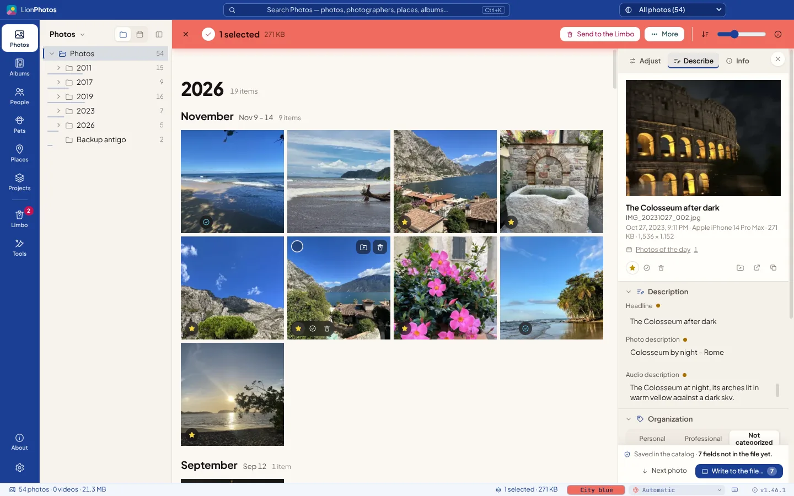
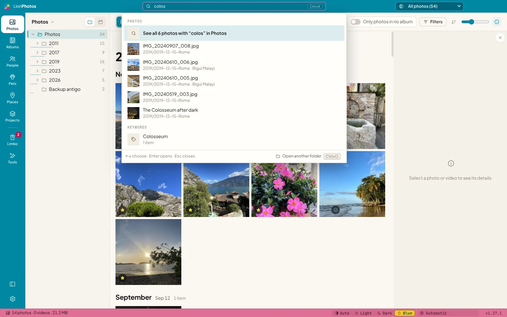
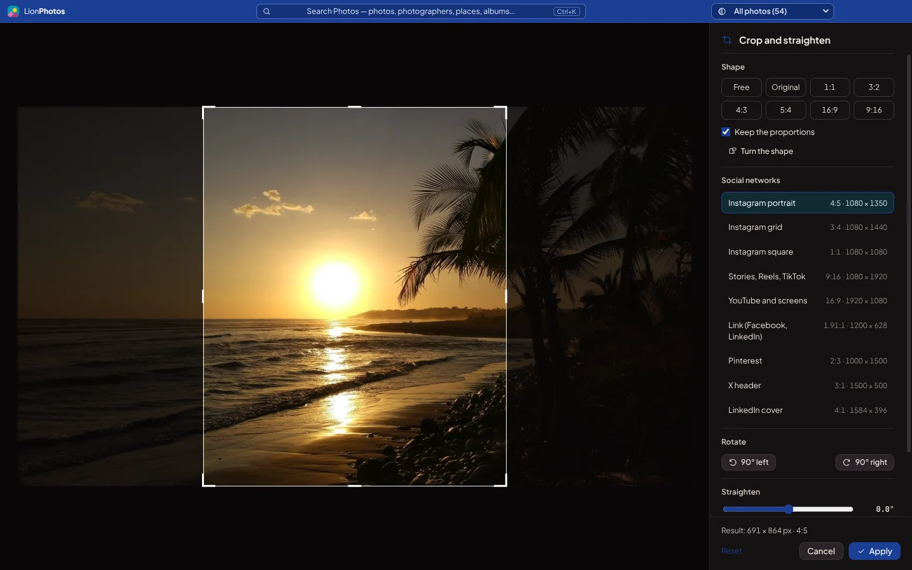

<div align="center">


# LionPhotos

### Todas las fotos que has hecho — encontradas en segundos.

Explora, busca y organiza colecciones enormes de fotos y vídeos allí donde ya están: en tu disco, en un disco externo o en una carpeta en la nube. Rápido, privado y gratuito.

<sub>por el <b>LionPhotos Team</b> · creado e ideado por <b>Daniel Michelon De Carli</b> · hermano de <a href="https://github.com/danielcarli/lionorganizer">LionOrganizer</a></sub>

[English](../README.md) · [Português (Brasil)](README.pt-BR.md) · [Português (Portugal)](README.pt-PT.md) · **Español** · [Français](README.fr.md) · [Deutsch](README.de.md) · [Italiano](README.it.md) · [简体中文](README.zh-CN.md) · [日本語](README.ja.md) · [한국어](README.ko.md)

<p>
  <a href="https://github.com/danielcarli/lionphotos/releases/latest/download/LionPhotos-Setup.exe"></a>
  <a href="https://github.com/danielcarli/lionphotos/releases/latest/download/LionPhotos-mac-universal.dmg"></a>
  <a href="https://github.com/danielcarli/lionphotos/releases/latest/download/lionphotos_amd64.deb"></a>
  <a href="https://github.com/danielcarli/lionphotos/releases/latest/download/lionphotos.x86_64.rpm"></a>
  <a href="https://github.com/danielcarli/lionphotos/releases/latest/download/LionPhotos-x86_64.AppImage"></a>
</p>

<a href="https://github.com/danielcarli/lionphotos/releases/latest"></a>

<sub><a href="https://github.com/danielcarli/lionphotos/releases">Todas las versiones</a> · <a href="#descargar">Cómo instalar</a></sub>



**Sin importar nada** · **Nada sale de tu ordenador** · **100 000 fotos se desplazan como 100** · **Gratuito y de código abierto**


</div>

> **Prueba beta.** LionPhotos ya sirve para el uso diario y se prueba con una colección real de unas 15 000 fotos y vídeos, pero todavía está en beta: puede haber detalles por pulir, y conviene tener una copia de seguridad de la colección antes de reorganizarla por primera vez. [Qué significa beta aquí](#prueba-beta).

## Míralo en acción

Las colecciones de fotos crecen más rápido de lo que nadie puede ordenarlas: años de trabajos repartidos en carpetas y discos externos, la misma foto en tres sitios, archivos RAW que la mayoría de los visores no abre, y el trabajo de ordenarlas encerrado en un solo programa, en un solo ordenador. LionPhotos está hecho para esa situación:

### Tus carpetas, tal como están

> *«Abrir la colección tarda una eternidad.»*

Sin importar y sin copiar sus fotos: LionPhotos recorre las carpetas tal como están, hace cada miniatura una vez y solo la rehace cuando el archivo cambia. 100 000 elementos se desplazan como 100.

Álbumes, personas, marcas, descripciones, ajustes y recortes también se guardan en una carpeta oculta dentro de la colección, así que el mismo disco externo se abre con todo ello en otro ordenador, con cualquier letra de unidad.

<p align="center"><br><sub><b>Lista</b> — carpeta, tipo, dimensiones, tamaño, fecha</sub></p>

### Cualquier foto en segundos

> *«No encuentro esa foto.»*

Busque por nombre, carpeta, cámara, autor, descripción, álbum, proyecto, persona, mascota o lugar. Las caras y las mascotas se reconocen en su ordenador, y los lugares se completan solos a partir del GPS o del lugar escrito en la foto. O simplemente por lo que muestra la foto: escribe *playa*, *perro* o *cumpleaños*.

<p align="center"><br><sub><b>Búsqueda</b> — en la barra de título, en toda la colección</sub></p>

### Cada viaje en un mapamundi

Los lugares se completan solos con el GPS o el lugar escrito en cada foto y aparecen en un mapamundi dibujado en tu ordenador. Haz clic en un punto y ahí están las fotos de ese lugar.

<p align="center"><br><sub><b>Lugares</b> — en un mapamundi dibujado en el ordenador</sub></p>

### Álbumes que casi se hacen solos

*Sugerir álbumes* agrupa las fotos tal como se tomaron y las nombra por lo que muestran — una playa, una boda, un cumpleaños — para que las revises. Cada álbum tiene portada, descripción y periodo, y se abre en mosaico, cuadrícula uniforme, lista o destacados; el lápiz lo pone en la lista de lo que aún está *por editar*.

<p align="center"> <br><sub><b>Álbumes</b> — mosaico por año, con descripciones · <b>Dentro de un álbum</b> — mosaico, cuadrícula uniforme, lista o destacados</sub></p>

### Tus mejores fotos, como un portafolio

Marca las fotos excelentes y las correctas con `1` y `2` mientras navegas. *Destacados* muestra solo esas — álbumes, personas, lugares y proyectos, una fila cada uno, la foto elegida en grande — una página de portafolio hecha con tus propias marcas.

<p align="center"><br><sub><b>Destacados</b> — solo las fotos marcadas con estrella u OK, como un portafolio</sub></p>

### Edición rápida, original intacto

Exposición, color, blanco y negro, recorte, enderezado, corrección de objetivo y de perspectiva, revelado RAW — en vivo, en la tarjeta gráfica. Todo queda en el catálogo: el archivo nunca cambia y `\` muestra el original en cualquier momento.

<p align="center"> <br><sub><b>Visor</b> — con el panel de edición (blanco y negro) · <b>Corrección del objetivo</b> — perspectiva enderezada a mano</sub></p>

### Listo para cada red

> *«Tengo que entregar.»*

Edición rápida y recortes para cada red social, pies de foto y audiodescripción para la accesibilidad, y exportación con nombres de archivo coherentes y los metadatos que elija. Los originales nunca cambian.

<p align="center"> <br><sub><b>Recorte</b> — para Instagram, Stories, YouTube… · <b>Exportar fotos</b> — nombres uniformes, tamaños de cada red</sub></p>

### Descrito para todos

Titular, pie de foto, audiodescripción, autor y lugar para una foto o cien a la vez — guardados mientras escribes, legibles por otros programas (IPTC y XMP) y escritos en los archivos solo cuando lo pides.

<p align="center"><br><sub><b>Descripción</b> — metadatos IPTC, guardados mientras escribe</sub></p>

### Libera espacio sin miedo

> *«El disco está lleno de cosas que no necesito.»*

Marque los descartes mientras mira y envíelos al Limbo; encuentre archivos repetidos por su contenido. Todo sale por la Papelera, nunca se borra para siempre.

<p align="center"><br><sub><b>Archivos repetidos</b> — encontrados por su contenido</sub></p>

### Orden en el disco — con deshacer

> *«Mis carpetas son un desorden.»*

*Reorganizar la colección* lee las carpetas y propone una estructura clara en el disco (`2025/2025-12-24-Navidad`, temas, una bandeja de entrada, pruebas de cámara), para revisarla antes de mover nada — y todo se puede deshacer.

<p align="center"></p>

**¿Listo para reencontrar tus fotos?** [Descarga LionPhotos](#descargar) para Windows, macOS o Linux — gratuito, sin cuenta, en 10 idiomas.

## Por qué LionPhotos

- **Sus carpetas, tal como están.** Sin importación y sin biblioteca cerrada: las fotos se quedan donde las puso, y sus otros programas siguen trabajando con ellas.
- **Local y privado.** Sin cuenta, sin telemetría; solo se conecta a internet cuando le pide buscar una nueva versión. El reconocimiento de caras y mascotas funciona en su ordenador. Solo lee la carpeta que elija y sus subcarpetas.
- **Rápido a cualquier escala.** La cuadrícula dibuja solo lo que está en pantalla; las miniaturas son pequeñas, se guardan en un único archivo de caché y se hacen una sola vez. Las colecciones grandes en discos externos siguen fluidas.
- **Todos los formatos, con decodificadores propios.** JPEG, HEIC/HEIF, TIFF, PSD/PSB, RAW de las principales marcas (CR3, CR2, NEF, ARW, RAF, DNG…) y vídeos (MP4, MOV, MTS, AVI…).
- **Seguro por diseño.** Cada cambio en los archivos muestra antes su plan, pide un código de 3 caracteres escrito a mano y se puede deshacer; borrar siempre envía a la Papelera.
- **El catálogo viaja con las fotos,** en un formato JSON abierto y documentado que otros programas pueden leer.
- **Organiza de verdad.** Álbumes, proyectos, personas, mascotas y lugares en el catálogo — y, cuando quiera, carpetas y nombres de archivo en el disco, con el RAW, el JPEG y los archivos auxiliares de una misma toma siempre juntos.
- **Gratuito y de código abierto** (MIT), para Windows, macOS y Linux, en 10 idiomas.

## Para quién es

- **Fotógrafos profesionales y aficionados** que guardan su trabajo en carpetas y discos externos, disparan en RAW + JPEG y quieren ordenar, encontrar y entregar sin importarlo todo a un catálogo.
- **Equipos de comunicación, redacciones y estudios** que comparten una colección entre ordenadores y personas, necesitan nombres, autoría y descripciones accesibles coherentes y organizan el trabajo por proyecto y cliente.
- **Familias y cualquiera con años de fotos del móvil** repartidas en carpetas, que quiere reencontrar personas, lugares y momentos y liberar espacio con seguridad.
- **Quien se preocupa por la privacidad:** no se sube nada, no hay cuenta y nada pasa por la red.

## Qué es — y qué no es

LionPhotos es un **organizador y un catálogo**. Su función principal es ordenar el trabajo y mantener un catálogo fácil, accesible e intuitivo: encontrar una foto, separar una sesión, crear álbumes y proyectos y entregar el resultado.

También **edita y corrige**, para el trabajo rápido y ligero que necesita la mayoría de las fotos — exposición, color, blanco y negro, recorte y enderezado, correcciones de lente, revelado de RAW — y en eso ya es bastante capaz y da resultados rápidos.

**No pretende sustituir a Lightroom, Photoshop ni a otros editores dedicados al revelado de fotos digitales**. Los trabajos con capas de tratamiento, el retoque localizado y la composición quedan a cargo de esos programas más dedicados; LionPhotos abre la foto en ellos (*Abrir con*) y trae el resultado de vuelta al catálogo.

## Descargar

Descargue el instalador de su sistema. Los enlaces apuntan siempre a la **última versión**, y cada archivo se verifica (SHA-256 y procedencia de compilación firmada).

- **Windows 10/11** (x64, ARM): un instalador con la aplicación completa dentro (unos 150 MB): no se descarga nada durante la instalación, que tarda segundos. → [`LionPhotos-Setup.exe`](https://github.com/danielcarli/lionphotos/releases/latest/download/LionPhotos-Setup.exe) · [ARM](https://github.com/danielcarli/lionphotos/releases/latest/download/LionPhotos-Setup-arm64.exe) · [`.zip` portátil, sin instalar](https://github.com/danielcarli/lionphotos/releases/latest/download/LionPhotos-win-x64.zip)
- **macOS 11+** (Apple Silicon, Intel): abra el `.dmg` y arrastre LionPhotos a Aplicaciones. → [`LionPhotos-mac-universal.dmg`](https://github.com/danielcarli/lionphotos/releases/latest/download/LionPhotos-mac-universal.dmg)
- **Linux** (x64): `.deb` para Ubuntu, Debian, Mint…, `.rpm` para Fedora, RHEL, openSUSE…, o el AppImage para cualquier distribución, sin instalación. → [`.deb`](https://github.com/danielcarli/lionphotos/releases/latest/download/lionphotos_amd64.deb) · [`.rpm`](https://github.com/danielcarli/lionphotos/releases/latest/download/lionphotos.x86_64.rpm) · [AppImage](https://github.com/danielcarli/lionphotos/releases/latest/download/LionPhotos-x86_64.AppImage)

> Los instaladores aún no están firmados con un certificado de pago. La primera vez, Windows puede mostrar "Windows protegió su PC" (**Más información › Ejecutar de todas formas**) y macOS pide permitir la aplicación en **Ajustes del Sistema › Privacidad y seguridad › Abrir igualmente**.

**¿Prefiere la terminal?** macOS y Linux:

```bash
curl -fsSL https://github.com/danielcarli/lionphotos/releases/latest/download/install.sh | bash
```

[Todas las versiones](https://github.com/danielcarli/lionphotos/releases) · [Guía de instalación](INSTALL.md) (en inglés): detalles, cómo se mantiene segura, actualizar y desinstalar.

## Prueba beta

LionPhotos está en **beta**. Eso significa:

- Se usa a diario con una colección real, y cada versión supera más de 100 comprobaciones automáticas de extremo a extremo, pero todavía no se ha usado en muchos ordenadores y colecciones distintos.
- **Probado con una colección grande en un disco común:** más de 70 000 archivos en un disco duro externo USB 3.1 — un disco común, no un SSD. En esta prueba, el rendimiento ha resultado satisfactorio.
- Antes de organizar, renombrar o reorganizar una colección por primera vez, **tenga una copia de seguridad** (la pestaña Copia de seguridad puede hacerla). Toda operación se puede deshacer y nada se borra para siempre, pero la copia de seguridad es la red más segura.
- Los instaladores todavía no están firmados con un certificado de pago (vea [Descargar](#descargar)).
- Las fotos RAW se editan, por defecto, sobre el JPEG que la cámara guarda dentro (8 bits); el **modo revelado** (un interruptor en Ajustes) edita los datos del sensor, revelados en este ordenador en 16 bits con LibRaw — nuevo y aún en ajuste (sus colores no son los de la cámara ni los de Lightroom). Necesita tarjeta gráfica con WebGL 2.
- ¿Encontró un problema o tiene una sugerencia? Abra un [issue](https://github.com/danielcarli/lionphotos/issues) con la versión (en la barra de estado) y lo que hizo. LionPhotos nunca envía nada por su cuenta.

## Funciones

| | |
|---|---|
| **Fotos** | Cuadrícula por mes o lista con carpeta, tipo, dimensiones, tamaño, fecha y detalles; selección con clic, Ctrl y Mayús; zoom; filtros por tipo, año, marca, categoría y subcarpetas, mostrados como etiquetas que se quitan con un clic. El árbol de carpetas (o los años) a la izquierda y el panel de información a la derecha — ambos se pueden ocultar, o todo con el modo enfoque (`\`). **La búsqueda en la barra de título** (Ctrl+K o Ctrl+F) busca en toda la colección mientras escribe — fotos, álbumes, proyectos, personas, lugares, fotógrafos, cámaras, palabras clave, carpetas — y, cuando los filtros lo ocultan todo, la página dice cuáles, con un botón para quitar cada uno. Dentro de un álbum, persona, mascota, lugar o proyecto: mosaico, cuadrícula uniforme, lista o destacados. |
| **Visor** | Tamaño completo al instante (primero la miniatura), archivos RAW a tamaño completo mediante el JPEG que guardó la cámara, ← → para avanzar, `I` para información, zoom al tamaño real; los vídeos se reproducen con controles. El control de zoom va del tamaño de la pantalla al 400 %; la rueda acerca donde está el puntero, arrastrar mueve la foto, `Z` alterna entre ajustar y tamaño real. *Editar* (o `H`) muestra u oculta el mismo panel de edición del panel de información — categoría, álbumes, ajustes, descripción, autor y lugar; una foto llevada a una categoría fuera del filtro sigue a la vista, en gris, con un aviso que dice dónde está ahora. HEIC, HEIF e HIF también se abren a tamaño real; las fotos HDR (PQ, HLG) se convierten para una pantalla común, en el visor y en las miniaturas. Doble clic: zoom al 100 % en el punto, y vuelta. Supr envía la foto al Limbo con una confirmación simple. El panel muestra una tarea a la vez —Ajustar, Describir, Info— y, en una ventana de 1680 px o más, Describir e Info a la izquierda y Ajustar a la derecha; arrastre el borde de un panel para ensancharlo. |
| **Ajustes** | Exposición, contraste, sombras y saturación en el panel de información, para una foto o varias, con histograma y vista previa al instante (en la tarjeta gráfica, o en el procesador si no hay); cópielos y péguelos en otras fotos. El archivo nunca cambia: los ajustes están en el catálogo (se deshacen con Ctrl+Z), las miniaturas y el visor los muestran (mantenga `\` para ver el original) y *Guardar copia editada* escribe un JPEG nuevo junto al original, con sus metadatos. *Exportar fotos* (Ctrl+E) crea archivos nuevos de las fotos editadas en cualquier carpeta — JPEG, PNG o TIFF, al tamaño de una red social o de una impresión, con nitidez de salida, nombres como `2026-07-24-Graduacion-Ana-Souza-001.jpg`, con todos los metadatos o sin la ubicación y una firma opcional — con el perfil sRGB; los originales nunca cambian. |
| **Edición** | Iluminaciones, blancos, negros, balance de blancos (temperatura, matiz y cuentagotas), intensidad, blanco y negro con mezcla por color, viñeta y — en la tarjeta gráfica — nitidez, textura y claridad; *Automático*, ajustes preestablecidos y antes y después en el visor (`Y`). **Recortar y enderezar** (`C`): libre o con una proporción — las comunes y las de redes sociales (Instagram 4:5 y 3:4, Stories/Reels/TikTok 9:16, YouTube 16:9, enlace 1,91:1, Pinterest, cabeceras de X y LinkedIn) —, giros de 90° y enderezar trazando una línea sobre el horizonte. Todo queda en el catálogo; el archivo nunca cambia. |
| **Corrección del objetivo** | Distorsión, esquinas oscuras y franjas de color del objetivo deshechas con su perfil — toda la base de [Lensfun](https://lensfun.github.io), unos 1600 objetivos, hallada por el nombre que escribió la cámara o elegida en una lista con búsqueda — y a mano: distorsión, perspectiva vertical y horizontal (edificios que caen hacia atrás), escala, esquinas y franjas. En la tarjeta gráfica; el archivo nunca cambia. |
| **Historial de la Papelera** | Herramientas › *Historial de la papelera* (`Ctrl+5`) lista cada archivo que LionPhotos envió a la Papelera — cuándo, cuál, su tamaño y de dónde vino (Limbo, Archivos repetidos, selección) — y muestra el espacio que liberó el Limbo: en total, este mes y mes a mes. |
| **Panel de información** | Todos los metadatos de la selección, la categoría, los álbumes, personas, mascotas, lugares y proyectos en los que está, que se añaden o quitan allí mismo. |
| **Descripción y metadatos** | Titular, descripción, audiodescripción, autor y cargo, lugar (sublugar, ciudad, estado, país), palabras clave e instrucciones, para una foto o varias a la vez — solo cambia el catálogo. Lo que ya dice el archivo (EXIF, IPTC, XMP, el `.xmp` de un RAW) aparece como pista y lo usan las exportaciones. *Guardar en los archivos* (con el código escrito) lo graba dentro del propio JPEG, con la versión anterior a la Papelera, o en un `.xmp` junto a cualquier otro archivo. El JPEG también recibe el mismo `.xmp` al lado: los datos viajan con la foto al enviarla y quedan legibles junto a ella. Todo cambio se puede deshacer (Ctrl+Z) y rehacer (Ctrl+Shift+Z); la escritura en los archivos se deshace desde el aviso o las operaciones recientes, y los archivos vuelven byte a byte. |
| **Álbumes** | Portada, descripción y período; *Añadir a un álbum…* en cualquier selección, *Quitar del álbum*, *Usar como portada*; **álbumes a partir de las carpetas** (el primer nivel, las carpetas con fotos o las que elija), ligados a toda la carpeta; presentación a pantalla completa. **Sugerir álbumes**: las fotos agrupadas como se tomaron y nombradas por lo que son — la carpeta, lo que muestran las fotos (leído en este equipo a partir de las miniaturas: playa, montaña, una tarta, un vestido de novia, comida…), las fiestas por su fecha, el lugar, la persona — y álbumes de un tema a lo largo de los años, para revisar antes de crearlos. **Unir dos álbumes** en uno (las fotos de ambos, con el nombre que elija; solo cambia el catálogo, y se puede deshacer). Se ven en mosaico, cuadrícula uniforme (todas las portadas del mismo tamaño), lista o destacados. |
| **Proyectos, personas, mascotas, lugares** | Cada uno en su pestaña, en cuadrícula o lista agrupada por año. Al abrir uno se ven sus fotos, en su pestaña; una foto se puede quitar con un clic. La etiqueta de una carpeta vale para todo lo que contiene. Un proyecto agrupa álbumes y tiene una ficha (estado, para quién, lugar, equipo, plazo) y un panel con el avance: clasificadas, editadas, elegidas en álbumes, audiodescripciones. Los lugares se completan solos a partir de las fotos (la posición GPS o el lugar escrito en ellas) y aparecen en un **mapamundi** dibujado en el propio ordenador. |
| **Por editar** | El lápiz en la portada de un álbum o proyecto lo pone en la pestaña **Por editar** (Ctrl+Shift+E), una lista en el orden en que hay que hacer las cosas: arrastre las filas, o use las flechas o Alt+↑ ↓, para poner primero lo que va primero. Su puesto en la lista se ve en la portada, un proyecto muestra su fecha de entrega (en rojo si va atrasado) y *Listo* quita el lápiz. Solo cambia el catálogo, y la lista va con la colección. |
| **Nombre y logotipo** | *Configuración › Nombre y logotipo* pone su propio nombre y logotipo (de una agencia, un estudio, un curso) en la barra de título, en la página de inicio y en el título de la ventana, con vista previa. Un nombre propio siempre muestra **Powered by LionPhotos** al lado; Acerca de conserva los créditos. El logotipo (PNG, JPG, WebP, SVG) queda entero en un cuadrado; *Volver a LionPhotos* lo deshace. Se guarda en este equipo. Un plugin también puede definirlos mientras esté activado (`brand` en su `plugin.json`); los tuyos van primero. |
| **Caras y mascotas** | face-api (TensorFlow.js) para caras, COCO-SSD y MobileNet para animales, en la tarjeta gráfica (WebGL). Grupos de caras parecidas, sugerencias que usted confirma o rechaza, "no es" recordado. Desactivado por defecto; *Indexar ahora* o tras cada análisis. |
| **Marcas y Limbo** | Excelente, bien, candidata a borrar: en la miniatura, la lista, el visor y el panel de información; teclas `1` `2` `3` `0`. El Limbo muestra todas las candidatas y cuánto espacio ocupan, y las envía a la Papelera de una vez. **Destacados**: álbumes, personas, mascotas y proyectos solo con sus fotos marcadas con estrella u OK, uno por fila — el nombre grande, una foto elegida en grande — como una página de portafolio. También los lugares; y dentro de cada uno, sus fotos elegidas en grande, una por fila. |
| **Abrir con** | Los programas de fotos y vídeo del equipo para los archivos seleccionados (Photoshop, Lightroom Classic, Bridge, Premiere Pro, Capture One, DxO PhotoLab, Affinity, darktable, GIMP, VLC…), primero los últimos usados; en Windows, también todos los programas registrados para el tipo de archivo. |
| **Complementos** | Instale paquetes `.lionplugin` que exportan álbumes y proyectos como una página (HTML, CSS y JavaScript), con los nombres de archivo, las descripciones y las audiodescripciones; nada de ellos se ejecuta dentro de LionPhotos. Consulte [PLUGINS.md](PLUGINS.md) (en inglés). Cada complemento activo tiene su pestaña después de Por editar, con su página: elija los álbumes y proyectos y exporte. |
| **Resumen** | Elementos, fotos, vídeos, tamaño y período; archivos por tipo, por año, formatos, cámaras, códecs; la caché de miniaturas. |
| **Organizar** | Carpetas por fecha (`2024/2024-07`, `2024-07`, `2024`, `2024/2024-07-14` o `2024-07-14-tema`), carpetas por álbum (`2024/2024-07-14-álbum`), con `Raw/` e `Img/` dentro si se desea; *Mover a carpeta* con subcarpetas por tipo; los archivos de la misma toma van juntos; operaciones recientes con deshacer. Los archivos se mueven de verdad en el disco y también se pueden **renombrar** (`{data}-{álbum}-{fotógrafo}-{nº}` por defecto, numerados por fecha; el RAW, el JPEG y el `.xmp` de una toma quedan con el mismo nombre), o solo renombrar donde están. **Reorganizar la colección** lee las carpetas como están y propone una estructura única en el disco — `2025/2025-12-24-Navidad`, temas largos en `Temas/`, lo pendiente en `_Entrada/`, pruebas de cámara en `_Equipo/` — para revisar (renombrar o dejar fuera cualquier carpeta, ver el árbol final) antes de mover carpetas enteras, con deshacer. **Archivos relacionados sueltos** (un `.xmp` o `.dop` que quedó solo después de mover su foto) vuelven junto a su foto, con su nombre. **Duplicar** (Ctrl+D): una copia junto a la foto, con sus ajustes, recorte, marcas y álbumes, con código escrito y deshacer. |
| **Archivos repetidos** | SHA-256 en tres etapas (tamaño → primeros/últimos 64 KB → archivo entero), lado a lado con sus miniaturas. Cada copia muestra la carpeta donde está guardada, se abre en LionPhotos o en el programa del ordenador, se muestra en su carpeta o copia su ruta; *Comparar lado a lado* pone la copia que se mantiene junto a otra (los vídeos se abren en el programa del ordenador). Elegir otra copia mueve la marca, no las copias. |
| **Fotos parecidas** | En cualquier día, las tomas que en la práctica son la misma imagen (una ráfaga, la misma pose varias veces) se agrupan a partir de las miniaturas, en el propio equipo, con la más nítida y mejor expuesta sugerida para quedarse. Un clic conserva o deja ir cada foto; las demás van juntas al Limbo, el RAW y su JPG como una sola. Tres niveles: casi iguales, parecidas, misma escena. También desde la barra de Fotos, junto a *Solo fotos sin álbum*: las fotos mostradas — una carpeta, un año, un álbum — entre varios días. |
| **Búsqueda por lo que muestra la foto** | Escribe *playa*, *perro*, *cumpleaños* o *puesta de sol* y encuentra las fotos que lo muestran, se llamen como se llamen. Un modelo pequeño (TinyCLIP, MIT) lee cada miniatura en el ordenador, con el procesador, mientras se analiza «lo que muestran las fotos», y la compara con 605 tipos de escenas, eventos, objetos y lugares, con nombres en los diez idiomas de la app. El panel de información muestra lo que enseña la foto; cada nombre lo busca. Nada se descarga ni se envía. |
| **Copia de seguridad** | Una carpeta maestra y una de copia comparadas por contenido; copias verificadas de lo que falta, en las mismas subcarpetas o en carpetas por fecha. |
| **Convertir** | HEIC/HEIF → JPG o PNG a resolución completa, conservando el EXIF y el perfil de color, junto al original. |
| **Formatos** | Fotos: JPEG, PNG, GIF, WebP, AVIF, BMP, HEIC/HEIF, TIFF, PSD/PSB, RAW de cámara (CR3, CR2, NEF, NRW, ARW, SR2, ORF, RW2, RAF, SRW, PEF, DNG, 3FR, IIQ, ERF, RWL). Vídeos: MP4, MOV, M4V, 3GP, WebM, MKV, MTS/M2TS, AVI. |
| **10 idiomas** | English, Português (Brasil), Português (Portugal), Español, Français, Deutsch, Italiano, 简体中文, 日本語, 한국어: detectado del sistema y cambiable en la barra de estado. |
| **Temas** | Sandía (el turquesa del logotipo, rosa y blanco ), Azul ciudad (cobalto, coral y blanco, como un plano urbano — el predeterminado), claro, oscuro y automático. |

## La seguridad primero

Las mismas reglas que LionOrganizer:

- **Código de confirmación escrito.** Cada cambio en archivos (Papelera, organizar, mover, renombrar, convertir, deshacer, vaciar la caché) muestra un código de 3 caracteres que hay que **escribir** (pegar está desactivado). El proceso principal genera y comprueba el código; cinco intentos fallidos cancelan.
- **Papelera, no borrado definitivo.**
- **Alcance limitado.** La interfaz llega a los archivos solo por los identificadores de la biblioteca de la carpeta abierta, nunca por la ruta.
- **Solo lectura por defecto.** Explorar, los metadatos, las miniaturas, las previsualizaciones, la búsqueda de repetidos y "Abrir con" nunca modifican sus archivos. Los álbumes, etiquetas, marcas y caras solo cambian el catálogo propio de LionPhotos. La única excepción: lo que hace con las fotos también se escribe, en JSON, en una carpeta oculta `.lionphotos` dentro de la colección (solo cuando ya hizo algo; se puede apagar en Copia de seguridad).

## Atajos de teclado

| Atajo | Acción |
|---|---|
| `Ctrl+O` | Abrir una carpeta |
| `F5` | Buscar archivos nuevos y modificados |
| `Ctrl+K` · `Ctrl+F` | Buscar en toda la colección (barra de título) |
| `Ctrl+1` · `Ctrl+Shift+A` | Fotos · Álbumes |
| `Ctrl+Shift+E` | Por editar |
| `Ctrl+6` … `Ctrl+9` | Proyectos · Personas · Mascotas · Lugares |
| `Ctrl+L` | Limbo |
| `Ctrl+2` · `Ctrl+3` · `Ctrl+4` · `Ctrl+0` | Resumen · Archivos repetidos · Organizar · Copia de seguridad |
| `Alt+←` · `Alt+Home` | Volver de un álbum, proyecto o persona · toda la colección, sin filtros |
| `Ctrl+B` · `\` | Mostrar/ocultar la barra lateral · modo enfoque (solo las fotos) |
| `1` `2` `3` · `0` | Marcar la selección como excelente · bien · candidata a borrar · quitar |
| `Ctrl+A` · `Enter` · `H` · `Supr` · `F2` · `Esc` | Seleccionar todo · abrir · panel de información · Papelera · renombrar · quitar la selección |
| `E` · `D` · `I` | Panel lateral en Ajustar · Describir · Info (la misma tecla otra vez lo pliega) |
| `V` · `?` | Comparar lado a lado · Atajos de teclado |
| `Ctrl+E` | Exportar fotos (la selección, o las fotos mostradas) |
| `←` `→` · `Espacio` · `Esc` | Visor: anterior/siguiente · reproducir/pausar · cerrar |
| `P` · `F` · `A` | Visor: presentación · pantalla completa · añadir a un álbum |

## Idiomas

| Idioma | Código | | Idioma | Código |
|---|---|---|---|---|
| English | `en` | | Deutsch | `de` |
| Português (Brasil) | `pt-BR` | | Italiano | `it` |
| Português (Portugal) | `pt-PT` | | 简体中文 | `zh-CN` |
| Español | `es` | | 日本語 | `ja` |
| Français | `fr` | | 한국어 | `ko` |

El idioma sigue al del sistema y se puede cambiar en la barra de estado. Los números y las fechas siguen el idioma elegido. Los catálogos de textos se generan desde `tools/nls/*.py` en `src/nls/*.json`.

## Privacidad

LionPhotos solo se conecta a la red cuando usted lo pide: al hacer clic en la versión, en la esquina inferior derecha, busca una nueva versión en GitHub, y al actualizar descarga el instalador de su sistema, verificado (SHA-256) antes de usarlo. Sin cuenta, sin telemetría, no se envía nada sobre usted ni sus fotos. El reconocimiento de caras y mascotas se ejecuta en este equipo, con modelos incluidos en la aplicación.

El catálogo y las miniaturas están en un único archivo en su equipo:

```
%APPDATA%\LionPhotos\library.sqlite
```

*Resumen › Vaciar caché* borra las miniaturas. Sus fotos nunca se tocan.

## Primeros pasos

### Ejecutar desde el código fuente (Windows)

1. Instale [Node.js LTS](https://nodejs.org).
2. Descargue o clone este repositorio.
3. Haga doble clic en **`start.bat`**: la primera ejecución instala las dependencias.

O desde una terminal:

```powershell
npm install
npm start
```

### Crear un instalador

Haga doble clic en **`build-installer.bat`** (o ejecute `npm run dist`). Los instaladores se crean en `dist/`. Las versiones publicadas las crea GitHub Actions cuando se envía una etiqueta `vX.Y.Z`.

## Cómo las miniaturas siguen siendo rápidas

1. **Análisis**: solo la carpeta elegida y sus subcarpetas, solo `readdir` + `stat`; nunca se abre el contenido de un archivo para listarlo. 20 000 archivos tardan alrededor de un segundo.
2. **Validez**: la miniatura se guarda con el tamaño y la fecha de modificación de su archivo; mientras coincidan, se reutiliza. Un archivo movido o renombrado fuera de la aplicación conserva su miniatura.
3. **Orden**: lo que está en pantalla primero, después el resto, del más reciente al más antiguo; las previsualizaciones solo después de todas las miniaturas.
4. **Motor**: una página oculta con menor prioridad lo decodifica todo con código propio de LionPhotos: imágenes en Web Workers, archivos RAW desde su vista previa JPEG incrustada, TIFF y PSD leyendo solo una de cada n filas, HEIC con libheif en WebAssembly, vídeos con WebCodecs. Nunca se llama al generador de miniaturas del sistema.
5. **Almacenamiento**: miniaturas WebP de 320 px (8–25 KB) en un único archivo SQLite, sin archivos huérfanos.

## Arquitectura

Las mismas capas que [LionOrganizer](https://github.com/danielcarli/lionorganizer) y [Visual Studio Code](https://github.com/microsoft/vscode): `base` no conoce nada por encima, `platform` ofrece los servicios del proceso principal y `workbench` construye la interfaz; la interfaz aislada (sandbox) solo habla con el proceso principal a través del puente `preload`.

```
src/
  base/            eventos, formato, i18n, utilidades DOM, iconos, gráficos
  platform/
    library/       catálogo SQLite, análisis de carpetas, lectores de metadatos (EXIF: JPEG, raw, HEIC, AVIF; PNG, MP4/MOV, Matroska)
    thumbs/        motor de miniaturas y previsualizaciones + la página oculta (workers, muxer WebM)
    media/         lionthumb:// y lionmedia:// (por id de biblioteca, con rangos de bytes)
    faces/         reconocimiento de caras y mascotas (página oculta en la tarjeta gráfica, quién-es-quién en el principal)
    labels/        álbumes, proyectos, personas, mascotas, lugares, personal/profesional
    operations/    operaciones con código escrito: Papelera, organizar, mover, renombrar, deshacer, vaciar caché
    openWith/      los programas de fotos y vídeo del equipo
    duplicates/    búsqueda por SHA-256 (compartida con LionOrganizer)
  code/            punto de entrada electron-main, puente preload
  nls/             en.json … ko.json (generados desde tools/nls)
  workbench/       partes del diseño, servicios y vistas
```

Seguridad: `contextIsolation` y `sandbox` activados, sin `nodeIntegration`, una Content Security Policy estricta, y toda petición que modifica archivos se valida en el proceso principal.

## Desarrollo

| Comando | Qué hace |
|---|---|
| `npm start` | Ejecuta la aplicación |
| `npm run dist` | Crea los instaladores |
| `npm run test:e2e` | Prueba de extremo a extremo en una carpeta **desechable** (`npm run fixtures` crea una) |
| `npm run test:i18n` | Cada clave usada existe, cada idioma está completo, los marcadores coinciden |
| `npm run test:faces` | Quién-es-quién con caras sintéticas |
| `npm run test:openwith` | "Abrir con": registro de Windows, archivos `.desktop`, ejecución |
| `npm run test:plugins` | Plugins |
| `npm run nls` | Genera `src/nls/*.json` desde `tools/nls/*.py` |
| `npm run release:assets` | Crea en `dist-release/` los archivos de versión que usan los instaladores |

```powershell
# la prueba de extremo a extremo modifica archivos: apunte siempre a una copia desechable
$env:LIONPHOTOS_FOLDER="C:\temp\copia-fotos"; npm run test:e2e
```

## Historial de cambios

Consulte [CHANGELOG.md](../CHANGELOG.md) (en inglés). Versión actual: **1.59.0**.

## Créditos

LionPhotos fue **creado e ideado por Daniel Michelon De Carli**, estudiante de arquitectura y urbanismo, y lo mantiene el **LionPhotos Team** junto con sus colaboradores y traductores.

## Licencia

Copyright © 2026 LionPhotos Team.

LionPhotos es de código abierto bajo la **[Licencia MIT](../LICENSE)**: úselo, cópielo, modifíquelo y distribúyalo libremente, conservando el aviso de copyright. Se ofrece **"tal cual", sin garantía** de ningún tipo.

Los componentes de terceros incluidos conservan sus propias licencias:

| Componente | Licencia | Dónde |
|---|---|---|
| [libheif](https://github.com/strukturag/libheif) con libde265 (compilación WebAssembly de [libheif-js](https://github.com/catdad-experiments/libheif-js)) | GNU LGPL v3, sin modificar | `src/platform/thumbs/electron-sandbox/vendor/libheif` |
| [face-api](https://github.com/vladmandic/face-api) con TensorFlow.js y sus modelos de caras | MIT | `src/platform/faces/electron-sandbox/vendor/face-api` |
| Modelos [COCO-SSD y MobileNet](https://github.com/tensorflow/tfjs-models) | Apache 2.0 | `src/platform/faces/electron-sandbox/vendor/pets` |
| [ONNX Runtime Web](https://github.com/microsoft/onnxruntime) 1.22 and the [TinyCLIP ViT-61M/32](https://huggingface.co/wkcn/TinyCLIP-ViT-61M-32-Text-29M-LAION400M) model (Microsoft; built by `tools/models/build.py`) | MIT · MIT | `src/platform/faces/electron-sandbox/vendor/onnxruntime-web` · `models/tinyclip` |
| Fronteras y nombres de países de [Natural Earth](https://www.naturalearthdata.com) (1:50m) | Dominio público | `src/platform/geo` |
| [GeoNames](https://www.geonames.org) — cities15000 | CC BY 4.0 | `src/platform/geo/node/cities.json` |
| [LibRaw](https://www.libraw.org) 0.22 (raw development), in WebAssembly via [libraw-wasm](https://github.com/colorhythm/libraw-wasm) and [typed-cstruct](https://github.com/ssssota/typed-cstruct) | LGPL-2.1 or CDDL-1.0 · MIT · MIT | `src/platform/raw/electron-sandbox/vendor` |
| [Lensfun](https://lensfun.github.io) lens database (lens correction profiles), converted by `tools/lensfun/build.py` | CC BY-SA 3.0 (data only; none of Lensfun’s code) | `src/workbench/services/adjust/common/lensfun.json` |
| [Plus Jakarta Sans](https://github.com/tokotype/PlusJakartaSans), [JetBrains Mono](https://github.com/JetBrains/JetBrainsMono) | SIL Open Font License 1.1 | fuentes |

## Fotos de las capturas

Las fotos de las capturas vienen del [WordPress Photo Directory](https://wordpress.org/photos/) y son de dominio público ([CC0](https://creativecommons.org/publicdomain/zero/1.0/)): no requieren atribución y se acreditan aquí con agradecimiento. Las descripciones, cámaras y fechas son de los propios fotógrafos; los lugares del mapa se añadieron para la demostración.

- **Roma:** [Isabel Gutierrez](https://wordpress.org/photos/photo/53469e1c45/), [salsel](https://wordpress.org/photos/photo/2456557419/), [Jupa](https://wordpress.org/photos/photo/3816aaf093/), Bigul Malayi ([1](https://wordpress.org/photos/photo/17168efb07/), [2](https://wordpress.org/photos/photo/616857a90c/), [3](https://wordpress.org/photos/photo/33768dc862/), [4](https://wordpress.org/photos/photo/42268dc85f/)), [karolishostinger](https://wordpress.org/photos/photo/35766e9c63/)
- **Lisboa:** [Isabel Gutierrez](https://wordpress.org/photos/photo/35669e1d6f/), [MelissaH](https://wordpress.org/photos/photo/31968ae275/), KafleG ([1](https://wordpress.org/photos/photo/687685d279/), [2](https://wordpress.org/photos/photo/852685d283/), [3](https://wordpress.org/photos/photo/468685d28f/), [4](https://wordpress.org/photos/photo/667685d2c4/), [5](https://wordpress.org/photos/photo/501685d2ca/)), [Jeff Golenski](https://wordpress.org/photos/photo/3016a7fb59/)
- **Costa Rica:** [Harlyn Luna Brenes](https://wordpress.org/photos/photo/626af3dce8/), [Francisco Herrera](https://wordpress.org/photos/photo/18764e77d3/), wenmirandav ([1](https://wordpress.org/photos/photo/2786aefef5/), [2](https://wordpress.org/photos/photo/2776aefeba/), [3](https://wordpress.org/photos/photo/2016aeffe6/)), [alexandrachacaltana2303](https://wordpress.org/photos/photo/3846aeeac8/), [dmoreno2003](https://wordpress.org/photos/photo/4466af376b/), [dangrijal](https://wordpress.org/photos/photo/3516af7648/), [xbullscm](https://wordpress.org/photos/photo/7066af7fae/)
- **Lago de Garda:** xbullscm ([1](https://wordpress.org/photos/photo/836af4b8d6/), [2](https://wordpress.org/photos/photo/716af4b7c7/), [3](https://wordpress.org/photos/photo/1046af4b83/), [4](https://wordpress.org/photos/photo/8286af4b88/), [5](https://wordpress.org/photos/photo/3966af4b78/))
- **Arquitectura:** Joel Peralta ([1](https://wordpress.org/photos/photo/9656a6d336/), [2](https://wordpress.org/photos/photo/1866a70aeb/), [3](https://wordpress.org/photos/photo/8766a7044c/), [4](https://wordpress.org/photos/photo/9866a6d32f/), [5](https://wordpress.org/photos/photo/766a2f39b8/)), [Silvia Fernanda Marin Giraldo](https://wordpress.org/photos/photo/1656a972f2/), [dumanag](https://wordpress.org/photos/photo/7806a66cad/), [Manjil Aryal](https://wordpress.org/photos/photo/416a282c7f/), [Anup Kankale](https://wordpress.org/photos/photo/966a390efb/)
- **Cielo nocturno:** [shirishpoudel07](https://wordpress.org/photos/photo/8606a28c17/), Jeff Golenski ([1](https://wordpress.org/photos/photo/544620fdb6/), [2](https://wordpress.org/photos/photo/92361d465c/)), [vanessartavia](https://wordpress.org/photos/photo/3036ae9774/), [Natcha Boonroj](https://wordpress.org/photos/photo/512693d15a/), [Faisal Ahammad](https://wordpress.org/photos/photo/816ae8da24/)
- **Kioto:** [Maruti Mohanty](https://wordpress.org/photos/photo/4746570441/), [Timi Wahalahti](https://wordpress.org/photos/photo/14766bbb55/), Wajari Velasquez ([1](https://wordpress.org/photos/photo/506a214832/), [2](https://wordpress.org/photos/photo/5236a216f0/), [3](https://wordpress.org/photos/photo/8366a216e4/), [4](https://wordpress.org/photos/photo/8976a21449/), [5](https://wordpress.org/photos/photo/296a2182a4/))
