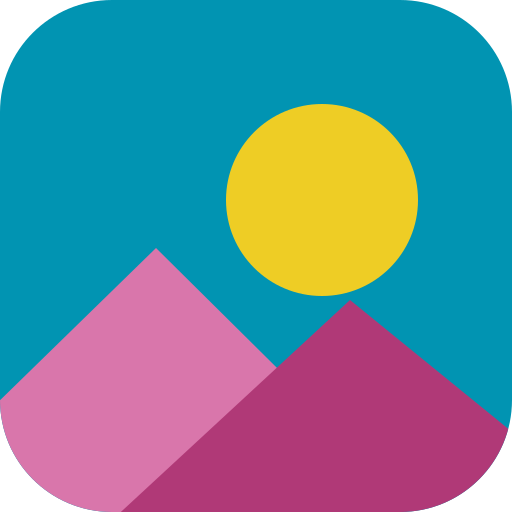
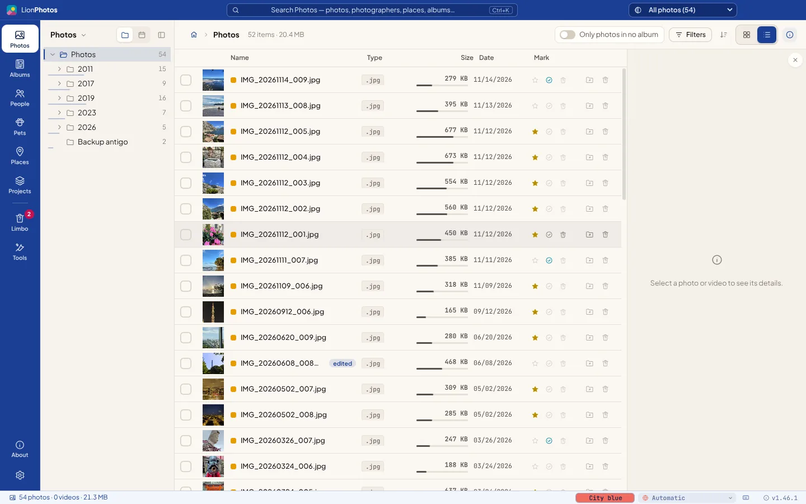

<div align="center">



# LionPhotos

**Parcourez, recherchez et organisez vos collections de photos et de vidéos, rapidement.**<br>
Travaille sur vos dossiers tels qu'ils sont : de petites miniatures créées une seule fois, les métadonnées qui comptent et des outils de rangement sûrs.

<sub>par la <b>LionPhotos Team</b> · créé et conçu par <b>Daniel Michelon De Carli</b> · un frère de <a href="https://github.com/danielcarli/lionorganizer">LionOrganizer</a></sub>

[English](../README.md) · [Português (Brasil)](README.pt-BR.md) · [Português (Portugal)](README.pt-PT.md) · [Español](README.es.md) · **Français** · [Deutsch](README.de.md) · [Italiano](README.it.md) · [简体中文](README.zh-CN.md) · [日本語](README.ja.md) · [한국어](README.ko.md)


<p>
  <a href="https://github.com/danielcarli/lionphotos/releases/latest/download/LionPhotos-Setup.exe"></a>
  <a href="https://github.com/danielcarli/lionphotos/releases/latest/download/LionPhotos-mac-universal.dmg"></a>
  <a href="https://github.com/danielcarli/lionphotos/releases/latest/download/lionphotos_amd64.deb"></a>
  <a href="https://github.com/danielcarli/lionphotos/releases/latest/download/lionphotos.x86_64.rpm"></a>
  <a href="https://github.com/danielcarli/lionphotos/releases/latest/download/LionPhotos-x86_64.AppImage"></a>
</p>

<sub><a href="https://github.com/danielcarli/lionphotos/releases">Toutes les versions</a> · <a href="#télécharger">Comment installer</a></sub>


</div>

> **Version bêta.** LionPhotos est déjà utilisable au quotidien et testé sur une vraie collection d’environ 15 000 photos et vidéos, mais il est encore en bêta : il reste des aspérités, et mieux vaut garder une sauvegarde de la collection avant de la réorganiser pour la première fois. [Ce que bêta veut dire ici](#version-bêta).

## Ce qu’il résout

Les collections de photos grandissent plus vite qu’on ne peut les trier : des années de prises de vue réparties dans des dossiers et des disques externes, la même photo à trois endroits, des fichiers RAW que la plupart des visionneuses n’ouvrent pas, et le travail de tri enfermé dans un seul logiciel, sur un seul ordinateur. LionPhotos est fait pour cette situation :

- **« Je ne retrouve pas cette photo. »** Recherche par nom, dossier, appareil, auteur, description, album, projet, personne, animal ou lieu. Les visages et les animaux sont reconnus sur votre ordinateur, et les lieux se remplissent tout seuls grâce au GPS ou au lieu inscrit dans la photo.
- **« Ouvrir la collection prend une éternité. »** Pas d’import, pas de copie de vos photos : LionPhotos parcourt les dossiers tels qu’ils sont, crée chaque vignette une fois et ne la refait que si le fichier change. 100 000 éléments défilent comme 100.
- **« Mes dossiers sont en désordre. »** *Réorganiser la collection* lit les dossiers et propose une structure claire sur le disque (`2025/2025-12-24-Noël`, thèmes, une boîte d’entrée, essais d’appareil), à vérifier avant que rien ne bouge — et tout peut être annulé.
- **« Le disque est plein de choses inutiles. »** Marquez les rebuts au fil de l’eau et envoyez-les dans les Limbes ; trouvez les fichiers en double par leur contenu. Tout part par la Corbeille, jamais supprimé définitivement.
- **« Mon travail reste sur un seul ordinateur. »** Albums, personnes, marques, descriptions, réglages et recadrages sont aussi gardés dans un dossier caché au sein de la collection : le même disque externe s’ouvre avec tout cela sur un autre ordinateur, quelle que soit la lettre de lecteur.
- **« Je dois livrer. »** Retouche rapide et recadrages pour chaque réseau social, légendes et audiodescription pour l’accessibilité, et export avec des noms de fichiers cohérents et les métadonnées de votre choix. Les originaux ne changent jamais.

## Ce qu’il est — et ce qu’il n’est pas

LionPhotos est un **organisateur et un catalogue**. Sa fonction principale est d’organiser le travail et de tenir un catalogue simple, accessible et intuitif : retrouver une photo, trier une séance, créer des albums et des projets et livrer le résultat.

Il **retouche et corrige** aussi, pour le travail rapide et léger dont la plupart des photos ont besoin — exposition, couleur, noir et blanc, recadrage et redressement, corrections d’objectif, développement RAW — et il y est déjà très capable, avec des résultats rapides.

Il **n’a pas pour but de remplacer Lightroom, Photoshop ni d’autres éditeurs dédiés au développement des photos numériques**. Le travail avec des calques de traitement, la retouche locale et le photomontage restent à la charge de ces logiciels plus spécialisés ; LionPhotos y ouvre la photo (*Ouvrir avec*) et ramène le résultat dans le catalogue.

## Pour qui

- **Photographes professionnels et amateurs** qui gardent leur travail dans des dossiers et sur des disques externes, photographient en RAW + JPEG et veulent trier, retrouver et livrer sans tout importer dans un catalogue.
- **Équipes de communication, rédactions et studios** qui partagent une collection entre ordinateurs et personnes, ont besoin de noms, de crédits et de descriptions accessibles cohérents et organisent le travail par projet et par client.
- **Familles et toute personne avec des années de photos de téléphone** éparpillées dans des dossiers, qui veut retrouver des personnes, des lieux et des moments et libérer de l’espace en toute sécurité.
- **Ceux qui tiennent à leur vie privée :** rien n’est envoyé, il n’y a pas de compte et rien ne passe par le réseau.

## Points forts

- **Vos dossiers, tels qu’ils sont.** Pas d’import ni de bibliothèque fermée : les photos restent là où vous les avez mises, et vos autres logiciels continuent de travailler avec elles.
- **Local et privé.** Pas de compte, pas de télémétrie ; il ne va sur Internet que lorsque vous lui demandez de chercher une nouvelle version. La reconnaissance des visages et des animaux tourne sur votre ordinateur. Il ne lit que le dossier choisi et ses sous-dossiers.
- **Rapide à toute échelle.** La grille ne dessine que ce qui est à l’écran ; les vignettes sont petites, gardées dans un seul fichier de cache et créées une seule fois. Les grandes collections sur disque externe restent fluides.
- **Tous les formats, avec ses propres décodeurs.** JPEG, HEIC/HEIF, TIFF, PSD/PSB, RAW des principales marques (CR3, CR2, NEF, ARW, RAF, DNG…) et vidéos (MP4, MOV, MTS, AVI…).
- **Sûr par conception.** Toute modification de fichiers montre d’abord son plan, demande un code de 3 caractères tapé au clavier et peut être annulée ; supprimer envoie toujours à la Corbeille.
- **Le catalogue voyage avec les photos,** dans un format JSON ouvert et documenté que d’autres logiciels peuvent lire.
- **Il range pour de vrai.** Albums, projets, personnes, animaux et lieux dans le catalogue — et, si vous le souhaitez, dossiers et noms de fichiers sur le disque, le RAW, le JPEG et les fichiers annexes d’une même prise restant ensemble.
- **Gratuit et open source** (MIT), pour Windows, macOS et Linux, en 10 langues.

## Version bêta

LionPhotos est en **bêta**. Cela signifie :

- Il est utilisé tous les jours sur une vraie collection, et chaque version passe plus de 100 vérifications automatiques de bout en bout, mais il n’a pas encore servi sur beaucoup d’ordinateurs et de collections différents.
- **Testé sur une grande collection, sur un disque ordinaire :** plus de 70 000 fichiers sur un disque dur externe USB 3.1 — un disque dur classique, pas un SSD. Dans ce test, les performances se sont montrées satisfaisantes.
- Avant d’organiser, de renommer ou de réorganiser une collection pour la première fois, **gardez-en une sauvegarde** (l’onglet Sauvegarde peut la faire). Toute opération peut être annulée et rien n’est supprimé définitivement, mais une sauvegarde reste le filet le plus sûr.
- Les installateurs ne sont pas encore signés avec un certificat payant (voir [Télécharger](#télécharger)).
- Les photos RAW sont retouchées, par défaut, sur le JPEG que l’appareil range dedans (8 bits) ; le **mode développement** (un interrupteur dans Réglages) retouche les données du capteur, développées sur cet ordinateur en 16 bits avec LibRaw — nouveau et encore en réglage (ses couleurs ne sont ni celles de l’appareil ni celles de Lightroom). Il faut une carte graphique avec WebGL 2.
- Un problème ou une suggestion ? Ouvrez une [issue](https://github.com/danielcarli/lionphotos/issues) avec la version (dans la barre d’état) et ce que vous avez fait. LionPhotos n’envoie jamais rien de lui-même.

## Télécharger

Téléchargez l'installateur de votre système. Chaque installateur récupère la **dernière version** sur GitHub, et chaque fichier est vérifié (SHA-256 et provenance de compilation signée).

- **Windows 10/11** (x64, ARM) : un assistant d'installation d'environ 2 Mo qui télécharge et vérifie l'application pendant l'installation. → [`LionPhotos-Setup.exe`](https://github.com/danielcarli/lionphotos/releases/latest/download/LionPhotos-Setup.exe)
- **macOS 11+** (Apple Silicon, Intel) : ouvrez le `.dmg` et faites glisser LionPhotos dans Applications. → [`LionPhotos-mac-universal.dmg`](https://github.com/danielcarli/lionphotos/releases/latest/download/LionPhotos-mac-universal.dmg)
- **Linux** (x64) : `.deb` pour Ubuntu, Debian, Mint…, `.rpm` pour Fedora, RHEL, openSUSE…, ou l'AppImage pour toute distribution, sans installation. → [`.deb`](https://github.com/danielcarli/lionphotos/releases/latest/download/lionphotos_amd64.deb) · [`.rpm`](https://github.com/danielcarli/lionphotos/releases/latest/download/lionphotos.x86_64.rpm) · [AppImage](https://github.com/danielcarli/lionphotos/releases/latest/download/LionPhotos-x86_64.AppImage)

> Les installateurs ne sont pas encore signés avec un certificat payant. Au premier lancement, Windows peut afficher « Windows a protégé votre ordinateur » (**Informations complémentaires › Exécuter quand même**) et macOS demande d'autoriser l'application dans **Réglages Système › Confidentialité et sécurité › Ouvrir quand même**.

**Vous préférez le terminal ?** Windows (PowerShell, sans administrateur) :

```powershell
irm https://github.com/danielcarli/lionphotos/releases/latest/download/install.ps1 | iex
```

macOS et Linux :

```bash
curl -fsSL https://github.com/danielcarli/lionphotos/releases/latest/download/install.sh | bash
```

[Toutes les versions](https://github.com/danielcarli/lionphotos/releases) · [Guide d'installation](INSTALL.md) (en anglais) : détails, sécurité, mise à jour et désinstallation.

## Fonctionnalités

| | |
|---|---|
| **Photos** | Grille par mois ou liste avec dossier, type, dimensions, taille, date et détails ; sélection au clic, avec Ctrl et Maj ; zoom ; filtres par type, année, marque, catégorie et sous-dossiers, affichés en étiquettes qui se retirent d’un clic. L’arborescence des dossiers (ou les années) à gauche, le panneau d’informations à droite — les deux peuvent être masqués, ou tout avec le mode concentration (`\`). **La recherche dans la barre de titre** (Ctrl+K ou Ctrl+F) parcourt toute la collection pendant la saisie — photos, albums, projets, personnes, lieux, photographes, appareils, mots-clés, dossiers — et, quand les filtres masquent tout, la page dit lesquels, avec un bouton pour retirer chacun. Dans un album, une personne, un animal, un lieu ou un projet : mosaïque, grille uniforme, liste ou sélection. |
| **Visionneuse** | Taille réelle immédiatement (la miniature d'abord), fichiers RAW en taille réelle grâce au JPEG enregistré par l'appareil, ← → pour naviguer, `I` pour les informations, zoom à la taille réelle ; les vidéos se lisent avec des commandes. Le curseur de zoom va de la taille de l’écran à 400 % ; la molette zoome là où est le pointeur, glisser déplace la photo, `Z` alterne ajusté ↔ taille réelle. *Modifier* (ou `H`) affiche ou replie le même panneau que le panneau d’informations — catégorie, albums, réglages, description, auteur et lieu ; une photo déplacée vers une catégorie hors du filtre reste visible, grisée, avec une note indiquant où elle se trouve. Les HEIC, HEIF et HIF s’ouvrent aussi en taille réelle ; les photos HDR (PQ, HLG) sont converties pour un écran ordinaire, dans la visionneuse et les miniatures. Un double-clic zoome à 100 % au point cliqué, et revient. Suppr envoie la photo aux Limbes avec une simple confirmation. Le panneau montre une tâche à la fois — Ajuster, Décrire, Infos — et, dans une fenêtre de 1680 px ou plus, Décrire et Infos à gauche et Ajuster à droite ; faites glisser le bord d'un panneau pour l'élargir. |
| **Réglages** | Exposition, contraste, ombres et saturation dans le panneau d'informations, pour une photo ou plusieurs, avec histogramme et aperçu immédiat (sur la carte graphique, ou le processeur à défaut) ; copiez-les et collez-les sur d'autres photos. Le fichier ne change jamais : les réglages sont dans le catalogue (annulés avec Ctrl+Z), les miniatures et la visionneuse les montrent (maintenez `\` pour l'original) et *Enregistrer une copie retouchée* écrit un nouveau JPEG à côté de l'original, avec ses métadonnées. *Exporter les photos* (Ctrl+E) crée de nouveaux fichiers des photos retouchées dans n'importe quel dossier — JPEG, PNG ou TIFF, à la taille d'un réseau social ou d'un tirage, netteté de sortie, noms comme `2026-07-24-Remise-Ana-Souza-001.jpg`, toutes les métadonnées ou sans le lieu, une signature facultative — avec le profil sRGB ; les originaux ne changent jamais. |
| **Retouche** | Hautes lumières, blancs, noirs, balance des blancs (température, teinte et pipette), vibrance, noir et blanc avec mélange par couleur, vignetage et — sur la carte graphique — netteté, texture et clarté ; *Auto*, préréglages et avant/après dans la visionneuse (`Y`). **Recadrer et redresser** (`C`) : libre ou selon un format — les courants et ceux des réseaux sociaux (Instagram 4:5 et 3:4, Stories/Reels/TikTok 9:16, YouTube 16:9, lien 1,91:1, Pinterest, bannières X et LinkedIn) —, rotations de 90° et redressement en traçant une ligne sur l’horizon. Tout reste dans le catalogue ; le fichier ne change jamais. |
| **Correction d’objectif** | Distorsion, coins sombres et franges colorées de l’objectif annulés d’après son profil — toute la base [Lensfun](https://lensfun.github.io), environ 1 600 objectifs, trouvée par le nom écrit par l’appareil ou choisie dans une liste avec recherche — et à la main : distorsion, perspective verticale et horizontale (bâtiments qui basculent), échelle, coins et franges. Sur la carte graphique ; le fichier ne change jamais. |
| **Historique de la Corbeille** | Outils › *Historique de la corbeille* (`Ctrl+5`) liste chaque fichier que LionPhotos a envoyé à la Corbeille — quand, lequel, sa taille et d’où il venait (Limbo, Fichiers en double, sélection) — et indique l’espace libéré par le Limbo : au total, ce mois-ci et mois par mois. |
| **Panneau d'informations** | Toutes les métadonnées de la sélection, la catégorie, les albums, personnes, animaux, lieux et projets auxquels elle appartient — ajoutés ou retirés sur place. |
| **Description et métadonnées** | Titre, légende, audiodescription, auteur et fonction, lieu (sous-lieu, ville, région, pays), mots-clés et instructions, pour une photo ou plusieurs à la fois — seul le catalogue change. Ce que dit déjà le fichier (EXIF, IPTC, XMP, le `.xmp` d'un RAW) apparaît en indication et sert aux exports. *Écrire dans les fichiers* (avec le code saisi) l'inscrit dans le JPEG lui-même, l'ancienne version allant à la Corbeille, ou dans un `.xmp` à côté de tout autre fichier. Le JPEG reçoit aussi le même `.xmp` à côté : les données voyagent avec la photo envoyée et restent lisibles à côté. Toute modification peut être annulée (Ctrl+Z) et rétablie (Ctrl+Maj+Z) ; l’écriture dans les fichiers s’annule depuis la notification ou les opérations récentes, et les fichiers reviennent octet par octet. |
| **Albums** | Couverture, description et période ; *Ajouter à un album…* sur toute sélection, *Retirer de l'album*, *Utiliser comme couverture* ; **albums à partir des dossiers** (le premier niveau, les dossiers contenant des photos ou ceux que vous choisissez), liés au dossier entier ; diaporama plein écran. **Suggérer des albums** : les photos regroupées comme elles ont été prises et nommées d'après leur sujet — le dossier, ce que montrent les photos (lu sur cet ordinateur à partir des vignettes : plage, montagne, gâteau, robe de mariée, cuisine…), les fêtes d'après leur date, le lieu, la personne — et des albums d'un sujet au fil des années, à revoir avant de les créer. **Fusionner deux albums** en un seul (les photos des deux, sous le nom choisi ; seul le catalogue change, avec annulation). Affichés en mosaïque, grille régulière (toutes les couvertures de même taille), liste ou sélection. |
| **Projets, personnes, animaux, lieux** | Chacun dans son onglet, en grille ou en liste groupée par année. En ouvrir un affiche ses photos, sous son onglet ; une photo peut en être retirée d'un clic. L'étiquette d'un dossier vaut pour tout son contenu. Un projet regroupe des albums et a une fiche (état, pour qui, lieu, équipe, échéance) et un panneau d'avancement : triées, retouchées, choisies dans les albums, audiodescriptions. Les lieux se remplissent tout seuls à partir des photos (la position GPS ou le lieu inscrit) et s’affichent sur une **carte du monde** dessinée sur l’ordinateur. |
| **Visages et animaux** | face-api (TensorFlow.js) pour les visages, COCO-SSD et MobileNet pour les animaux, sur la carte graphique (WebGL). Groupes de visages semblables, suggestions que vous confirmez ou refusez, « ce n'est pas lui » mémorisé. Désactivé par défaut ; *Indexer maintenant* ou après chaque analyse. |
| **Marques et Limbes** | Excellente, correcte, à supprimer — sur la miniature, dans la liste, la visionneuse et le panneau d'informations ; touches `1` `2` `3` `0`. Les Limbes montrent toutes les candidates et l'espace qu'elles occupent, et les envoient à la Corbeille en une fois. **Sélection** : albums, personnes, animaux et projets avec seulement leurs photos marquées d’une étoile ou OK, un par ligne — le nom en grand, une photo choisie en grand — comme une page de portfolio. Les lieux aussi ; et dans chacun, ses photos choisies en grand, une par ligne. |
| **Ouvrir avec** | Les logiciels photo et vidéo de l'ordinateur pour les fichiers sélectionnés (Photoshop, Lightroom Classic, Bridge, Premiere Pro, Capture One, DxO PhotoLab, Affinity, darktable, GIMP, VLC…), les derniers utilisés en premier ; sous Windows, aussi tous les programmes enregistrés pour le type de fichier. |
| **Extensions** | Installez des paquets `.lionplugin` qui exportent albums et projets sous forme de page (HTML, CSS et JavaScript), avec les noms de fichiers, les descriptions et les audiodescriptions ; rien ne s’y exécute dans LionPhotos. Voir [PLUGINS.md](PLUGINS.md) (en anglais). Chaque extension activée a son onglet après Projets, avec sa page : choisissez les albums et projets et exportez. |
| **Vue d'ensemble** | Éléments, photos, vidéos, taille et période ; fichiers par genre, par année, formats, appareils, codecs ; le cache des miniatures. |
| **Ranger** | Dossiers par date (`2024/2024-07`, `2024-07`, `2024`, `2024/2024-07-14` ou `2024-07-14-thème`), dossiers par album (`2024/2024-07-14-album`), avec `Raw/` et `Img/` dedans si souhaité ; *Déplacer vers un dossier* avec sous-dossiers par genre ; les fichiers de la même prise suivent ; opérations récentes avec annulation. Les fichiers sont vraiment déplacés sur le disque et peuvent aussi être **renommés** (`{data}-{álbum}-{fotógrafo}-{nº}` par défaut, numérotés par date ; le RAW, le JPEG et le `.xmp` d'une vue gardent le même nom), ou seulement renommés sur place. **Réorganiser la collection** lit les dossiers tels qu'ils sont et propose une structure unique sur le disque — `2025/2025-12-24-Noel`, thèmes longs dans `Thèmes/`, ce qui attend le tri dans `_A-trier/`, essais de matériel dans `_Materiel/` — à vérifier (renommer ou écarter un dossier, voir l'arbre final) avant de déplacer des dossiers entiers, avec annulation. **Fichiers associés laissés seuls** (un `.xmp` ou `.dop` resté seul après le déplacement de sa photo) retournent à côté de leur photo, sous son nom. **Dupliquer** (Ctrl+D) : une copie à côté de la photo, avec ses réglages, son recadrage, ses marques et ses albums, avec le code saisi et l’annulation. |
| **Fichiers en double** | SHA-256 en trois étapes (taille → premiers/derniers 64 Ko → fichier entier), côte à côte avec leurs miniatures. |
| **Sauvegarde** | Un dossier maître et un dossier de sauvegarde comparés par leur contenu ; copies vérifiées de ce qui manque, dans les mêmes sous-dossiers ou dans des dossiers par date. |
| **Convertir** | HEIC/HEIF → JPG ou PNG en pleine résolution, EXIF et profil de couleur conservés, à côté de l'original. |
| **Formats** | Photos : JPEG, PNG, GIF, WebP, AVIF, BMP, HEIC/HEIF, TIFF, PSD/PSB, RAW d'appareil (CR3, CR2, NEF, NRW, ARW, SR2, ORF, RW2, RAF, SRW, PEF, DNG, 3FR, IIQ, ERF, RWL). Vidéos : MP4, MOV, M4V, 3GP, WebM, MKV, MTS/M2TS, AVI. |
| **10 langues** | English, Português (Brasil), Português (Portugal), Español, Français, Deutsch, Italiano, 简体中文, 日本語, 한국어 — détectée depuis le système, modifiable dans la barre d'état. |
| **Thèmes** | Pastèque (le bleu canard du logo, rose et blanc ), Bleu ville (cobalt, corail et blanc, comme un plan d’urbanisme — par défaut), clair, sombre et automatique. |

## La sécurité d'abord

Les mêmes règles que LionOrganizer :

- **Code de confirmation à taper.** Chaque modification de fichiers — Corbeille, ranger, déplacer, renommer, convertir, annuler, vider le cache — affiche un code de 3 caractères à **taper** (le collage est désactivé). Le code est généré et vérifié par le processus principal ; cinq erreurs annulent l'opération.
- **Corbeille, pas de suppression définitive.**
- **Portée limitée.** L'interface n'atteint les fichiers que par les identifiants de la bibliothèque du dossier ouvert, jamais par leur chemin.
- **Lecture seule par défaut.** La navigation, les métadonnées, les miniatures, les aperçus, la recherche de doublons et « Ouvrir avec » ne modifient jamais vos fichiers. Albums, étiquettes, marques et visages ne changent que le catalogue de LionPhotos. Seule exception : ce que vous faites des photos est aussi écrit, en JSON, dans un dossier caché `.lionphotos` de la collection (seulement une fois quelque chose fait ; désactivable dans Sauvegarde).

<div align="center">

</div>

## Captures d'écran

| | |
|---|---|
|  **Albums** — mosaïque par année, avec descriptions |  **Sélection** — seulement les photos marquées étoile ou OK, comme un portfolio |
|  **Dans un album** — mosaïque, grille uniforme, liste ou sélection |  **Recherche** — dans la barre de titre, sur toute la collection |
|  **Lieux** — sur une carte du monde dessinée sur l’ordinateur |  **Visionneuse** — avec le panneau de retouche (noir et blanc) |
|  **Correction d’objectif** — perspective redressée à la main |  **Recadrage** — pour Instagram, Stories, YouTube… |
|  **Description** — métadonnées IPTC, enregistrées pendant la saisie |  **Exporter les photos** — noms cohérents, tailles de chaque réseau |
|  **Liste** — dossier, type, dimensions, taille, date |  **Fichiers en double** — trouvés par leur contenu |

## Premiers pas

### Lancer depuis le code source (Windows)

1. Installez [Node.js LTS](https://nodejs.org).
2. Téléchargez ou clonez ce dépôt.
3. Double-cliquez sur **`start.bat`** — le premier lancement installe les dépendances.

Ou depuis un terminal :

```powershell
npm install
npm start
```

### Créer un installateur

Double-cliquez sur **`build-installer.bat`** (ou lancez `npm run dist`). Les installateurs sont créés dans `dist/`. Les versions publiées sont construites par GitHub Actions lorsqu'une étiquette `vX.Y.Z` est poussée.

## Raccourcis clavier

| Raccourci | Action |
|---|---|
| `Ctrl+O` | Ouvrir un dossier |
| `F5` | Chercher les fichiers nouveaux et modifiés |
| `Ctrl+K` · `Ctrl+F` | Rechercher dans toute la collection (barre de titre) |
| `Ctrl+1` · `Ctrl+Shift+A` | Photos · Albums |
| `Ctrl+6` … `Ctrl+9` | Projets · Personnes · Animaux · Lieux |
| `Ctrl+L` | Limbes |
| `Ctrl+2` · `Ctrl+3` · `Ctrl+4` · `Ctrl+0` | Vue d'ensemble · Fichiers en double · Ranger · Sauvegarde |
| `Alt+←` · `Alt+Home` | Revenir d'un album, d'un projet ou d'une personne · toute la collection, sans filtres |
| `Ctrl+B` · `\` | Afficher/masquer la barre latérale · mode concentration (les photos seules) |
| `1` `2` `3` · `0` | Marquer la sélection excellente · correcte · à supprimer · effacer |
| `Ctrl+A` · `Entrée` · `H` · `Suppr` · `F2` · `Échap` | Tout sélectionner · ouvrir · panneau d'informations · Corbeille · renommer · vider la sélection |
| `E` · `D` · `I` | Panneau latéral sur Ajuster · Décrire · Infos (la même touche le replie) |
| `V` · `?` | Comparer côte à côte · Raccourcis clavier |
| `Ctrl+E` | Exporter les photos (la sélection, ou les photos affichées) |
| `←` `→` · `Espace` · `Échap` | Visionneuse : précédente/suivante · lecture/pause · fermer |
| `P` · `F` · `A` | Visionneuse : diaporama · plein écran · ajouter à un album |

## Langues

| Langue | Code | | Langue | Code |
|---|---|---|---|---|
| English | `en` | | Deutsch | `de` |
| Português (Brasil) | `pt-BR` | | Italiano | `it` |
| Português (Portugal) | `pt-PT` | | 简体中文 | `zh-CN` |
| Español | `es` | | 日本語 | `ja` |
| Français | `fr` | | 한국어 | `ko` |

La langue suit celle du système et peut être changée dans la barre d'état. Les nombres et les dates suivent la langue choisie. Les catalogues de textes sont générés depuis `tools/nls/*.py` dans `src/nls/*.json`.

## Confidentialité

LionPhotos ne se connecte au réseau que lorsque vous le demandez : un clic sur la version, en bas à droite, cherche une nouvelle version sur GitHub, et la mise à jour télécharge l'installateur de votre système, vérifié (SHA-256) avant d'être utilisé. Pas de compte, pas de télémétrie, rien sur vous ou vos photos n'est envoyé. La reconnaissance des visages et des animaux s'exécute sur cet ordinateur, avec des modèles inclus dans l'application.

Le catalogue et les miniatures tiennent dans un seul fichier sur votre ordinateur :

```
%APPDATA%\LionPhotos\library.sqlite
```

*Vue d'ensemble › Vider le cache* efface les miniatures. Vos photos ne sont jamais touchées.

## Comment les miniatures restent rapides

1. **Analyse** — uniquement le dossier choisi et ses sous-dossiers, seulement `readdir` + `stat` ; le contenu d'un fichier n'est jamais ouvert pour le lister. 20 000 fichiers prennent environ une seconde.
2. **Validité** — une miniature est enregistrée avec la taille et la date de modification de son fichier ; tant qu'elles correspondent, elle est réutilisée. Un fichier déplacé ou renommé hors de l'application garde sa miniature.
3. **Ordre** — ce qui est à l'écran d'abord, puis le reste du plus récent au plus ancien ; les aperçus seulement après toutes les miniatures.
4. **Moteur** — une page cachée à priorité plus basse décode tout avec le code de LionPhotos : images dans des Web Workers, fichiers RAW par leur aperçu JPEG intégré, TIFF et PSD en ne lisant qu'une ligne sur n, HEIC avec libheif en WebAssembly, vidéos avec WebCodecs. Le générateur de miniatures du système n'est jamais appelé.
5. **Stockage** — miniatures WebP de 320 px (8–25 Ko) dans un seul fichier SQLite, sans fichiers orphelins.

## Architecture

Les mêmes couches que [LionOrganizer](https://github.com/danielcarli/lionorganizer) et [Visual Studio Code](https://github.com/microsoft/vscode) : `base` ne connaît rien au-dessus d'elle, `platform` fournit les services du processus principal, `workbench` construit l'interface ; l'interface isolée (sandbox) ne parle au processus principal que par le pont `preload`.

```
src/
  base/            événements, formatage, i18n, utilitaires DOM, icônes, graphiques
  platform/
    library/       catalogue SQLite, analyse des dossiers, lecteurs de métadonnées (EXIF, PNG, MP4/MOV, Matroska)
    thumbs/        moteur de miniatures et d'aperçus + la page cachée (workers, muxer WebM)
    media/         lionthumb:// et lionmedia:// (par id de bibliothèque, avec plages d'octets)
    faces/         reconnaissance des visages et des animaux (page cachée sur la carte graphique, qui-est-qui dans le principal)
    labels/        albums, projets, personnes, animaux, lieux, personnel/professionnel
    operations/    opérations avec code à taper : Corbeille, ranger, déplacer, renommer, annuler, vider le cache
    openWith/      les logiciels photo et vidéo de l'ordinateur
    duplicates/    recherche par SHA-256 (partagée avec LionOrganizer)
  code/            point d'entrée electron-main, pont preload
  nls/             en.json … ko.json (générés depuis tools/nls)
  workbench/       parties de la mise en page, services et vues
```

Sécurité : `contextIsolation` et `sandbox` activés, pas de `nodeIntegration`, une Content Security Policy stricte, et chaque demande qui modifie des fichiers est validée dans le processus principal.

## Développement

| Commande | Ce qu'elle fait |
|---|---|
| `npm start` | Lance l'application |
| `npm run dist` | Crée les installateurs |
| `npm run test:e2e` | Test de bout en bout sur un dossier **jetable** (`npm run fixtures` en crée un) |
| `npm run test:i18n` | Chaque clé utilisée existe, chaque langue est complète, les paramètres correspondent |
| `npm run test:faces` | Qui-est-qui avec des visages synthétiques |
| `npm run test:openwith` | « Ouvrir avec » : registre Windows, fichiers `.desktop`, lancement |
| `npm run test:plugins` | Plugins |
| `npm run nls` | Génère `src/nls/*.json` depuis `tools/nls/*.py` |
| `npm run release:assets` | Crée dans `dist-release/` les fichiers de version utilisés par les installateurs |

```powershell
# le test de bout en bout modifie des fichiers : pointez-le toujours vers une copie jetable
$env:LIONPHOTOS_FOLDER="C:\temp\copie-photos"; npm run test:e2e
```

## Historique des versions

Voir [CHANGELOG.md](../CHANGELOG.md) (en anglais) — version actuelle : **1.51.1**.

## Crédits

LionPhotos a été **créé et conçu par Daniel Michelon De Carli**, étudiant en architecture et urbanisme, et il est maintenu par la **LionPhotos Team** avec ses contributeurs et traducteurs.

## Licence

Copyright © 2026 LionPhotos Team.

LionPhotos est open source sous **[licence MIT](../LICENSE)** : utilisez-le, copiez-le, modifiez-le et distribuez-le librement, en conservant la mention de copyright. Il est fourni **« tel quel », sans garantie** d'aucune sorte.

Les composants tiers inclus conservent leurs propres licences :

| Composant | Licence | Emplacement |
|---|---|---|
| [libheif](https://github.com/strukturag/libheif) avec libde265 (compilation WebAssembly de [libheif-js](https://github.com/catdad-experiments/libheif-js)) | GNU LGPL v3, non modifié | `src/platform/thumbs/electron-sandbox/vendor/libheif` |
| [face-api](https://github.com/vladmandic/face-api) avec TensorFlow.js et ses modèles de visages | MIT | `src/platform/faces/electron-sandbox/vendor/face-api` |
| Modèles [COCO-SSD et MobileNet](https://github.com/tensorflow/tfjs-models) | Apache 2.0 | `src/platform/faces/electron-sandbox/vendor/pets` |
| Frontières et noms des pays de [Natural Earth](https://www.naturalearthdata.com) (1:50m) | Domaine public | `src/platform/geo` |
| [GeoNames](https://www.geonames.org) — cities15000 | CC BY 4.0 | `src/platform/geo/node/cities.json` |
| [LibRaw](https://www.libraw.org) 0.22 (raw development), in WebAssembly via [libraw-wasm](https://github.com/colorhythm/libraw-wasm) and [typed-cstruct](https://github.com/ssssota/typed-cstruct) | LGPL-2.1 or CDDL-1.0 · MIT · MIT | `src/platform/raw/electron-sandbox/vendor` |
| [Lensfun](https://lensfun.github.io) lens database (lens correction profiles), converted by `tools/lensfun/build.py` | CC BY-SA 3.0 (data only; none of Lensfun’s code) | `src/workbench/services/adjust/common/lensfun.json` |
| [Plus Jakarta Sans](https://github.com/tokotype/PlusJakartaSans), [JetBrains Mono](https://github.com/JetBrains/JetBrainsMono) | SIL Open Font License 1.1 | polices |

## Photos des captures d’écran

Les photos des captures d’écran viennent du [WordPress Photo Directory](https://wordpress.org/photos/) et sont dans le domaine public ([CC0](https://creativecommons.org/publicdomain/zero/1.0/)) : aucune attribution n’est requise, elles sont créditées ici avec gratitude. Les descriptions, appareils et dates sont ceux des photographes ; les lieux sur la carte ont été ajoutés pour la démonstration.

- **Rome:** [Isabel Gutierrez](https://wordpress.org/photos/photo/53469e1c45/), [salsel](https://wordpress.org/photos/photo/2456557419/), [Jupa](https://wordpress.org/photos/photo/3816aaf093/), Bigul Malayi ([1](https://wordpress.org/photos/photo/17168efb07/), [2](https://wordpress.org/photos/photo/616857a90c/), [3](https://wordpress.org/photos/photo/33768dc862/), [4](https://wordpress.org/photos/photo/42268dc85f/)), [karolishostinger](https://wordpress.org/photos/photo/35766e9c63/)
- **Lisbonne:** [Isabel Gutierrez](https://wordpress.org/photos/photo/35669e1d6f/), [MelissaH](https://wordpress.org/photos/photo/31968ae275/), KafleG ([1](https://wordpress.org/photos/photo/687685d279/), [2](https://wordpress.org/photos/photo/852685d283/), [3](https://wordpress.org/photos/photo/468685d28f/), [4](https://wordpress.org/photos/photo/667685d2c4/), [5](https://wordpress.org/photos/photo/501685d2ca/)), [Jeff Golenski](https://wordpress.org/photos/photo/3016a7fb59/)
- **Costa Rica:** [Harlyn Luna Brenes](https://wordpress.org/photos/photo/626af3dce8/), [Francisco Herrera](https://wordpress.org/photos/photo/18764e77d3/), wenmirandav ([1](https://wordpress.org/photos/photo/2786aefef5/), [2](https://wordpress.org/photos/photo/2776aefeba/), [3](https://wordpress.org/photos/photo/2016aeffe6/)), [alexandrachacaltana2303](https://wordpress.org/photos/photo/3846aeeac8/), [dmoreno2003](https://wordpress.org/photos/photo/4466af376b/), [dangrijal](https://wordpress.org/photos/photo/3516af7648/), [xbullscm](https://wordpress.org/photos/photo/7066af7fae/)
- **Lac de Garde:** xbullscm ([1](https://wordpress.org/photos/photo/836af4b8d6/), [2](https://wordpress.org/photos/photo/716af4b7c7/), [3](https://wordpress.org/photos/photo/1046af4b83/), [4](https://wordpress.org/photos/photo/8286af4b88/), [5](https://wordpress.org/photos/photo/3966af4b78/))
- **Architecture:** Joel Peralta ([1](https://wordpress.org/photos/photo/9656a6d336/), [2](https://wordpress.org/photos/photo/1866a70aeb/), [3](https://wordpress.org/photos/photo/8766a7044c/), [4](https://wordpress.org/photos/photo/9866a6d32f/), [5](https://wordpress.org/photos/photo/766a2f39b8/)), [Silvia Fernanda Marin Giraldo](https://wordpress.org/photos/photo/1656a972f2/), [dumanag](https://wordpress.org/photos/photo/7806a66cad/), [Manjil Aryal](https://wordpress.org/photos/photo/416a282c7f/), [Anup Kankale](https://wordpress.org/photos/photo/966a390efb/)
- **Ciel nocturne:** [shirishpoudel07](https://wordpress.org/photos/photo/8606a28c17/), Jeff Golenski ([1](https://wordpress.org/photos/photo/544620fdb6/), [2](https://wordpress.org/photos/photo/92361d465c/)), [vanessartavia](https://wordpress.org/photos/photo/3036ae9774/), [Natcha Boonroj](https://wordpress.org/photos/photo/512693d15a/), [Faisal Ahammad](https://wordpress.org/photos/photo/816ae8da24/)
- **Kyoto:** [Maruti Mohanty](https://wordpress.org/photos/photo/4746570441/), [Timi Wahalahti](https://wordpress.org/photos/photo/14766bbb55/), Wajari Velasquez ([1](https://wordpress.org/photos/photo/506a214832/), [2](https://wordpress.org/photos/photo/5236a216f0/), [3](https://wordpress.org/photos/photo/8366a216e4/), [4](https://wordpress.org/photos/photo/8976a21449/), [5](https://wordpress.org/photos/photo/296a2182a4/))
