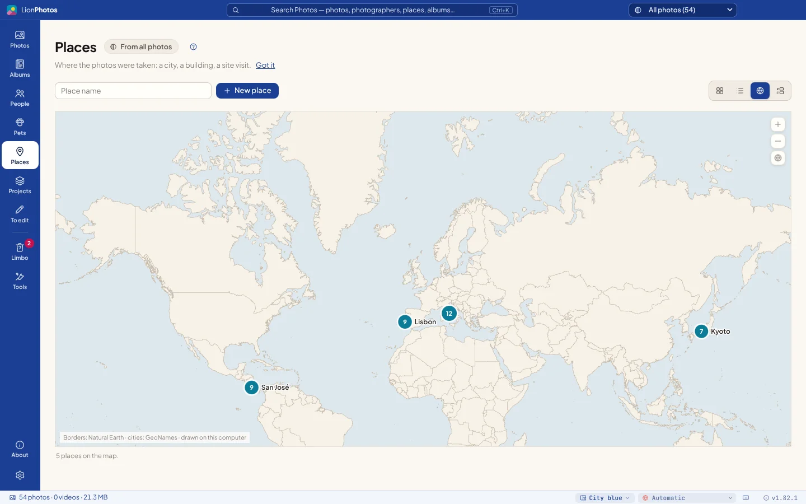

<div align="center">


# LionPhotos

**Sfoglia, cerca e organizza raccolte di foto e video, con rapidità.**<br>
Lavora sulle tue cartelle così come sono: miniature piccole create una volta sola, i metadati che contano e strumenti sicuri per organizzare.

<sub>dal <b>LionPhotos Team</b> · creato e ideato da <b>Daniel Michelon De Carli</b> · fratello di <a href="https://github.com/danielcarli/lionorganizer">LionOrganizer</a></sub>

[English](../README.md) · [Português (Brasil)](README.pt-BR.md) · [Português (Portugal)](README.pt-PT.md) · [Español](README.es.md) · [Français](README.fr.md) · [Deutsch](README.de.md) · **Italiano** · [简体中文](README.zh-CN.md) · [日本語](README.ja.md) · [한국어](README.ko.md)


<p>
  <a href="https://github.com/danielcarli/lionphotos/releases/latest/download/LionPhotos-Setup.exe"></a>
  <a href="https://github.com/danielcarli/lionphotos/releases/latest/download/LionPhotos-mac-universal.dmg"></a>
  <a href="https://github.com/danielcarli/lionphotos/releases/latest/download/lionphotos_amd64.deb"></a>
  <a href="https://github.com/danielcarli/lionphotos/releases/latest/download/lionphotos.x86_64.rpm"></a>
  <a href="https://github.com/danielcarli/lionphotos/releases/latest/download/LionPhotos-x86_64.AppImage"></a>
</p>

<sub><a href="https://github.com/danielcarli/lionphotos/releases">Tutte le versioni</a> · <a href="#scarica">Come installare</a></sub>


</div>

> **Versione beta.** LionPhotos è già pronto per l’uso quotidiano ed è provato su una raccolta reale di circa 15.000 foto e video, ma è ancora in beta: qualche spigolo è da mettere in conto, ed è meglio avere un backup della raccolta prima di riorganizzarla per la prima volta. [Cosa vuol dire beta qui](#versione-beta).

## Cosa risolve

Le raccolte di foto crescono più in fretta di quanto si riesca a ordinarle: anni di servizi sparsi tra cartelle e dischi esterni, la stessa foto in tre posti, file RAW che la maggior parte dei visualizzatori non apre, e il lavoro di ordinarle chiuso in un solo programma, su un solo computer. LionPhotos è fatto per questa situazione:

- **«Non trovo quella foto.»** Ricerca per nome, cartella, fotocamera, autore, descrizione, album, progetto, persona, animale o luogo. Volti e animali vengono riconosciuti sul tuo computer, e i luoghi si compilano da soli dal GPS o dal luogo scritto nella foto.
- **«Aprire la raccolta richiede un’eternità.»** Nessuna importazione, nessuna copia delle foto: LionPhotos sfoglia le cartelle così come sono, crea ogni miniatura una volta e la rifà solo quando il file cambia. 100.000 elementi scorrono come 100.
- **«Le mie cartelle sono un caos.»** *Riorganizza la raccolta* legge le cartelle e propone una struttura chiara sul disco (`2025/2025-12-24-Natale`, temi, una cartella da smistare, prove della fotocamera), da rivedere prima che qualcosa si sposti — e tutto si può annullare.
- **«Il disco è pieno di cose che non mi servono.»** Segna gli scarti mentre guardi e mandali nel Limbo; trova i file ripetuti dal contenuto. Tutto esce dal Cestino, niente viene eliminato per sempre.
- **«Il mio lavoro resta su un computer.»** Album, persone, contrassegni, descrizioni, regolazioni e ritagli sono conservati anche in una cartella nascosta dentro la raccolta: lo stesso disco esterno si apre con tutto questo su un altro computer, con qualunque lettera di unità.
- **«Devo consegnare.»** Modifica rapida e ritagli per ogni social network, didascalie e audiodescrizione per l’accessibilità, ed esportazione con nomi di file coerenti e i metadati che scegli. Gli originali non cambiano mai.

## Che cos’è — e che cosa non è

LionPhotos è un **organizzatore e un catalogo**. La sua funzione principale è mettere ordine nel lavoro e tenere un catalogo facile, accessibile e intuitivo: trovare una foto, selezionare un servizio, creare album e progetti e consegnare il risultato.

Inoltre **modifica e corregge**, per il lavoro rapido e leggero di cui ha bisogno la maggior parte delle foto — esposizione, colore, bianco e nero, ritaglio e raddrizzamento, correzioni dell’obiettivo, sviluppo RAW — e in questo è già piuttosto capace e dà risultati rapidi.

**Non ha lo scopo di sostituire Lightroom, Photoshop e altri editor dedicati allo sviluppo delle foto digitali**. I lavori con livelli di trattamento, il ritocco locale e il fotomontaggio restano a carico di quei software più dedicati; LionPhotos apre la foto in essi (*Apri con*) e riporta il risultato nel catalogo.

## Per chi è

- **Fotografi professionisti e appassionati** che tengono il lavoro in cartelle e dischi esterni, scattano in RAW + JPEG e vogliono ordinare, ritrovare e consegnare senza importare tutto in un catalogo.
- **Team di comunicazione, redazioni e studi** che condividono una raccolta tra computer e persone, hanno bisogno di nomi, autori e descrizioni accessibili coerenti e organizzano il lavoro per progetto e cliente.
- **Famiglie e chiunque abbia anni di foto del telefono** sparse in cartelle, e voglia ritrovare persone, luoghi e momenti e liberare spazio in sicurezza.
- **Chi tiene alla privacy:** non si carica nulla, non c’è un account e niente passa dalla rete.

## Punti di forza

- **Le tue cartelle, così come sono.** Nessuna importazione né libreria chiusa: le foto restano dove le hai messe, e gli altri programmi continuano a lavorarci.
- **Locale e privato.** Nessun account, nessuna telemetria; si collega a Internet solo quando gli chiedi di cercare una nuova versione. Il riconoscimento di volti e animali gira sul tuo computer. Legge solo la cartella che scegli e le sue sottocartelle.
- **Veloce a qualsiasi scala.** La griglia disegna solo ciò che è sullo schermo; le miniature sono piccole, tenute in un unico file di cache e create una sola volta. Le grandi raccolte su dischi esterni restano fluide.
- **Tutti i formati, con decodificatori propri.** JPEG, HEIC/HEIF, TIFF, PSD/PSB, RAW delle principali marche (CR3, CR2, NEF, ARW, RAF, DNG…) e video (MP4, MOV, MTS, AVI…).
- **Sicuro per progetto.** Ogni modifica ai file mostra prima il piano, chiede un codice di 3 caratteri digitato e si può annullare; eliminare manda sempre nel Cestino.
- **Il catalogo viaggia con le foto,** in un formato JSON aperto e documentato che altri programmi possono leggere.
- **Ordina davvero.** Album, progetti, persone, animali e luoghi nel catalogo — e, quando vuoi, cartelle e nomi dei file sul disco, con RAW, JPEG e file accessori dello stesso scatto sempre insieme.
- **Gratuito e open source** (MIT), per Windows, macOS e Linux, in 10 lingue.

## Versione beta

LionPhotos è in **beta**. Significa che:

- È usato ogni giorno su una raccolta reale, e ogni versione supera più di 100 controlli automatici end-to-end, ma non è ancora stato usato su molti computer e raccolte diversi.
- **Provato su una grande raccolta, su un disco comune:** più di 70.000 file su un disco rigido esterno USB 3.1 — un disco normale, non un SSD. In questa prova le prestazioni si sono dimostrate soddisfacenti.
- Prima di organizzare, rinominare o riorganizzare una raccolta per la prima volta, **tienine un backup** (la scheda Backup può farlo). Ogni operazione si può annullare e niente viene eliminato per sempre, ma il backup è la rete più sicura.
- I programmi di installazione non sono ancora firmati con un certificato a pagamento (vedi [Scarica](#scarica)).
- Le foto RAW si modificano, di norma, sul JPEG che la fotocamera salva al loro interno (8 bit); la **modalità sviluppo** (un interruttore in Regolazioni) modifica invece i dati del sensore, sviluppati su questo computer a 16 bit con LibRaw — nuova e ancora in messa a punto (i colori non sono quelli della fotocamera né di Lightroom). Serve una scheda grafica con WebGL 2.
- Hai trovato un problema o hai un suggerimento? Apri una [issue](https://github.com/danielcarli/lionphotos/issues) con la versione (nella barra di stato) e cosa hai fatto. LionPhotos non invia mai nulla da solo.

## Scarica

Scarica il programma di installazione per il tuo sistema. I link puntano sempre alla **versione più recente**, e ogni file viene verificato (SHA-256 e provenienza della build firmata).

- **Windows 10/11** (x64, ARM): un programma di installazione con tutta l'app dentro (circa 150 MB): durante l'installazione non si scarica nulla e bastano pochi secondi. → [`LionPhotos-Setup.exe`](https://github.com/danielcarli/lionphotos/releases/latest/download/LionPhotos-Setup.exe) · [ARM](https://github.com/danielcarli/lionphotos/releases/latest/download/LionPhotos-Setup-arm64.exe) · [`.zip` portatile, senza installare](https://github.com/danielcarli/lionphotos/releases/latest/download/LionPhotos-win-x64.zip)
- **macOS 11+** (Apple Silicon, Intel): apri il `.dmg` e trascina LionPhotos in Applicazioni. → [`LionPhotos-mac-universal.dmg`](https://github.com/danielcarli/lionphotos/releases/latest/download/LionPhotos-mac-universal.dmg)
- **Linux** (x64): `.deb` per Ubuntu, Debian, Mint…, `.rpm` per Fedora, RHEL, openSUSE…, oppure l'AppImage per qualsiasi distribuzione, senza installazione. → [`.deb`](https://github.com/danielcarli/lionphotos/releases/latest/download/lionphotos_amd64.deb) · [`.rpm`](https://github.com/danielcarli/lionphotos/releases/latest/download/lionphotos.x86_64.rpm) · [AppImage](https://github.com/danielcarli/lionphotos/releases/latest/download/LionPhotos-x86_64.AppImage)

> I programmi di installazione non sono ancora firmati con un certificato a pagamento. Al primo avvio, Windows può mostrare "PC protetto da Windows" (**Ulteriori informazioni › Esegui comunque**) e macOS chiede di consentire l'app in **Impostazioni di Sistema › Privacy e sicurezza › Apri comunque**.

**Preferisci il terminale?** macOS e Linux:

```bash
curl -fsSL https://github.com/danielcarli/lionphotos/releases/latest/download/install.sh | bash
```

[Tutte le versioni](https://github.com/danielcarli/lionphotos/releases) · [Guida all'installazione](INSTALL.md) (in inglese): dettagli, sicurezza, aggiornamento e disinstallazione.

## Funzionalità

| | |
|---|---|
| **Foto** | Griglia per mese o elenco con cartella, tipo, dimensioni, peso, data e dettagli; selezione con clic, Ctrl e Maiusc; zoom; filtri per tipo, anno, contrassegno, categoria e sottocartelle, mostrati come etichette che si tolgono con un clic. L’albero delle cartelle (o gli anni) a sinistra, il pannello informazioni a destra — entrambi nascondibili, o tutto con la modalità concentrazione (`\`). **La ricerca nella barra del titolo** (Ctrl+K o Ctrl+F) cerca in tutta la raccolta mentre scrivi — foto, album, progetti, persone, luoghi, fotografi, fotocamere, parole chiave, cartelle — e, quando i filtri nascondono tutto, la pagina dice quali, con un pulsante per toglierli uno a uno. Dentro un album, una persona, un animale, un luogo o un progetto: mosaico, griglia uniforme, elenco o in evidenza. |
| **Visualizzatore** | Dimensione piena subito (prima la miniatura), file RAW a dimensione piena tramite il JPEG salvato dalla fotocamera, ← → per scorrere, `I` per le informazioni, zoom alle dimensioni reali; i video si riproducono con i controlli. Il cursore dello zoom va dalla dimensione dello schermo al 400 %; la rotellina ingrandisce dove si trova il puntatore, trascinare sposta la foto, `Z` alterna adattata ↔ dimensione reale. *Modifica* (o `H`) mostra o comprime lo stesso pannello di modifica del pannello informazioni — categoria, album, regolazioni, descrizione, autore e luogo; una foto spostata in una categoria esclusa dal filtro resta visibile, in grigio, con un avviso che dice dove si trova. Anche HEIC, HEIF e HIF si aprono a dimensione reale; le foto HDR (PQ, HLG) vengono convertite per uno schermo comune, nel visualizzatore e nelle miniature. Il doppio clic ingrandisce al 100 % nel punto e torna indietro. Canc manda la foto nel Limbo con una semplice conferma. Il pannello mostra un'attività alla volta — Regola, Descrivi, Info — e, in una finestra di 1680 px o più, Descrivi e Info a sinistra e Regola a destra; trascina il bordo di un pannello per allargarlo. |
| **Regolazioni** | Esposizione, contrasto, ombre e saturazione nel pannello informazioni, per una foto o molte, con istogramma e anteprima immediata (sulla scheda grafica, o sul processore se manca); copiale e incollale su altre foto. Il file non cambia mai: le regolazioni sono nel catalogo (annullate con Ctrl+Z), miniature e visualizzatore le mostrano (tieni premuto `\` per l'originale) e *Salva copia modificata* scrive un nuovo JPEG accanto all'originale, con i suoi metadati. *Esporta foto* (Ctrl+E) crea nuovi file delle foto modificate in qualsiasi cartella — JPEG, PNG o TIFF, nella misura di un social network o di una stampa, con nitidezza in uscita, nomi come `2026-07-24-Laurea-Ana-Souza-001.jpg`, con tutti i metadati o senza il luogo e una firma facoltativa — con il profilo sRGB; gli originali non cambiano mai. |
| **Modifica** | Luci, bianchi, neri, bilanciamento del bianco (temperatura, tinta e contagocce), vividezza, bianco e nero con miscela per colore, vignettatura e — sulla scheda grafica — nitidezza, texture e chiarezza; *Automatico*, predefiniti e prima/dopo nel visualizzatore (`Y`). **Ritaglia e raddrizza** (`C`): libero o in un formato — quelli comuni e quelli dei social network (Instagram 4:5 e 3:4, Stories/Reels/TikTok 9:16, YouTube 16:9, link 1,91:1, Pinterest, copertine di X e LinkedIn) —, rotazioni di 90° e raddrizzamento tracciando una linea sull’orizzonte. Tutto resta nel catalogo; il file non cambia mai. |
| **Correzione dell’obiettivo** | Distorsione, angoli scuri e frange di colore dell’obiettivo annullati dal suo profilo — tutto il database [Lensfun](https://lensfun.github.io), circa 1.600 obiettivi, trovato dal nome scritto dalla fotocamera o scelto da un elenco con ricerca — e a mano: distorsione, prospettiva verticale e orizzontale (edifici che cadono all’indietro), scala, angoli e frange. Sulla scheda grafica; il file non cambia mai. |
| **Cronologia del Cestino** | Strumenti › *Cronologia del cestino* (`Ctrl+5`) elenca ogni file che LionPhotos ha spostato nel Cestino — quando, quale, la dimensione e da dove (Limbo, File ripetuti, selezione) — e mostra lo spazio liberato dal Limbo: in totale, questo mese e mese per mese. |
| **Pannello informazioni** | Tutti i metadati della selezione, la categoria, gli album, le persone, gli animali, i luoghi e i progetti in cui si trova — aggiunti o tolti direttamente lì. |
| **Descrizione e metadati** | Titolo, didascalia, audiodescrizione, autore e ruolo, luogo (sottoluogo, città, provincia/stato, paese), parole chiave e istruzioni, per una foto o molte insieme — cambia solo il catalogo. Ciò che il file già dice (EXIF, IPTC, XMP, il `.xmp` di un RAW) appare come suggerimento ed è usato dalle esportazioni. *Scrivi nei file* (con il codice digitato) lo scrive nel JPEG stesso, con la versione precedente nel Cestino, o in un `.xmp` accanto a ogni altro file. Il JPEG riceve anche lo stesso `.xmp` accanto: i dati viaggiano con la foto inviata e restano leggibili accanto a essa. Ogni modifica si può annullare (Ctrl+Z) e ripetere (Ctrl+Maiusc+Z); la scrittura nei file si annulla dall’avviso o dalle operazioni recenti, e i file tornano byte per byte. |
| **Album** | Copertina, descrizione e periodo; *Aggiungi all'album…* su qualsiasi selezione, *Togli dall'album*, *Usa come copertina*; **album dalle cartelle** (il primo livello, le cartelle con foto o quelle che scegli), legati all'intera cartella; presentazione a schermo intero. **Suggerisci album**: le foto raggruppate come sono state scattate e chiamate in base al soggetto — la cartella, ciò che mostrano le foto (letto su questo computer dalle miniature: spiaggia, montagna, torta, abito da sposa, cibo…), le feste dalla data, il luogo, la persona — e album di un soggetto negli anni, da rivedere prima di crearli. **Unire due album** in uno (le foto di entrambi, con il nome scelto; cambia solo il catalogo, ed è annullabile). Mostrati a mosaico, griglia uniforme (tutte le copertine della stessa misura), elenco o in evidenza. |
| **Progetti, persone, animali, luoghi** | Ognuno nella sua scheda, a griglia o in elenco raggruppato per anno. Aprirne uno mostra le sue foto, nella sua scheda; una foto si può togliere con un clic. L'etichetta di una cartella vale per tutto ciò che contiene. Un progetto raggruppa album e ha una scheda (stato, per chi, luogo, squadra, scadenza) e un pannello con l'avanzamento: smistate, modificate, scelte negli album, audiodescrizioni. I luoghi si compilano da soli dalle foto (la posizione GPS o il luogo scritto) e compaiono su una **mappa del mondo** disegnata sul computer. |
| **Da modificare** | La matita sulla copertina di un album o di un progetto lo mette nella scheda **Da modificare** (Ctrl+Shift+E), un elenco nell’ordine in cui vanno fatte le cose: trascina le righe, o usa le frecce o Alt+↑ ↓, per mettere per primo ciò che viene prima. Il posto nell’elenco si vede sulla copertina, un progetto mostra la sua scadenza (in rosso se in ritardo) e *Fatto* toglie la matita. Cambia solo il catalogo, e l’elenco segue la collezione. |
| **Nome e logo** | *Impostazioni › Nome e logo* mette il tuo nome e il tuo logo (di un’agenzia, uno studio, un corso) nella barra del titolo, nella pagina iniziale e nel titolo della finestra, con anteprima. Un nome tuo mostra sempre **Powered by LionPhotos** accanto; Informazioni mantiene i crediti. Il logo (PNG, JPG, WebP, SVG) viene messo intero in un quadrato; *Torna a LionPhotos* annulla. Resta su questo computer. |
| **Volti e animali** | face-api (TensorFlow.js) per i volti, COCO-SSD e MobileNet per gli animali, sulla scheda grafica (WebGL). Gruppi di volti simili, suggerimenti da confermare o rifiutare, "non è lui" ricordato. Disattivato per impostazione predefinita; *Indicizza ora* o dopo ogni scansione. |
| **Segni e Limbo** | Ottima, OK, da eliminare — sulla miniatura, nell'elenco, nel visualizzatore e nel pannello informazioni; tasti `1` `2` `3` `0`. Il Limbo mostra tutte le candidate e lo spazio che occupano, e le manda nel Cestino in un colpo solo. **In evidenza**: album, persone, animali e progetti con le sole foto segnate con stella o OK, uno per riga — il nome in grande, una foto scelta in grande — come una pagina di portfolio. Anche i luoghi; e dentro ciascuno, le foto scelte in grande, una per riga. |
| **Apri con** | I programmi per foto e video del computer per i file selezionati (Photoshop, Lightroom Classic, Bridge, Premiere Pro, Capture One, DxO PhotoLab, Affinity, darktable, GIMP, VLC…), prima gli ultimi usati; su Windows anche tutti i programmi registrati per il tipo di file. |
| **Plugin** | Installa pacchetti `.lionplugin` che esportano album e progetti come pagina (HTML, CSS e JavaScript), con nomi dei file, descrizioni e audiodescrizioni; niente viene eseguito dentro LionPhotos. Vedi [PLUGINS.md](PLUGINS.md) (in inglese). Ogni plugin attivo ha la sua scheda dopo Da modificare, con la sua pagina: scegli album e progetti ed esporta. |
| **Panoramica** | Elementi, foto, video, peso e periodo; file per tipo, per anno, formati, fotocamere, codec; la cache delle miniature. |
| **Organizza** | Cartelle per data (`2024/2024-07`, `2024-07`, `2024`, `2024/2024-07-14` o `2024-07-14-tema`), cartelle per album (`2024/2024-07-14-album`), con `Raw/` e `Img/` dentro se si vuole; *Sposta in cartella* con sottocartelle per tipo; i file dello stesso scatto vanno insieme; operazioni recenti con annullamento. I file si spostano davvero sul disco e possono anche essere **rinominati** (`{data}-{álbum}-{fotógrafo}-{nº}` per impostazione predefinita, numerati per data; il RAW, il JPEG e l'`.xmp` di uno scatto tengono lo stesso nome), o solo rinominati dove sono. **Riorganizza la raccolta** legge le cartelle come sono e propone un'unica struttura sul disco — `2025/2025-12-24-Natale`, temi lunghi in `Temi/`, ciò che aspetta in `_Da-smistare/`, prove di fotocamere in `_Attrezzatura/` — da rivedere (rinominare o escludere qualsiasi cartella, vedere l'albero finale) prima di spostare cartelle intere, con annulla. **File collegati rimasti soli** (un `.xmp` o `.dop` rimasto solo dopo lo spostamento della foto) tornano accanto alla foto, con il suo nome. **Duplica** (Ctrl+D): una copia accanto alla foto, con regolazioni, ritaglio, segni e album, con codice digitato e annullabile. |
| **File ripetuti** | SHA-256 in tre fasi (dimensione → primi/ultimi 64 KB → file intero), affiancati con le loro miniature. |
| **Backup** | Una cartella principale e una di backup confrontate per contenuto; copie verificate di ciò che manca, nelle stesse sottocartelle o in cartelle per data. |
| **Converti** | HEIC/HEIF → JPG o PNG a piena risoluzione, mantenendo EXIF e profilo colore, accanto all'originale. |
| **Formati** | Foto: JPEG, PNG, GIF, WebP, AVIF, BMP, HEIC/HEIF, TIFF, PSD/PSB, RAW della fotocamera (CR3, CR2, NEF, NRW, ARW, SR2, ORF, RW2, RAF, SRW, PEF, DNG, 3FR, IIQ, ERF, RWL). Video: MP4, MOV, M4V, 3GP, WebM, MKV, MTS/M2TS, AVI. |
| **10 lingue** | English, Português (Brasil), Português (Portugal), Español, Français, Deutsch, Italiano, 简体中文, 日本語, 한국어 — rilevata dal sistema, modificabile nella barra di stato. |
| **Temi** | Anguria (il verde petrolio del logo, rosa e bianco ), Blu città (cobalto, corallo e bianco, come una planimetria urbana — predefinito), chiaro, scuro e automatico. |

## Prima di tutto la sicurezza

Le stesse regole di LionOrganizer:

- **Codice di conferma digitato.** Ogni modifica ai file — Cestino, organizzare, spostare, rinominare, convertire, annullare, svuotare la cache — mostra un codice di 3 caratteri da **digitare** (incollare è disattivato). Il codice è generato e verificato dal processo principale; cinque tentativi sbagliati annullano.
- **Cestino, non eliminazione definitiva.**
- **Ambito limitato.** L'interfaccia raggiunge i file solo tramite gli identificativi della libreria della cartella aperta, mai tramite il percorso.
- **Sola lettura per impostazione predefinita.** Navigare, metadati, miniature, anteprime, la ricerca dei duplicati e "Apri con" non modificano mai i tuoi file. Album, etichette, segni e volti cambiano solo il catalogo di LionPhotos. Unica eccezione: ciò che fai con le foto viene scritto anche, in JSON, in una cartella nascosta `.lionphotos` nella raccolta (solo dopo che hai fatto qualcosa; si può spegnere in Backup).

<div align="center">

</div>

## Schermate

| | |
|---|---|
|  **Album** — mosaico per anno, con descrizioni |  **In evidenza** — solo le foto con stella o OK, come un portfolio |
|  **Dentro un album** — mosaico, griglia uniforme, elenco o in evidenza |  **Ricerca** — nella barra del titolo, in tutta la raccolta |
|  **Luoghi** — su un planisfero disegnato sul computer |  **Visualizzatore** — con il pannello di modifica (bianco e nero) |
|  **Correzione dell’obiettivo** — prospettiva raddrizzata a mano |  **Ritaglio** — per Instagram, Stories, YouTube… |
|  **Descrizione** — metadati IPTC, salvati mentre scrivi |  **Esporta foto** — nomi coerenti, dimensioni per ogni social |
|  **Elenco** — cartella, tipo, dimensioni, peso, data |  **File ripetuti** — trovati dal contenuto |

## Per iniziare

### Eseguire dal codice sorgente (Windows)

1. Installa [Node.js LTS](https://nodejs.org).
2. Scarica o clona questo repository.
3. Fai doppio clic su **`start.bat`** — la prima esecuzione installa le dipendenze.

Oppure da un terminale:

```powershell
npm install
npm start
```

### Creare un programma di installazione

Fai doppio clic su **`build-installer.bat`** (oppure esegui `npm run dist`). I programmi di installazione vengono creati in `dist/`. Le versioni pubblicate sono create da GitHub Actions quando viene inviato un tag `vX.Y.Z`.

## Scorciatoie da tastiera

| Scorciatoia | Azione |
|---|---|
| `Ctrl+O` | Apri una cartella |
| `F5` | Cerca file nuovi e modificati |
| `Ctrl+K` · `Ctrl+F` | Cerca in tutta la raccolta (barra del titolo) |
| `Ctrl+1` · `Ctrl+Shift+A` | Foto · Album |
| `Ctrl+Shift+E` | Da modificare |
| `Ctrl+6` … `Ctrl+9` | Progetti · Persone · Animali · Luoghi |
| `Ctrl+L` | Limbo |
| `Ctrl+2` · `Ctrl+3` · `Ctrl+4` · `Ctrl+0` | Panoramica · File ripetuti · Organizza · Backup |
| `Alt+←` · `Alt+Home` | Torna da un album, progetto o persona · l'intera raccolta, senza filtri |
| `Ctrl+B` · `\` | Mostra/nascondi la barra laterale · modalità concentrazione (solo le foto) |
| `1` `2` `3` · `0` | Segna la selezione come ottima · OK · da eliminare · togli il segno |
| `Ctrl+A` · `Invio` · `H` · `Canc` · `F2` · `Esc` | Seleziona tutto · apri · pannello informazioni · Cestino · rinomina · annulla la selezione |
| `E` · `D` · `I` | Pannello laterale su Regola · Descrivi · Info (lo stesso tasto di nuovo lo chiude) |
| `V` · `?` | Confronta fianco a fianco · Scorciatoie da tastiera |
| `Ctrl+E` | Esporta foto (la selezione, o le foto mostrate) |
| `←` `→` · `Spazio` · `Esc` | Visualizzatore: precedente/successiva · riproduci/pausa · chiudi |
| `P` · `F` · `A` | Visualizzatore: presentazione · schermo intero · aggiungi all'album |

## Lingue

| Lingua | Codice | | Lingua | Codice |
|---|---|---|---|---|
| English | `en` | | Deutsch | `de` |
| Português (Brasil) | `pt-BR` | | Italiano | `it` |
| Português (Portugal) | `pt-PT` | | 简体中文 | `zh-CN` |
| Español | `es` | | 日本語 | `ja` |
| Français | `fr` | | 한국어 | `ko` |

La lingua segue quella del sistema e si può cambiare nella barra di stato. Numeri e date seguono la lingua scelta. I cataloghi dei testi sono generati da `tools/nls/*.py` in `src/nls/*.json`.

## Privacy

LionPhotos si collega alla rete solo quando lo chiedi: un clic sulla versione, nell'angolo in basso a destra, cerca una nuova versione su GitHub, e l'aggiornamento scarica il programma di installazione per il tuo sistema, verificato (SHA-256) prima di usarlo. Nessun account, nessuna telemetria, non viene inviato nulla su di te o sulle tue foto. Il riconoscimento di volti e animali gira su questo computer, con modelli inclusi nell'app.

Il catalogo e le miniature stanno in un unico file sul tuo computer:

```
%APPDATA%\LionPhotos\library.sqlite
```

*Panoramica › Svuota cache* cancella le miniature. Le tue foto non vengono mai toccate.

## Come le miniature restano veloci

1. **Scansione** — solo la cartella scelta e le sue sottocartelle, solo `readdir` + `stat`; il contenuto di un file non viene mai aperto per elencarlo. 20 000 file richiedono circa un secondo.
2. **Validità** — una miniatura è salvata con la dimensione e la data di modifica del suo file; finché coincidono, viene riutilizzata. Un file spostato o rinominato fuori dall'app mantiene la sua miniatura.
3. **Ordine** — prima ciò che è sullo schermo, poi il resto dal più recente al più vecchio; le anteprime solo dopo tutte le miniature.
4. **Motore** — una pagina nascosta a priorità più bassa decodifica tutto con codice proprio di LionPhotos: immagini nei Web Worker, file RAW tramite la loro anteprima JPEG incorporata, TIFF e PSD leggendo solo una riga ogni n, HEIC con libheif in WebAssembly, video con WebCodecs. Il generatore di miniature del sistema non viene mai chiamato.
5. **Archiviazione** — miniature WebP da 320 px (8–25 KB) in un unico file SQLite, senza file orfani.

## Architettura

Gli stessi livelli di [LionOrganizer](https://github.com/danielcarli/lionorganizer) e [Visual Studio Code](https://github.com/microsoft/vscode): `base` non conosce nulla sopra di sé, `platform` fornisce i servizi del processo principale, `workbench` costruisce l'interfaccia; l'interfaccia isolata (sandbox) parla con il processo principale solo attraverso il ponte `preload`.

```
src/
  base/            eventi, formattazione, i18n, utilità DOM, icone, grafici
  platform/
    library/       catalogo SQLite, scansione delle cartelle, lettori di metadati (EXIF: JPEG, raw, HEIC, AVIF; PNG, MP4/MOV, Matroska)
    thumbs/        motore di miniature e anteprime + la pagina nascosta (worker, muxer WebM)
    media/         lionthumb:// e lionmedia:// (per id di libreria, con intervalli di byte)
    faces/         riconoscimento di volti e animali (pagina nascosta sulla scheda grafica, chi-è-chi nel principale)
    labels/        album, progetti, persone, animali, luoghi, personale/professionale
    operations/    operazioni con codice digitato: Cestino, organizzare, spostare, rinominare, annullare, svuotare la cache
    openWith/      i programmi per foto e video del computer
    duplicates/    ricerca tramite SHA-256 (condivisa con LionOrganizer)
  code/            punto di ingresso electron-main, ponte preload
  nls/             en.json … ko.json (generati da tools/nls)
  workbench/       parti del layout, servizi e viste
```

Sicurezza: `contextIsolation` e `sandbox` attivi, niente `nodeIntegration`, una Content Security Policy rigorosa, e ogni richiesta che modifica file viene convalidata nel processo principale.

## Sviluppo

| Comando | Cosa fa |
|---|---|
| `npm start` | Avvia l'app |
| `npm run dist` | Crea i programmi di installazione |
| `npm run test:e2e` | Test end-to-end su una cartella **usa e getta** (`npm run fixtures` ne crea una) |
| `npm run test:i18n` | Ogni chiave usata esiste, ogni lingua è completa, i segnaposto coincidono |
| `npm run test:faces` | Chi-è-chi con volti sintetici |
| `npm run test:openwith` | "Apri con": registro di Windows, file `.desktop`, avvio |
| `npm run test:plugins` | Plugins |
| `npm run nls` | Genera `src/nls/*.json` da `tools/nls/*.py` |
| `npm run release:assets` | Crea in `dist-release/` i file di versione usati dai programmi di installazione |

```powershell
# il test end-to-end modifica file: puntalo sempre a una copia usa e getta
$env:LIONPHOTOS_FOLDER="C:\temp\copia-foto"; npm run test:e2e
```

## Registro delle modifiche

Vedi [CHANGELOG.md](../CHANGELOG.md) (in inglese) — versione attuale: **1.54.0**.

## Riconoscimenti

LionPhotos è stato **creato e ideato da Daniel Michelon De Carli**, studente di architettura e urbanistica, ed è mantenuto dal **LionPhotos Team** insieme ai suoi collaboratori e traduttori.

## Licenza

Copyright © 2026 LionPhotos Team.

LionPhotos è open source con **[licenza MIT](../LICENSE)**: usalo, copialo, modificalo e distribuiscilo liberamente, mantenendo l'avviso di copyright. È fornito **"così com'è", senza alcuna garanzia**.

I componenti di terze parti inclusi mantengono le proprie licenze:

| Componente | Licenza | Dove |
|---|---|---|
| [libheif](https://github.com/strukturag/libheif) con libde265 (build WebAssembly di [libheif-js](https://github.com/catdad-experiments/libheif-js)) | GNU LGPL v3, non modificato | `src/platform/thumbs/electron-sandbox/vendor/libheif` |
| [face-api](https://github.com/vladmandic/face-api) con TensorFlow.js e i suoi modelli dei volti | MIT | `src/platform/faces/electron-sandbox/vendor/face-api` |
| Modelli [COCO-SSD e MobileNet](https://github.com/tensorflow/tfjs-models) | Apache 2.0 | `src/platform/faces/electron-sandbox/vendor/pets` |
| Confini e nomi dei paesi di [Natural Earth](https://www.naturalearthdata.com) (1:50m) | Pubblico dominio | `src/platform/geo` |
| [GeoNames](https://www.geonames.org) — cities15000 | CC BY 4.0 | `src/platform/geo/node/cities.json` |
| [LibRaw](https://www.libraw.org) 0.22 (raw development), in WebAssembly via [libraw-wasm](https://github.com/colorhythm/libraw-wasm) and [typed-cstruct](https://github.com/ssssota/typed-cstruct) | LGPL-2.1 or CDDL-1.0 · MIT · MIT | `src/platform/raw/electron-sandbox/vendor` |
| [Lensfun](https://lensfun.github.io) lens database (lens correction profiles), converted by `tools/lensfun/build.py` | CC BY-SA 3.0 (data only; none of Lensfun’s code) | `src/workbench/services/adjust/common/lensfun.json` |
| [Plus Jakarta Sans](https://github.com/tokotype/PlusJakartaSans), [JetBrains Mono](https://github.com/JetBrains/JetBrainsMono) | SIL Open Font License 1.1 | caratteri |

## Foto delle schermate

Le foto delle schermate provengono dal [WordPress Photo Directory](https://wordpress.org/photos/) e sono di pubblico dominio ([CC0](https://creativecommons.org/publicdomain/zero/1.0/)): non serve l’attribuzione, e sono citate qui con gratitudine. Descrizioni, fotocamere e date sono dei fotografi; i luoghi sulla mappa sono stati aggiunti per la dimostrazione.

- **Roma:** [Isabel Gutierrez](https://wordpress.org/photos/photo/53469e1c45/), [salsel](https://wordpress.org/photos/photo/2456557419/), [Jupa](https://wordpress.org/photos/photo/3816aaf093/), Bigul Malayi ([1](https://wordpress.org/photos/photo/17168efb07/), [2](https://wordpress.org/photos/photo/616857a90c/), [3](https://wordpress.org/photos/photo/33768dc862/), [4](https://wordpress.org/photos/photo/42268dc85f/)), [karolishostinger](https://wordpress.org/photos/photo/35766e9c63/)
- **Lisbona:** [Isabel Gutierrez](https://wordpress.org/photos/photo/35669e1d6f/), [MelissaH](https://wordpress.org/photos/photo/31968ae275/), KafleG ([1](https://wordpress.org/photos/photo/687685d279/), [2](https://wordpress.org/photos/photo/852685d283/), [3](https://wordpress.org/photos/photo/468685d28f/), [4](https://wordpress.org/photos/photo/667685d2c4/), [5](https://wordpress.org/photos/photo/501685d2ca/)), [Jeff Golenski](https://wordpress.org/photos/photo/3016a7fb59/)
- **Costa Rica:** [Harlyn Luna Brenes](https://wordpress.org/photos/photo/626af3dce8/), [Francisco Herrera](https://wordpress.org/photos/photo/18764e77d3/), wenmirandav ([1](https://wordpress.org/photos/photo/2786aefef5/), [2](https://wordpress.org/photos/photo/2776aefeba/), [3](https://wordpress.org/photos/photo/2016aeffe6/)), [alexandrachacaltana2303](https://wordpress.org/photos/photo/3846aeeac8/), [dmoreno2003](https://wordpress.org/photos/photo/4466af376b/), [dangrijal](https://wordpress.org/photos/photo/3516af7648/), [xbullscm](https://wordpress.org/photos/photo/7066af7fae/)
- **Lago di Garda:** xbullscm ([1](https://wordpress.org/photos/photo/836af4b8d6/), [2](https://wordpress.org/photos/photo/716af4b7c7/), [3](https://wordpress.org/photos/photo/1046af4b83/), [4](https://wordpress.org/photos/photo/8286af4b88/), [5](https://wordpress.org/photos/photo/3966af4b78/))
- **Architettura:** Joel Peralta ([1](https://wordpress.org/photos/photo/9656a6d336/), [2](https://wordpress.org/photos/photo/1866a70aeb/), [3](https://wordpress.org/photos/photo/8766a7044c/), [4](https://wordpress.org/photos/photo/9866a6d32f/), [5](https://wordpress.org/photos/photo/766a2f39b8/)), [Silvia Fernanda Marin Giraldo](https://wordpress.org/photos/photo/1656a972f2/), [dumanag](https://wordpress.org/photos/photo/7806a66cad/), [Manjil Aryal](https://wordpress.org/photos/photo/416a282c7f/), [Anup Kankale](https://wordpress.org/photos/photo/966a390efb/)
- **Cielo notturno:** [shirishpoudel07](https://wordpress.org/photos/photo/8606a28c17/), Jeff Golenski ([1](https://wordpress.org/photos/photo/544620fdb6/), [2](https://wordpress.org/photos/photo/92361d465c/)), [vanessartavia](https://wordpress.org/photos/photo/3036ae9774/), [Natcha Boonroj](https://wordpress.org/photos/photo/512693d15a/), [Faisal Ahammad](https://wordpress.org/photos/photo/816ae8da24/)
- **Kyoto:** [Maruti Mohanty](https://wordpress.org/photos/photo/4746570441/), [Timi Wahalahti](https://wordpress.org/photos/photo/14766bbb55/), Wajari Velasquez ([1](https://wordpress.org/photos/photo/506a214832/), [2](https://wordpress.org/photos/photo/5236a216f0/), [3](https://wordpress.org/photos/photo/8366a216e4/), [4](https://wordpress.org/photos/photo/8976a21449/), [5](https://wordpress.org/photos/photo/296a2182a4/))
