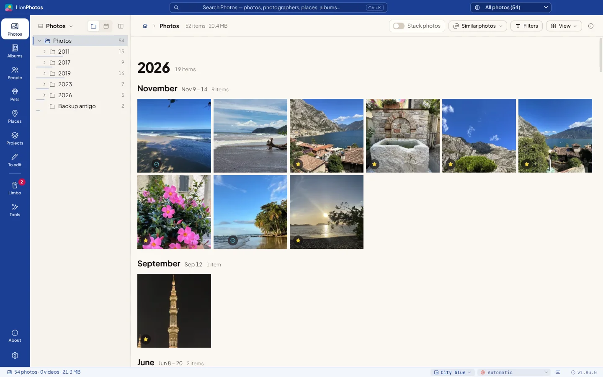
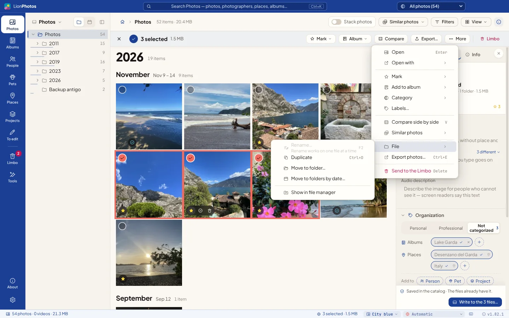
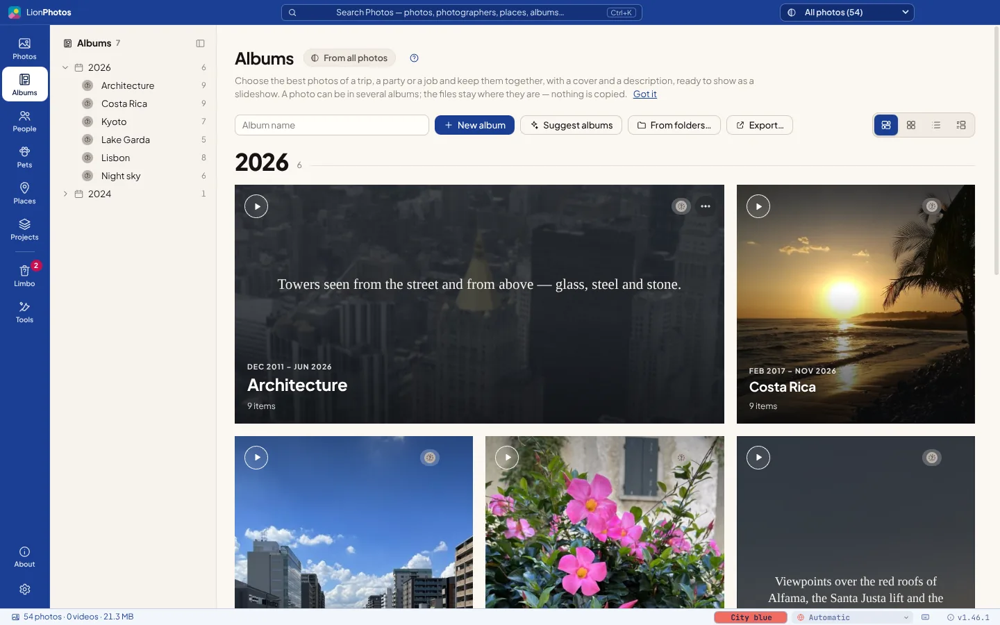

<div align="center">


# LionPhotos

### これまでに撮ったすべての写真を、数秒で見つける。

膨大な写真と動画のコレクションを、今ある場所のまま——内蔵ディスクでも、外付けドライブでも、クラウドのフォルダーでも——閲覧・検索・整理できます。速く、プライベートで、無料。

<sub><b>LionPhotos Team</b> 制作 · 考案・作成 <b>Daniel Michelon De Carli</b> · <a href="https://github.com/danielcarli/lionorganizer">LionOrganizer</a> の姉妹ソフト</sub>

[English](../README.md) · [Português (Brasil)](README.pt-BR.md) · [Português (Portugal)](README.pt-PT.md) · [Español](README.es.md) · [Français](README.fr.md) · [Deutsch](README.de.md) · [Italiano](README.it.md) · [简体中文](README.zh-CN.md) · **日本語** · [한국어](README.ko.md)

<p>
  <a href="https://github.com/danielcarli/lionphotos/releases/latest/download/LionPhotos-Setup.exe"></a>
  <a href="https://github.com/danielcarli/lionphotos/releases/latest/download/LionPhotos-mac-universal.dmg"></a>
  <a href="https://github.com/danielcarli/lionphotos/releases/latest/download/lionphotos_amd64.deb"></a>
  <a href="https://github.com/danielcarli/lionphotos/releases/latest/download/lionphotos.x86_64.rpm"></a>
  <a href="https://github.com/danielcarli/lionphotos/releases/latest/download/LionPhotos-x86_64.AppImage"></a>
</p>

<a href="https://github.com/danielcarli/lionphotos/releases/latest"></a>

<sub><a href="https://github.com/danielcarli/lionphotos/releases">すべてのバージョン</a> · <a href="#ダウンロード">インストール方法</a></sub>


**インポート不要** · **何もコンピューターの外に出ない** · **10万枚でも100枚のように軽快** · **無料・オープンソース**


</div>

> **ベータテスト中。** LionPhotos は日常の利用に足る機能がそろい、約 15,000 点の写真と動画の実際のコレクションでテストしていますが、まだベータ版です。粗い部分があるかもしれません。コレクションを初めて再編成する前には、バックアップを取っておいてください。[ここでのベータの意味](#ベータテスト)。

**充実した機能。** LionPhotos は、Lightroom のライブラリモジュールの要点（カタログ、マーク、IPTC、RAW+JPEG、非破壊の調整）と、Google フォトの優れた機能（人物、ペット、内容による検索、似た写真のスタック）をすでにひとつにまとめています。さらに保留（Limbo）、独自ブランドのプラグイン、10 言語にも対応しています。

**実際の利用から生まれました。** 多くの機能は、写真を撮る人の実際の悩みから生まれています：遅い Google ドライブ、RAW+JPEG、写真を捨てる前のメタデータの比較。そうして生まれるソフトウェアは、見た目だけでなく役に立つものになりがちです。

**大きなコレクションでテスト中。** LionPhotos は、USB 3.1 の外付けドライブにある 7 万枚以上の写真コレクションでテストされています。コレクション全体のサムネイル作成には時間がかかりますが、インターフェイスは操作しやすく、なめらかなままです。

## 実際の画面

写真のコレクションは、整理が追いつかない速さで増えていきます。何年分もの撮影がフォルダーや外付けドライブに散らばり、同じ写真が 3 か所にあり、RAW ファイルは多くのビューアーで開けず、整理した成果は 1 台のパソコンの 1 本のソフトに閉じ込められています。LionPhotos はこの状況のために作られました。

### フォルダーは、そのままで

> *「コレクションを開くのに時間がかかる」*

読み込み（インポート）も写真のコピーも不要です。LionPhotos はフォルダーをそのまま閲覧し、サムネイルは一度だけ作成して、ファイルが変わったときだけ作り直します。10 万項目も 100 項目と同じようにスクロールできます。

アルバム、人物、マーク、説明、調整、トリミングはコレクション内の隠しフォルダーにも保存されるので、同じ外付けドライブを別のパソコンで、どのドライブ文字でも、すべてそのまま開けます。

<p align="center"><br><sub><b>写真</b> — 月ごとのグリッド。端から年へすぐ移動</sub></p>

<p align="center"> <br><sub><b>リスト</b> — フォルダー、種類、サイズ、容量、日付 · <b>ひとつのメニュー</b> — 「その他」と右クリックで同じ。ディスクを変える操作は「ファイル」▸ に</sub></p>

### どんな写真も数秒で

> *「あの写真が見つからない」*

名前、フォルダー、カメラ、作成者、説明、アルバム、プロジェクト、人物、ペット、場所で検索できます。顔とペットはお使いのパソコン上で認識され、場所は GPS や写真に書かれた場所から自動で入ります。 写っているものでも検索できます。「ビーチ」「犬」「誕生日パーティー」と入力するだけです。

<p align="center"><br><sub><b>検索</b> — タイトルバーからコレクション全体を</sub></p>

### 手早く編集、元の写真はそのまま

露出、色、モノクロ、切り抜き、傾き補正、レンズと遠近の補正、RAW 現像——グラフィックカードでリアルタイムに。すべてカタログに保存され、ファイルは変わりません。`\` でいつでも元の写真を確認できます。

<p align="center"> <br><sub><b>ビューアー</b> — 編集パネルつき（白黒） · <b>レンズ補正</b> — 手動で遠近を補正</sub></p>

### ほとんど自動でできるアルバム

*アルバムを提案* は撮影の流れに沿って写真をまとめ、写っているもの——ビーチ、結婚式、誕生日——から名前を付けて確認を待ちます。アルバムには表紙・説明・期間があり、モザイク、均等グリッド、リスト、ハイライトで開けます。鉛筆を付ければ「編集待ち」のリストに入ります。

<p align="center"> <br><sub><b>アルバム</b> — 年ごとのモザイク、説明つき · <b>アルバムの中</b> — モザイク、均等グリッド、リスト、ハイライト</sub></p>

### ベストショットをポートフォリオのように

見ながら `1` と `2` で「最高」と「OK」の写真に印を付けましょう。*ハイライト* はそれだけを表示します——アルバム、人物、場所、プロジェクトを1行ずつ、選んだ写真を大きく。自分の印で作るポートフォリオのページです。

<p align="center"><br><sub><b>ハイライト</b> — 星と OK の写真だけをポートフォリオのように</sub></p>

### 旅の記録を世界地図に

場所は GPS や写真に書かれた地名から自動で入り、このコンピューター上で描かれる世界地図に表示されます。ピンをクリックすれば、その場所の写真がそろっています。

<p align="center"><br><sub><b>場所</b> — このコンピューターで描く世界地図</sub></p>

### どの SNS にもすぐ出せる

> *「納品しなければ」*

クイック編集と SNS ごとのトリミング、アクセシビリティのためのキャプションと音声解説、統一したファイル名と選んだメタデータでの書き出し。元のファイルは決して変わりません。

<p align="center"> <br><sub><b>切り抜き</b> — Instagram、ストーリーズ、YouTube など · <b>写真の書き出し</b> — 統一された名前、各 SNS のサイズ</sub></p>

### すべての人に伝わる説明

見出し、キャプション、音声解説、作成者、場所を、1枚にも100枚にも一度に——入力と同時に保存され、他のソフトでも読め（IPTC・XMP）、ファイルへの書き込みは指示したときだけです。

<p align="center"><br><sub><b>説明</b> — IPTC メタデータ、入力と同時に保存</sub></p>

### 安心して空き容量を確保

> *「ディスクが要らないものでいっぱい」*

見ながら不要な写真に印を付けて Limbo へ。内容が同じファイルも見つけ、余分なコピーも Limbo へ送れます。ごみ箱へ移すのは Limbo だけで、完全に消すことはありません。

<p align="center"><br><sub><b>重複ファイル</b> — 内容で検出</sub></p>

### ディスクを整理——元に戻すことも

> *「フォルダーがぐちゃぐちゃ」*

*コレクションを再編成* が既存のフォルダーを読み取り、ディスク上のわかりやすい構成（`2025/2025-12-24-クリスマス`、テーマ、未整理、カメラのテスト）を提案します。何かが動く前に確認でき、すべて元に戻せます。

<p align="center"></p>

**写真をもう一度見つけませんか？** Windows・macOS・Linux 用の [LionPhotos をダウンロード](#ダウンロード)——無料、アカウント不要、10言語対応。

## LionPhotos を選ぶ理由

- **フォルダーはそのまま。** インポートも閉じたライブラリもありません。写真は置いた場所にあり、ほかのソフトもこれまでどおり使えます。
- **ローカルでプライベート。** アカウントもテレメトリーもなし。インターネットに接続するのは、新しいバージョンの確認を頼んだときだけです。顔とペットの認識もお使いのパソコン上で動きます。読み取るのは選んだフォルダーとそのサブフォルダーだけです。
- **どんな規模でも速い。** グリッドは画面に見えている部分だけを描画し、サムネイルは小さく、1 つのキャッシュファイルにまとめて一度だけ作成します。外付けドライブ上の大きなコレクションも滑らかです。
- **あらゆる形式を独自のデコーダーで。** JPEG、HEIC/HEIF、TIFF、PSD/PSB、主要メーカーの RAW（CR3、CR2、NEF、ARW、RAF、DNG…）、動画（MP4、MOV、MTS、AVI…）。
- **安全を前提とした設計。** ファイルを変更する操作は、まず計画を示し、3 文字のコードの手入力を求め、元に戻せます。削除は常にごみ箱へ送られます。
- **カタログは写真と一緒に移動します。** 公開され文書化された JSON 形式なので、ほかのソフトからも読めます。
- **本当に整理します。** カタログ上のアルバム、プロジェクト、人物、ペット、場所に加え、必要ならディスク上のフォルダーとファイル名も。同じ撮影の RAW、JPEG、付随ファイルは常に一緒です。
- **無料のオープンソース**（MIT）。Windows、macOS、Linux に対応し、10 言語で使えます。

## 対象となる人

- **プロとアマチュアの写真家**：作品をフォルダーや外付けドライブに保存し、RAW + JPEG で撮影し、すべてをカタログに取り込まずに整理・検索・納品したい人。
- **広報チーム、編集部、スタジオ**：複数のパソコンと人でコレクションを共有し、統一したファイル名、クレジット、アクセシブルな説明が必要で、プロジェクトやクライアントごとに仕事を整理する人たち。
- **家族や、何年分ものスマートフォンの写真を持つ人**：フォルダーに散らばった写真から人物、場所、思い出を見つけ直し、安全に空き容量を増やしたい人。
- **プライバシーを大切にする人**：何もアップロードせず、アカウントもなく、ネットワークも使いません。

## LionPhotos とは — そして、そうでないもの

LionPhotos は**整理ツールであり、カタログ**です。主な役割は、作業を整理し、簡単で、利用しやすく、直感的なカタログを保つことです。写真を見つけ、撮影をより分け、アルバムやプロジェクトを作り、成果を納品します。

また、ほとんどの写真に必要な手早く軽い作業のための**編集と補正**も備えています。露出、色、白黒、切り抜きと傾き補正、レンズ補正、RAW 現像などで、すでに十分な力があり、すばやく結果が得られます。

**Lightroom や Photoshop など、デジタル写真の現像に特化したエディターを置き換えることは目的としていません**。処理レイヤーを使う作業、部分的なレタッチ、合成は、そうしたより専門的なソフトウェアに任せます。LionPhotos は写真をそれらで開き（*プログラムから開く*）、結果をカタログに戻します。

## ダウンロード

お使いのシステム用のインストーラーをダウンロードしてください。リンクは常に**最新バージョン**を指し、すべてのファイルが検証されます（SHA-256 と署名付きビルド来歴）。

- **Windows 10/11**（x64、ARM）：アプリ全体を含むセットアップ（約 150 MB）。インストール中は何もダウンロードせず、数秒で終わります。→ [`LionPhotos-Setup.exe`](https://github.com/danielcarli/lionphotos/releases/latest/download/LionPhotos-Setup.exe) · [ARM](https://github.com/danielcarli/lionphotos/releases/latest/download/LionPhotos-Setup-arm64.exe) · [ポータブル版 `.zip`（インストール不要）](https://github.com/danielcarli/lionphotos/releases/latest/download/LionPhotos-win-x64.zip)
- **macOS 11+**（Apple シリコン、Intel）：`.dmg` を開き、LionPhotos を「アプリケーション」にドラッグします。→ [`LionPhotos-mac-universal.dmg`](https://github.com/danielcarli/lionphotos/releases/latest/download/LionPhotos-mac-universal.dmg)
- **Linux**（x64）：Ubuntu、Debian、Mint などには `.deb`、Fedora、RHEL、openSUSE などには `.rpm`、どのディストリビューションでもインストール不要の AppImage。→ [`.deb`](https://github.com/danielcarli/lionphotos/releases/latest/download/lionphotos_amd64.deb) · [`.rpm`](https://github.com/danielcarli/lionphotos/releases/latest/download/lionphotos.x86_64.rpm) · [AppImage](https://github.com/danielcarli/lionphotos/releases/latest/download/LionPhotos-x86_64.AppImage)

> インストーラーはまだ有料の証明書で署名されていません。初回起動時、Windows では「Windows によって PC が保護されました」と表示されることがあり（**詳細情報 › 実行**）、macOS では **システム設定 › プライバシーとセキュリティ › このまま開く** でアプリを許可するよう求められます。

**ターミナルを使いたい場合** macOS と Linux：

```bash
curl -fsSL https://github.com/danielcarli/lionphotos/releases/latest/download/install.sh | bash
```

[すべてのバージョン](https://github.com/danielcarli/lionphotos/releases) · [インストールガイド](INSTALL.md)（英語）：詳細、安全性、アップデートとアンインストール。

## ベータテスト

LionPhotos は**ベータ版**です。つまり：

- 実際のコレクションで毎日使われ、どのバージョンも 100 以上の自動エンドツーエンドチェックに合格していますが、まだ多くの異なるパソコンやコレクションでは使われていません。
- **一般的なディスク上の大きなコレクションでテスト中:** USB 3.1 の外付けハードディスク（SSD ではない一般的な HDD）にある 7 万以上のファイルで試しています。このテストでは、満足できる性能が出ています。
- コレクションを初めて整理、名前変更、再編成する前に、**バックアップを取ってください**（「バックアップ」タブで作れます）。どの操作も元に戻せ、完全に削除されるものはありませんが、バックアップがいちばん確実な安全網です。
- インストーラーはまだ有料の証明書で署名されていません（[ダウンロード](#ダウンロード)を参照）。
- RAW 写真は通常、カメラが内部に保存した JPEG（8 ビット）で編集します。**現像モード**（調整のスイッチ）ではセンサーデータを編集し、このコンピューターで LibRaw により 16 ビットで現像します。新しい機能で調整中です（色はカメラとも Lightroom とも異なります）。WebGL 2 対応のグラフィックカードが必要です。
- 問題を見つけた、または提案がありますか？バージョン（ステータスバーに表示）と行った操作を添えて [issue](https://github.com/danielcarli/lionphotos/issues) を作成してください。LionPhotos が自分から何かを送信することはありません。

## 機能

| | |
|---|---|
| **写真** | 月ごとのグリッド、またはフォルダー・種類・サイズ・容量・日付・詳細のリスト。クリック、Ctrl、Shift で選択、ズーム。種類・年・印・カテゴリー・サブフォルダーのフィルターはチップで表示され、クリックひとつで外せます。左にフォルダーツリー（または年）、右に情報パネル。どちらも隠せ、集中モード（`\`）ではすべて隠れます。**タイトルバーの検索**（Ctrl+K または Ctrl+F）は入力しながらコレクション全体（写真、アルバム、プロジェクト、人物、場所、撮影者、カメラ、キーワード、フォルダー）を探し、フィルターですべてが隠れたときは、どのフィルターかを示して一つずつ外すボタンを出します。アルバム・人物・ペット・場所・プロジェクトの中では、モザイク、均等グリッド、リスト、ハイライトで表示できます。 グリッドかリスト、サイズ、並び順は **表示** にまとまっています。写真を選ぶと、マーク、アルバム、比較、書き出し、**その他**（右クリックと同じメニュー。ディスクを変える操作は *ファイル* ▸ に）、最後にリンボが並ぶ帯が出ます。 |
| **ビューアー** | すぐに原寸表示（先にサムネイル）。RAW ファイルはカメラが埋め込んだ JPEG で原寸表示。← → で移動、`I` で情報、実寸ズーム。動画はコントロール付きで再生。ズームスライダーは画面に合わせたサイズから 400% まで。ホイールでポインター位置を拡大、ドラッグで移動、`Z` で全体表示と実際のサイズを切り替えます。*編集*（または `H`）で情報パネルと同じ編集パネル（カテゴリ、アルバム、補正、説明、作者と場所）を表示・折りたたみ。フィルター外のカテゴリに移した写真も表示されたまま、名前がグレーになり、移動先が通知されます。HEIC、HEIF、HIF も原寸で開けます。HDR 写真（PQ、HLG）はビューアーとサムネイルで通常の画面向けに変換されます。ダブルクリックでクリック位置を 100% に拡大し、もう一度で戻ります。Delete は簡単な確認だけで写真をリンボへ送ります。 パネルは一度に 1 つの作業（調整・説明・情報）を表示し、幅 1680 px 以上のウインドウでは左に説明と情報、右に調整を並べます。パネルの端をドラッグすると幅を変えられます。 |
| **補正** | 情報パネルで露出・コントラスト・シャドウ・彩度を 1 枚または複数枚に、ヒストグラムと即時プレビュー付きで調整（グラフィックカード、なければプロセッサーで処理）。ほかの写真にコピー＆貼り付けもできます。ファイルは一切変更されず、補正はカタログに保存（Ctrl+Z で元に戻す）。サムネイルとビューアーに反映され（`\` を押している間は元の写真）、*編集したコピーを保存* で元の写真の隣にメタデータ付きの新しい JPEG を書き出します。 「写真を書き出す」（Ctrl+E）は編集した写真の新しいファイルを任意のフォルダーに作ります——JPEG・PNG・TIFF、SNS やプリントのサイズ、出力シャープ、`2026-07-24-Sotsugyo-Ana-Souza-001.jpg` のような名前、すべてのメタデータまたは位置情報なし、任意の文字署名——sRGB プロファイル付きで、元の写真は変わりません。 |
| **編集** | ハイライト、白レベル、黒レベル、ホワイトバランス（色温度、色かぶり補正、スポイト）、自然な彩度、色ごとの混合付き白黒、周辺光量、そして GPU での シャープ・テクスチャ・明瞭度。*自動*、プリセット、ビューアーでのビフォー・アフター（`Y`）。**切り抜きと傾き補正**（`C`）：自由または比率指定（一般的な比率と SNS の比率：Instagram 4:5・3:4、ストーリーズ/リール/TikTok 9:16、YouTube 16:9、リンク 1.91:1、Pinterest、X と LinkedIn のヘッダー）、90° 回転、地平線に沿って線を引く傾き補正。すべてカタログに保存され、ファイルは変更されません。 |
| **レンズ補正** | レンズの歪曲・周辺減光・色収差をプロファイルで補正 — [Lensfun](https://lensfun.github.io) の全データベース（約 1,600 本）から、カメラが記録した名前で自動検出、または検索できる一覧から選択 — さらに手動で：歪曲、垂直・水平の遠近（後ろに倒れる建物）、拡大・縮小、四隅、色収差。グラフィックカードで処理し、ファイルは変わりません。 |
| **ごみ箱の履歴** | ツール › *ごみ箱の履歴*（`Ctrl+5`）に、LionPhotos がごみ箱に移したすべてのファイル（日時、ファイル、サイズ、元：リンボ・重複ファイル・選択）を一覧し、リンボで空いた容量を合計・今月・月別に表示します。 |
| **情報パネル** | 選択項目のすべてのメタデータ、カテゴリ、属するアルバム、人物、ペット、場所、プロジェクト。その場で追加・削除できます。 |
| **説明とメタデータ** | 見出し、キャプション、音声解説、作者と肩書き、場所（詳細な場所、市区町村、都道府県/州、国）、キーワード、指示事項を、1 枚にも複数枚にもまとめて入力 — 変わるのはカタログだけです。ファイルにすでにある情報（EXIF、IPTC、XMP、RAW の `.xmp`）はヒントとして表示され、書き出しに使われます。*ファイルに書き込む*（確認コード入力が必要）は JPEG 自体に書き込み、以前の版はごみ箱へ。その他のファイルは隣の `.xmp` に書き込みます。 JPEG には同じ `.xmp` も隣に書き込み、送ったときにデータが写真と一緒に届き、隣でも読めるようにします。どの変更も元に戻せ（Ctrl+Z）、やり直せます（Ctrl+Shift+Z）。ファイルへの書き込みは通知または最近の操作から元に戻せ、ファイルはバイト単位で元どおりになります。 **`.xmp` ファイルと同期**（バックアップのページで、入力コードでオン）: LionPhotos で書いた内容（説明、場所、キーワード、星としてのマーク）は各写真の隣の `.xmp` に自動で書き込まれ、Lightroom、digiKam、darktable がそこに書いた内容は戻ってきます。両方で変更された項目はあなたが選ぶまで待ちます。サイドカーでは LionPhotos が扱う項目だけを変更し、写真そのものには一切触れません。 |
| **アルバム** | カバー、説明、期間。どの選択にも *アルバムに追加…*、*アルバムから外す*、*カバーに設定*。**フォルダーからアルバム**（最初の階層、写真のあるフォルダー、または自分で選ぶ）を作成し、フォルダー全体と結び付けます。全画面スライドショー。**アルバムを提案**：撮影のまとまりごとに写真をグループ化し、フォルダー、写真の内容（このコンピューター上でサムネイルから読み取り：ビーチ、山、ケーキ、ウェディングドレス、料理…）、日付による祝日、場所、人物から名前を付けます。年をまたぐテーマのアルバムも提案し、作成前に確認できます。 **2 つのアルバムを結合**（両方の写真を、選んだ名前で。変わるのはカタログだけで、元に戻せます）。モザイク、均等グリッド（すべてのカバーが同じ大きさ）、リスト、ハイライトで表示できます。 |
| **プロジェクト、人物、ペット、場所** | それぞれ専用のタブで、グリッドまたは年ごとのリスト表示。開くとそのタブの下に写真を表示し、ワンクリックで写真を外せます。フォルダーのラベルは中のすべてに適用されます。 プロジェクトは複数のアルバムをまとめ、シート（状態・依頼先・場所・チーム・期限）と進み具合のパネル（仕分け済み・編集済み・アルバムに選んだ写真・音声解説）を持ちます。 場所は写真から自動で入り（GPS の位置や写真に書かれた場所）、このパソコン上で描く**世界地図**に表示されます。 |
| **編集待ち** | アルバムやプロジェクトの表紙の鉛筆をクリックすると **編集待ち** タブ（Ctrl+Shift+E）に入ります。作業する順に並ぶリストで、行のドラッグ、矢印、Alt+↑ ↓ で最初にやることを先頭に置けます。リストでの順番は表紙に表示され、プロジェクトは期限（遅れていれば赤）も表示し、「完了」で鉛筆を外します。変わるのはカタログだけで、リストはコレクションと一緒に移ります。 |
| **名前とロゴ** | 「設定 › 名前とロゴ」で、独自の名前とロゴ（事務所、スタジオ、講座など）をタイトルバー、スタート画面、ウィンドウのタイトルに表示できます（プレビュー付き）。独自の名前には必ず **Powered by LionPhotos** が並びます。「情報」のクレジットはそのままです。ロゴ（PNG、JPG、WebP、SVG）は正方形に全体が収まります。「LionPhotos に戻す」で元に戻ります。このコンピューターに保存されます。 プラグインも、有効なあいだ名前とロゴを設定できます（`plugin.json` の `brand`）。自分で設定したものが優先されます。 |
| **顔とペット** | 顔には face-api（TensorFlow.js）、動物には COCO-SSD と MobileNet をグラフィックカード（WebGL）で使用。似た顔のグループ、確認または却下する提案、「この人ではない」を記憶。既定ではオフ。*今すぐインデックス作成* またはスキャンのたびに実行。 |
| **マークとリンボ** | とても良い、OK、削除候補 — サムネイル、リスト、ビューアー、情報パネルで設定。キー `1` `2` `3` `0`。リンボはすべての削除候補とその容量を表示し、まとめてごみ箱に送れます。 **ハイライト**：アルバム、人物、ペット、プロジェクトを星または OK の写真だけで、1 行に 1 つずつ（大きな名前と大きな写真 1 枚）ポートフォリオのページのように表示します。場所にも対応し、それぞれの中でも選んだ写真を 1 行に 1 枚ずつ大きく表示できます。 |
| **プログラムから開く** | 選択したファイルに使える、コンピューター上の写真・動画アプリ（Photoshop、Lightroom Classic、Bridge、Premiere Pro、Capture One、DxO PhotoLab、Affinity、darktable、GIMP、VLC など）。最近使ったものが先頭。Windows ではそのファイル形式に登録されたすべてのプログラムも表示。 |
| **プラグイン** | `.lionplugin` パッケージをインストールすると、アルバムやプロジェクトをファイル名、説明、音声解説付きのページ（HTML、CSS、JavaScript）として書き出せます。LionPhotos の中では何も実行されません。[PLUGINS.md](PLUGINS.md)（英語）を参照。 有効なプラグインは「編集待ち」の後に専用のタブを持ち、そのページでアルバムとプロジェクトを選んで書き出せます。 |
| **概要** | 項目数、写真、動画、容量、期間。種類別、年別、形式、カメラ、コーデック別のファイル。サムネイルのキャッシュ。 |
| **整理** | 日付フォルダー（`2024/2024-07`、`2024-07`、`2024`、`2024/2024-07-14`、`2024-07-14-テーマ`）、アルバム別フォルダー（`2024/2024-07-14-アルバム`）、必要なら中に `Raw/` と `Img/`；種類別サブフォルダー付きの *フォルダーへ移動*；同じ撮影のファイルも一緒に移動；元に戻せる最近の操作。 ファイルはディスク上で実際に移動し、**名前の変更**もできます（既定は `{data}-{álbum}-{fotógrafo}-{nº}`、日付順の番号。同じ写真の RAW・JPEG・`.xmp` は同じ名前のまま）。その場で名前だけ変えることもできます。 「コレクションを整理し直す」は今のフォルダーを読み取り、ディスク上の統一した構成を提案します——`2025/2025-12-24-クリスマス`、長期のテーマは `テーマ/`、整理待ちは `_整理待ち/`、カメラのテストは `_機材/`。フォルダーごとに名前の変更や除外ができ、整理後のツリーを確認してからフォルダーを丸ごと移動します。元に戻せます。**取り残された関連ファイル**（写真の移動後に残った `.xmp` や `.dop`）を写真の隣に戻し、写真と同じ名前にします。 **複製**（Ctrl+D）：調整、切り抜き、マーク、アルバムを引き継いだコピーを写真の隣に作成（確認コード入力、元に戻せます）。 日付フォルダーと *移動* は選択した写真にだけ作用します。コレクション全体には **再整理** という 1 つの道があり、何かが動く前に確認できます。日付フォルダーがイベントフォルダーを月フォルダーに空けてしまうときは、先に確認し、再整理を勧めます。 |
| **重複ファイル** | 3 段階の SHA-256（サイズ → 先頭/末尾 64 KB → ファイル全体）。サムネイルを並べて表示。 各コピーには保存先のフォルダーが表示され、LionPhotos やコンピューターのアプリで開く、フォルダーで表示する、パスをコピーすることができます。*並べて比較* では残すコピーと別のコピーを並べます（動画はコンピューターのアプリで開きます）。別のコピーを選んでも、並び順は変わらず印だけが移ります。互いに重複するフォルダーはパス全体で表示され、*ここに残す* でそのすべてのファイルに適用できます。重複ファイルを選択し（1 つずつ、フォルダーのセットごと、またはすべて）、上部のバーか末尾のボタンで余分なコピーを Limbo へ送ります。 |
| **似ている写真** | 日ごとに、実質的に同じ写真（連写、同じポーズを数回）をサムネイルからコンピューター上でまとめ、最もシャープで露出の良い 1 枚を残す候補にします。クリックで写真ごとに残す／送るを切り替え、それ以外はまとめて「保留」へ。RAW と JPG は 1 枚として扱います。3 段階：ほぼ同じ、似ている、同じ場面。 写真バーの *アルバムにない写真のみ* の横からも使えます：表示中の写真（フォルダー、年、アルバム）を複数の日にまたがって比較します。 |
| **写っているもので検索** | 「ビーチ」「犬」「誕生日パーティー」「夕焼け」などと入力すると、ファイル名に関係なく、それが写っている写真が見つかります。小さなモデル（TinyCLIP、MIT）が「写真に写っているもの」の分析中に各サムネイルをコンピューター上でプロセッサーを使って読み取り、アプリの10言語で名前の付いた605種類の場面・行事・物・場所と照らし合わせます。情報パネルには写っているものが表示され、名前をクリックするとそれで検索します。何もダウンロードも送信もされません。 |
| **バックアップ** | マスターとバックアップのフォルダーを内容で比較。足りないものを検証付きで、同じサブフォルダーまたは日付フォルダーにコピー。 |
| **変換** | HEIC/HEIF → フル解像度の JPG または PNG。EXIF とカラープロファイルを保持し、元のファイルの横に保存。 |
| **形式** | 写真：JPEG、PNG、GIF、WebP、AVIF、BMP、HEIC/HEIF、TIFF、PSD/PSB、カメラ RAW（CR3、CR2、NEF、NRW、ARW、SR2、ORF、RW2、RAF、SRW、PEF、DNG、3FR、IIQ、ERF、RWL）。動画：MP4、MOV、M4V、3GP、WebM、MKV、MTS/M2TS、AVI。 |
| **10 言語** | English、Português (Brasil)、Português (Portugal)、Español、Français、Deutsch、Italiano、简体中文、日本語、한국어 — システムから検出し、ステータスバーで切り替え可能。 |
| **テーマ** | スイカ（ロゴのティール、ピンク、白）、シティブルー（都市計画図のようなコバルト、コーラル、白・既定）、ライト、ダーク、自動。 |

## 安全を第一に

LionOrganizer と同じルールです。

- **コードの入力による確認。** ファイルを変更するすべての操作（ごみ箱、整理、移動、名前の変更、変換、元に戻す、キャッシュの消去）で 3 文字のコードを表示し、**手で入力**する必要があります（貼り付けは無効）。コードはメインプロセスが生成・確認し、5 回間違えると取り消されます。
- **完全削除ではなく、ごみ箱へ。**
- **範囲を限定。** インターフェイスは、開いているフォルダーのライブラリ ID を通してのみファイルにアクセスし、パスは使いません。
- **既定は読み取り専用。** 閲覧、メタデータ、サムネイル、プレビュー、重複チェック、「プログラムから開く」はファイルを変更しません。アルバム、ラベル、マーク、顔は LionPhotos 自身のカタログだけを変更します。 唯一の例外：写真に対して行ったことは、コレクション内の隠しフォルダー `.lionphotos` にも JSON で書き込まれます（何かを行ってからのみ。バックアップでオフにできます）。

## キーボードショートカット

| ショートカット | 操作 |
|---|---|
| `Ctrl+O` | フォルダーを開く |
| `F5` | 新しいファイルと変更されたファイルを探す |
| `Ctrl+K` · `Ctrl+F` | コレクション全体を検索（タイトルバー） |
| `Ctrl+1` · `Ctrl+Shift+A` | 写真 · アルバム |
| `Ctrl+Shift+E` | 編集待ち |
| `Ctrl+6` … `Ctrl+9` | プロジェクト · 人物 · ペット · 場所 |
| `Ctrl+L` | リンボ |
| `Ctrl+2` · `Ctrl+3` · `Ctrl+4` · `Ctrl+0` | 概要 · 重複ファイル · 整理 · バックアップ |
| `Alt+←` · `Alt+Home` | アルバム、プロジェクト、人物から戻る · フィルターなしでコレクション全体 |
| `Ctrl+B` · `\` | サイドバーの表示/非表示 · 集中モード（写真だけ） |
| `1` `2` `3` · `0` | 選択項目をとても良い · OK · 削除候補にする · マークを外す |
| `Ctrl+A` · `Enter` · `H` · `Delete` · `F2` · `Esc` | すべて選択 · 開く · 情報パネル · ごみ箱 · 名前の変更 · 選択解除 |
| `E` · `D` · `I` | サイドパネルを 調整 · 説明 · 情報 に切り替え（同じキーをもう一度押すと閉じる） |
| `Ctrl+G` · `Ctrl+Shift+G` | 選択をスタック · 解除 |
| `V` · `?` | 並べて比較 · キーボードショートカット |
| `Ctrl+E` | 写真を書き出す（選択した写真、または表示中の写真） |
| `←` `→` · `Space` · `Esc` | ビューアー：前/次 · 再生/一時停止 · 閉じる |
| `↑` `↓` · `B` | ビューアー：スタックの写真（下の帯）: 次/前 · ベストに設定 |
| `P` · `F` · `A` | ビューアー：スライドショー · 全画面 · アルバムに追加 |

## 言語

| 言語 | コード | | 言語 | コード |
|---|---|---|---|---|
| English | `en` | | Deutsch | `de` |
| Português (Brasil) | `pt-BR` | | Italiano | `it` |
| Português (Portugal) | `pt-PT` | | 简体中文 | `zh-CN` |
| Español | `es` | | 日本語 | `ja` |
| Français | `fr` | | 한국어 | `ko` |

言語は既定でシステムに従い、ステータスバーで変更できます。数値と日付は選んだ言語の形式になります。テキストのカタログは `tools/nls/*.py` から `src/nls/*.json` に生成されます。

## プライバシー

LionPhotos がネットワークに接続するのは、頼んだときだけです。右下のバージョンをクリックすると GitHub で新しいバージョンを確認し、更新するとお使いのシステム用のインストーラーをダウンロードして、使う前に検証（SHA-256）します。アカウント不要、テレメトリなし、あなたや写真に関する情報は送信されません。顔とペットの認識は、アプリに同梱されたモデルでこのコンピューター上で動きます。

カタログとサムネイルは、コンピューター上の 1 つのファイルにまとまっています。

```
%APPDATA%\LionPhotos\library.sqlite
```

*概要 › キャッシュを消去* でサムネイルを削除できます。写真には一切触れません。

## はじめに

### ソースから実行（Windows）

1. [Node.js LTS](https://nodejs.org) をインストールします。
2. このリポジトリをダウンロードまたはクローンします。
3. **`start.bat`** をダブルクリックします（初回は依存関係をインストールします）。

またはターミナルで：

```powershell
npm install
npm start
```

### インストーラーを作成

**`build-installer.bat`** をダブルクリックします（または `npm run dist`）。インストーラーは `dist/` に作成されます。公開版は `vX.Y.Z` タグをプッシュすると GitHub Actions がビルドします。

## サムネイルが速い理由

1. **スキャン** — 選んだフォルダーとそのサブフォルダーだけを、`readdir` + `stat` のみで読みます。一覧のためにファイルの中身を開くことはありません。2 万ファイルで約 1 秒です。
2. **有効性** — サムネイルは元のファイルのサイズと更新日時とともに保存され、一致している間は再利用されます。アプリの外で移動・名前変更されたファイルもサムネイルを引き継ぎます。
3. **順序** — 画面に見えているものが先、残りは新しい順。プレビュー動画はすべてのサムネイルの後です。
4. **エンジン** — 優先度の低い非表示ページが、LionPhotos 独自のコードですべてをデコードします。画像は Web Worker、RAW ファイルは埋め込み JPEG プレビュー、TIFF と PSD は n 行に 1 行だけ読み、HEIC は WebAssembly 版 libheif、動画は WebCodecs。OS のサムネイル機能は呼び出しません。
5. **保存** — 320 px の WebP サムネイル（8〜25 KB）を 1 つの SQLite ファイルに保存。孤立したファイルは残りません。

## アーキテクチャ

[LionOrganizer](https://github.com/danielcarli/lionorganizer) や [Visual Studio Code](https://github.com/microsoft/vscode) と同じレイヤー構成です。`base` は上位を知らず、`platform` はメインプロセスのサービスを提供し、`workbench` がインターフェイスを構築します。サンドボックス化されたインターフェイスは `preload` ブリッジを通してのみメインプロセスと通信します。

```
src/
  base/            イベント、書式、i18n、DOM ヘルパー、アイコン、グラフ
  platform/
    library/       SQLite カタログ、フォルダースキャン、メタデータ読み取り（EXIF：JPEG、raw、HEIC、AVIF；PNG、MP4/MOV、Matroska）
    thumbs/        サムネイルとプレビューのエンジン + 非表示ページ（ワーカー、WebM マルチプレクサー）
    media/         lionthumb:// と lionmedia://（ライブラリ ID 指定、バイト範囲対応）
    faces/         顔とペットの認識（グラフィックカード上の非表示ページ、メインプロセスでの人物照合）
    labels/        アルバム、プロジェクト、人物、ペット、場所、プライベート/仕事
    operations/    コード入力が必要な操作：ごみ箱、整理、移動、名前の変更、元に戻す、キャッシュ消去
    openWith/      コンピューター上の写真・動画アプリ
    duplicates/    SHA-256 による検索（LionOrganizer と共通）
  code/            electron-main のエントリーポイント、preload ブリッジ
  nls/             en.json … ko.json（tools/nls から生成）
  workbench/       レイアウト部品、サービス、ビュー
```

セキュリティ：`contextIsolation` と `sandbox` を有効にし、`nodeIntegration` は使わず、厳格な Content Security Policy を設定。ファイルを変更する要求はすべてメインプロセスで検証します。

## 開発

| コマンド | 内容 |
|---|---|
| `npm start` | アプリを起動 |
| `npm run dist` | インストーラーを作成 |
| `npm run test:e2e` | **使い捨て**フォルダーでのエンドツーエンドテスト（`npm run fixtures` で作成） |
| `npm run test:i18n` | 使用中のキーがすべて存在し、各言語がそろい、プレースホルダーが一致するか |
| `npm run test:faces` | 合成した顔での人物照合 |
| `npm run test:openwith` | 「プログラムから開く」：Windows レジストリ、`.desktop` ファイル、起動 |
| `npm run test:plugins` | Plugins |
| `npm run nls` | `tools/nls/*.py` から `src/nls/*.json` を生成 |
| `npm run release:assets` | インストーラーが使うリリース用ファイルを `dist-release/` に作成 |

```powershell
# エンドツーエンドテストはファイルを変更します。必ず使い捨てのコピーを指定してください
$env:LIONPHOTOS_FOLDER="C:\temp\photos-copy"; npm run test:e2e
```

## 変更履歴

[CHANGELOG.md](../CHANGELOG.md)（英語）を参照してください。現在のバージョン：**1.83.4**。

## クレジット

LionPhotos は、建築・都市計画を学ぶ **Daniel Michelon De Carli が考案・作成**し、**LionPhotos Team** が貢献者や翻訳者とともに保守しています。

## ライセンス

Copyright © 2026 LionPhotos Team.

LionPhotos は **[MIT ライセンス](../LICENSE)** のオープンソースです。著作権表示を残せば、自由に使用、複製、改変、配布できます。**「現状のまま」提供され、いかなる保証もありません**。

同梱しているサードパーティーのコンポーネントは、それぞれのライセンスに従います。

| コンポーネント | ライセンス | 場所 |
|---|---|---|
| [libheif](https://github.com/strukturag/libheif) と libde265（[libheif-js](https://github.com/catdad-experiments/libheif-js) の WebAssembly ビルド） | GNU LGPL v3、未改変 | `src/platform/thumbs/electron-sandbox/vendor/libheif` |
| [face-api](https://github.com/vladmandic/face-api) と TensorFlow.js、その顔モデル | MIT | `src/platform/faces/electron-sandbox/vendor/face-api` |
| [COCO-SSD と MobileNet](https://github.com/tensorflow/tfjs-models) のモデル | Apache 2.0 | `src/platform/faces/electron-sandbox/vendor/pets` |
| [ONNX Runtime Web](https://github.com/microsoft/onnxruntime) 1.22 and the [TinyCLIP ViT-61M/32](https://huggingface.co/wkcn/TinyCLIP-ViT-61M-32-Text-29M-LAION400M) model (Microsoft; built by `tools/models/build.py`) | MIT · MIT | `src/platform/faces/electron-sandbox/vendor/onnxruntime-web` · `models/tinyclip` |
| [Natural Earth](https://www.naturalearthdata.com) の国境と国名（1:50m） | パブリックドメイン | `src/platform/geo` |
| [GeoNames](https://www.geonames.org) — cities15000 | CC BY 4.0 | `src/platform/geo/node/cities.json` |
| [LibRaw](https://www.libraw.org) 0.22 (raw development), in WebAssembly via [libraw-wasm](https://github.com/colorhythm/libraw-wasm) and [typed-cstruct](https://github.com/ssssota/typed-cstruct) | LGPL-2.1 or CDDL-1.0 · MIT · MIT | `src/platform/raw/electron-sandbox/vendor` |
| [Lensfun](https://lensfun.github.io) lens database (lens correction profiles), converted by `tools/lensfun/build.py` | CC BY-SA 3.0 (data only; none of Lensfun’s code) | `src/workbench/services/adjust/common/lensfun.json` |
| [Plus Jakarta Sans](https://github.com/tokotype/PlusJakartaSans)、[JetBrains Mono](https://github.com/JetBrains/JetBrainsMono) | SIL Open Font License 1.1 | フォント |

## スクリーンショットの写真

スクリーンショットの写真は [WordPress Photo Directory](https://wordpress.org/photos/) のもので、パブリックドメイン（[CC0](https://creativecommons.org/publicdomain/zero/1.0/)）です。クレジット表記は不要ですが、感謝を込めてここに記します。説明・カメラ・日付は撮影者によるもので、地図上の場所はデモのために追加しました。

- **ローマ:** [Isabel Gutierrez](https://wordpress.org/photos/photo/53469e1c45/), [salsel](https://wordpress.org/photos/photo/2456557419/), [Jupa](https://wordpress.org/photos/photo/3816aaf093/), Bigul Malayi ([1](https://wordpress.org/photos/photo/17168efb07/), [2](https://wordpress.org/photos/photo/616857a90c/), [3](https://wordpress.org/photos/photo/33768dc862/), [4](https://wordpress.org/photos/photo/42268dc85f/)), [karolishostinger](https://wordpress.org/photos/photo/35766e9c63/)
- **リスボン:** [Isabel Gutierrez](https://wordpress.org/photos/photo/35669e1d6f/), [MelissaH](https://wordpress.org/photos/photo/31968ae275/), KafleG ([1](https://wordpress.org/photos/photo/687685d279/), [2](https://wordpress.org/photos/photo/852685d283/), [3](https://wordpress.org/photos/photo/468685d28f/), [4](https://wordpress.org/photos/photo/667685d2c4/), [5](https://wordpress.org/photos/photo/501685d2ca/)), [Jeff Golenski](https://wordpress.org/photos/photo/3016a7fb59/)
- **コスタリカ:** [Harlyn Luna Brenes](https://wordpress.org/photos/photo/626af3dce8/), [Francisco Herrera](https://wordpress.org/photos/photo/18764e77d3/), wenmirandav ([1](https://wordpress.org/photos/photo/2786aefef5/), [2](https://wordpress.org/photos/photo/2776aefeba/), [3](https://wordpress.org/photos/photo/2016aeffe6/)), [alexandrachacaltana2303](https://wordpress.org/photos/photo/3846aeeac8/), [dmoreno2003](https://wordpress.org/photos/photo/4466af376b/), [dangrijal](https://wordpress.org/photos/photo/3516af7648/), [xbullscm](https://wordpress.org/photos/photo/7066af7fae/)
- **ガルダ湖:** xbullscm ([1](https://wordpress.org/photos/photo/836af4b8d6/), [2](https://wordpress.org/photos/photo/716af4b7c7/), [3](https://wordpress.org/photos/photo/1046af4b83/), [4](https://wordpress.org/photos/photo/8286af4b88/), [5](https://wordpress.org/photos/photo/3966af4b78/))
- **建築:** Joel Peralta ([1](https://wordpress.org/photos/photo/9656a6d336/), [2](https://wordpress.org/photos/photo/1866a70aeb/), [3](https://wordpress.org/photos/photo/8766a7044c/), [4](https://wordpress.org/photos/photo/9866a6d32f/), [5](https://wordpress.org/photos/photo/766a2f39b8/)), [Silvia Fernanda Marin Giraldo](https://wordpress.org/photos/photo/1656a972f2/), [dumanag](https://wordpress.org/photos/photo/7806a66cad/), [Manjil Aryal](https://wordpress.org/photos/photo/416a282c7f/), [Anup Kankale](https://wordpress.org/photos/photo/966a390efb/)
- **夜空:** [shirishpoudel07](https://wordpress.org/photos/photo/8606a28c17/), Jeff Golenski ([1](https://wordpress.org/photos/photo/544620fdb6/), [2](https://wordpress.org/photos/photo/92361d465c/)), [vanessartavia](https://wordpress.org/photos/photo/3036ae9774/), [Natcha Boonroj](https://wordpress.org/photos/photo/512693d15a/), [Faisal Ahammad](https://wordpress.org/photos/photo/816ae8da24/)
- **京都:** [Maruti Mohanty](https://wordpress.org/photos/photo/4746570441/), [Timi Wahalahti](https://wordpress.org/photos/photo/14766bbb55/), Wajari Velasquez ([1](https://wordpress.org/photos/photo/506a214832/), [2](https://wordpress.org/photos/photo/5236a216f0/), [3](https://wordpress.org/photos/photo/8366a216e4/), [4](https://wordpress.org/photos/photo/8976a21449/), [5](https://wordpress.org/photos/photo/296a2182a4/))
