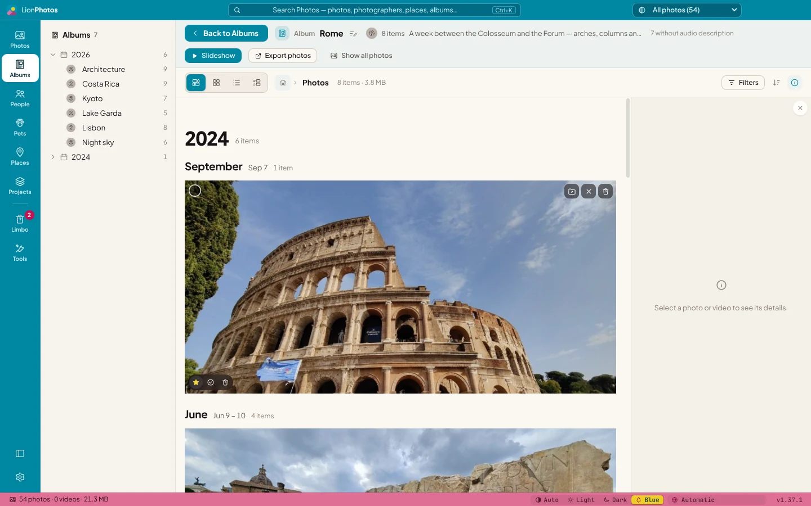

<div align="center">


# LionPhotos

### 지금까지 찍은 모든 사진을 몇 초 만에 찾으세요.

방대한 사진과 동영상 컬렉션을 지금 있는 그 자리에서 — 내장 디스크, 외장 드라이브, 클라우드 폴더 어디서든 — 보고, 찾고, 정리하세요. 빠르고, 사적이며, 무료입니다.

<sub><b>LionPhotos Team</b> 제작 · <b>Daniel Michelon De Carli</b> 기획 및 제작 · <a href="https://github.com/danielcarli/lionorganizer">LionOrganizer</a>의 자매 프로그램</sub>

[English](../README.md) · [Português (Brasil)](README.pt-BR.md) · [Português (Portugal)](README.pt-PT.md) · [Español](README.es.md) · [Français](README.fr.md) · [Deutsch](README.de.md) · [Italiano](README.it.md) · [简体中文](README.zh-CN.md) · [日本語](README.ja.md) · **한국어**

<p>
  <a href="https://github.com/danielcarli/lionphotos/releases/latest/download/LionPhotos-Setup.exe"></a>
  <a href="https://github.com/danielcarli/lionphotos/releases/latest/download/LionPhotos-mac-universal.dmg"></a>
  <a href="https://github.com/danielcarli/lionphotos/releases/latest/download/lionphotos_amd64.deb"></a>
  <a href="https://github.com/danielcarli/lionphotos/releases/latest/download/lionphotos.x86_64.rpm"></a>
  <a href="https://github.com/danielcarli/lionphotos/releases/latest/download/LionPhotos-x86_64.AppImage"></a>
</p>

<a href="https://github.com/danielcarli/lionphotos/releases/latest"></a>

<sub><a href="https://github.com/danielcarli/lionphotos/releases">모든 버전</a> · <a href="#다운로드">설치 방법</a></sub>


**가져오기 없음** · **컴퓨터 밖으로 나가는 것 없음** · **10만 장도 100장처럼 매끄럽게** · **무료 오픈 소스**


</div>

> **베타 테스트 중.** LionPhotos는 일상적으로 쓰기에 충분하며 약 15,000개의 사진과 동영상으로 이루어진 실제 컬렉션에서 테스트하고 있지만, 아직 베타입니다. 다듬어지지 않은 부분이 있을 수 있으니 컬렉션을 처음 재구성하기 전에 백업을 해 두세요. [여기서 베타의 의미](#베타-테스트).

**인상적인 기능 범위.** LionPhotos는 이미 Lightroom 라이브러리 모듈의 핵심(카탈로그, 표시, IPTC, RAW+JPEG, 비파괴 보정)과 Google 포토의 장점(인물, 반려동물, 내용 검색, 비슷한 사진 묶음)을 하나로 모았습니다. 여기에 보류함(Limbo), 자체 브랜드 플러그인, 10개 언어까지 갖추었습니다.

**실제 사용에서 출발했습니다.** 많은 기능이 사진을 찍는 사람들이 실제로 겪는 문제에서 나왔습니다: 느린 Google 드라이브, RAW+JPEG, 사진을 버리기 전 메타데이터 비교. 이렇게 만든 소프트웨어는 보기 좋을 뿐 아니라 쓸모가 있습니다.

**큰 컬렉션으로 테스트 중입니다.** LionPhotos는 USB 3.1 외장 드라이브에 있는 7만 장이 넘는 사진 컬렉션으로 테스트되고 있으며, 전체 컬렉션의 썸네일을 만드는 데는 시간이 더 걸리지만 인터페이스는 탐색하기 쉽고 부드럽게 유지됩니다.

## 실제 모습

사진 컬렉션은 정리하는 속도보다 빨리 늘어납니다. 여러 해의 촬영이 폴더와 외장 드라이브에 흩어져 있고, 같은 사진이 세 군데에 있고, RAW 파일은 대부분의 뷰어에서 열리지 않으며, 정리한 결과는 한 컴퓨터의 한 프로그램 안에 갇혀 있습니다. LionPhotos는 바로 이런 상황을 위해 만들어졌습니다.

### 폴더는 지금 그대로

> *"컬렉션을 여는 데 한참 걸려요."*

가져오기도, 사진 복사도 없습니다. LionPhotos는 폴더를 있는 그대로 탐색하고, 썸네일은 한 번만 만들며 파일이 바뀔 때만 다시 만듭니다. 10만 개 항목도 100개처럼 스크롤됩니다.

앨범, 인물, 표시, 설명, 보정, 자르기는 컬렉션 안의 숨김 폴더에도 저장되므로, 같은 외장 드라이브를 다른 컴퓨터에서 어떤 드라이브 문자로 연결해도 모두 그대로 열립니다.

<p align="center"><br><sub><b>목록</b> — 폴더, 종류, 크기, 용량, 날짜</sub></p>

### 어떤 사진이든 몇 초 만에

> *"그 사진을 못 찾겠어요."*

이름, 폴더, 카메라, 작성자, 설명, 앨범, 프로젝트, 인물, 반려동물, 장소로 검색합니다. 얼굴과 반려동물은 내 컴퓨터에서 인식되고, 장소는 GPS나 사진에 적힌 장소로 자동 채워집니다. 사진에 담긴 것으로도 찾을 수 있습니다. *해변*, *개*, *생일 파티*처럼 입력하세요.

<p align="center"><br><sub><b>검색</b> — 제목 표시줄에서 컬렉션 전체를</sub></p>

### 모든 여행을 세계 지도 위에

장소는 GPS나 사진에 적힌 지명으로 저절로 채워지고, 이 컴퓨터에서 그리는 세계 지도에 나타납니다. 핀을 누르면 그곳의 사진이 모여 있습니다.

<p align="center"><br><sub><b>장소</b> — 이 컴퓨터에서 그리는 세계 지도</sub></p>

### 거의 저절로 만들어지는 앨범

*앨범 추천*은 찍은 흐름대로 사진을 묶고 담긴 것—해변, 결혼식, 생일—으로 이름을 붙여 검토를 기다립니다. 앨범마다 표지, 설명, 기간이 있고 모자이크, 균등 그리드, 목록, 하이라이트로 열 수 있으며, 연필을 달면 *편집할 것* 목록에 들어갑니다.

<p align="center"> <br><sub><b>앨범</b> — 연도별 모자이크, 설명 포함 · <b>앨범 안</b> — 모자이크, 균일 그리드, 목록, 하이라이트</sub></p>

### 포트폴리오처럼, 가장 좋은 사진만

둘러보면서 `1`과 `2`로 최고와 괜찮은 사진을 표시하세요. *하이라이트*는 그 사진만 보여 줍니다 — 앨범, 사람, 장소, 프로젝트마다 한 줄, 고른 사진은 크게. 내 표시로 만든 포트폴리오 페이지입니다.

<p align="center"><br><sub><b>하이라이트</b> — 별표와 OK 사진만, 포트폴리오처럼</sub></p>

### 빠른 편집, 원본은 그대로

노출, 색, 흑백, 자르기, 수평 맞추기, 렌즈·원근 보정, RAW 현상 — 그래픽 카드에서 실시간으로. 모든 것은 카탈로그에 남고 파일은 바뀌지 않으며, `\`로 언제든 원본을 볼 수 있습니다.

<p align="center"> <br><sub><b>뷰어</b> — 편집 패널과 함께(흑백) · <b>렌즈 보정</b> — 원근을 수동으로 보정</sub></p>

### 모든 SNS에 바로

> *"납품해야 해요."*

빠른 편집과 소셜 네트워크별 자르기, 접근성을 위한 캡션과 음성 해설, 일관된 파일 이름과 원하는 메타데이터로 내보내기. 원본은 절대 바뀌지 않습니다.

<p align="center"> <br><sub><b>자르기</b> — Instagram, 스토리, YouTube 등 · <b>사진 내보내기</b> — 일관된 이름, SNS별 크기</sub></p>

### 모두를 위한 설명

제목, 캡션, 음성 해설, 작가와 장소를 사진 한 장이든 백 장이든 한 번에 — 입력하는 대로 저장되고, 다른 프로그램에서도 읽히며(IPTC, XMP), 요청할 때만 파일에 기록됩니다.

<p align="center"><br><sub><b>설명</b> — IPTC 메타데이터, 입력 즉시 저장</sub></p>

### 안심하고 공간 확보

> *"디스크가 필요 없는 것으로 가득해요."*

보면서 버릴 사진에 표시해 Limbo로 보내고, 내용이 같은 중복 파일을 찾으세요. 모든 삭제는 휴지통을 거치며, 영구 삭제되지 않습니다.

<p align="center"><br><sub><b>중복 파일</b> — 내용으로 찾기</sub></p>

### 디스크 정리 — 되돌리기 가능

> *"폴더가 엉망이에요."*

*컬렉션 재구성*이 폴더를 읽고 디스크에 명확한 구조(`2025/2025-12-24-크리스마스`, 주제, 분류 대기, 카메라 테스트)를 제안합니다. 무엇이든 옮기기 전에 검토할 수 있고, 모두 되돌릴 수 있습니다.

<p align="center"></p>

**사진을 다시 찾을 준비가 되셨나요?** Windows, macOS, Linux용 [LionPhotos 내려받기](#다운로드) — 무료, 계정 없음, 10개 언어.

## LionPhotos를 써야 하는 이유

- **폴더를 있는 그대로.** 가져오기도 닫힌 라이브러리도 없습니다. 사진은 둔 자리에 그대로 있고, 다른 프로그램도 계속 그대로 사용할 수 있습니다.
- **로컬이며 비공개.** 계정도 원격 측정도 없습니다. 새 버전 확인을 요청할 때만 인터넷에 연결합니다. 얼굴과 반려동물 인식도 내 컴퓨터에서 실행됩니다. 선택한 폴더와 그 하위 폴더만 읽습니다.
- **어떤 규모에서도 빠름.** 그리드는 화면에 보이는 부분만 그리고, 썸네일은 작고 하나의 캐시 파일에 보관되며 한 번만 만들어집니다. 외장 드라이브의 큰 컬렉션도 부드럽습니다.
- **모든 형식을 자체 디코더로.** JPEG, HEIC/HEIF, TIFF, PSD/PSB, 주요 제조사의 RAW(CR3, CR2, NEF, ARW, RAF, DNG…)와 동영상(MP4, MOV, MTS, AVI…).
- **설계부터 안전.** 파일을 바꾸는 모든 작업은 먼저 계획을 보여 주고, 3자리 코드를 직접 입력하게 하며, 되돌릴 수 있습니다. 삭제는 항상 휴지통으로 갑니다.
- **카탈로그가 사진과 함께 이동합니다.** 공개되고 문서화된 JSON 형식이라 다른 프로그램도 읽을 수 있습니다.
- **실제로 정리합니다.** 카탈로그의 앨범, 프로젝트, 인물, 반려동물, 장소는 물론, 원할 때는 디스크의 폴더와 파일 이름까지. 같은 촬영의 RAW, JPEG, 부속 파일은 항상 함께 다닙니다.
- **무료 오픈 소스**(MIT), Windows, macOS, Linux용, 10개 언어.

## 누구를 위한 것인가요

- **전문 및 아마추어 사진가**: 작업을 폴더와 외장 드라이브에 보관하고 RAW + JPEG로 촬영하며, 모든 것을 카탈로그로 가져오지 않고 정리하고 찾고 납품하고 싶은 분.
- **홍보팀, 편집국, 스튜디오**: 여러 컴퓨터와 사람이 컬렉션을 함께 쓰고, 일관된 파일 이름과 저작자 표시, 접근성 있는 설명이 필요하며, 프로젝트와 고객별로 작업을 정리하는 곳.
- **가족, 그리고 수년 치 휴대폰 사진이 있는 누구나**: 폴더에 흩어진 사진에서 사람, 장소, 순간을 다시 찾고 안전하게 공간을 확보하고 싶은 분.
- **개인정보를 중시하는 분**: 아무것도 업로드하지 않고, 계정도 없으며, 네트워크를 거치지 않습니다.

## LionPhotos는 무엇이고, 무엇이 아닌가요

LionPhotos는 **정리 도구이자 카탈로그**입니다. 주된 역할은 작업을 정리하고, 쉽고 접근하기 편하며 직관적인 카탈로그를 유지하는 것입니다. 사진을 찾고, 촬영분을 고르고, 앨범과 프로젝트를 만들고, 결과물을 전달합니다.

또한 대부분의 사진에 필요한 빠르고 가벼운 작업을 위한 **편집과 보정** 기능도 있습니다. 노출, 색, 흑백, 자르기와 수평 맞추기, 렌즈 보정, RAW 현상 등에서 이미 충분한 성능을 내며 결과가 빠릅니다.

**Lightroom, Photoshop 등 디지털 사진 현상 전용 편집기를 대체하는 것이 목적은 아닙니다**. 보정 레이어 작업, 부분 리터칭, 합성은 그런 더 전문적인 소프트웨어에 맡깁니다. LionPhotos는 사진을 그 프로그램에서 열고(*연결 프로그램*) 결과를 카탈로그로 다시 가져옵니다.

## 다운로드

사용하는 시스템의 설치 프로그램을 다운로드하세요. 링크는 항상 **최신 버전**을 가리키며, 모든 파일을 검증합니다(SHA-256과 서명된 빌드 출처 증명).

- **Windows 10/11**(x64, ARM): 앱 전체가 들어 있는 설치 프로그램(약 150MB). 설치 중에는 아무것도 내려받지 않고 몇 초면 끝납니다. → [`LionPhotos-Setup.exe`](https://github.com/danielcarli/lionphotos/releases/latest/download/LionPhotos-Setup.exe) · [ARM](https://github.com/danielcarli/lionphotos/releases/latest/download/LionPhotos-Setup-arm64.exe) · [설치 없이 쓰는 `.zip`](https://github.com/danielcarli/lionphotos/releases/latest/download/LionPhotos-win-x64.zip)
- **macOS 11+**(Apple 실리콘, Intel): `.dmg`를 열고 LionPhotos를 응용 프로그램으로 끌어 놓으세요. → [`LionPhotos-mac-universal.dmg`](https://github.com/danielcarli/lionphotos/releases/latest/download/LionPhotos-mac-universal.dmg)
- **Linux**(x64): Ubuntu, Debian, Mint 등은 `.deb`, Fedora, RHEL, openSUSE 등은 `.rpm`, 설치 없이 모든 배포판에서 쓰는 AppImage. → [`.deb`](https://github.com/danielcarli/lionphotos/releases/latest/download/lionphotos_amd64.deb) · [`.rpm`](https://github.com/danielcarli/lionphotos/releases/latest/download/lionphotos.x86_64.rpm) · [AppImage](https://github.com/danielcarli/lionphotos/releases/latest/download/LionPhotos-x86_64.AppImage)

> 설치 프로그램은 아직 유료 인증서로 서명되지 않았습니다. 처음 실행할 때 Windows는 "Windows의 PC 보호"를 표시할 수 있고(**추가 정보 › 실행**), macOS는 **시스템 설정 › 개인정보 보호 및 보안 › 그래도 열기**에서 앱을 허용하라고 요청합니다.

**터미널이 더 편하신가요?** macOS와 Linux:

```bash
curl -fsSL https://github.com/danielcarli/lionphotos/releases/latest/download/install.sh | bash
```

[모든 버전](https://github.com/danielcarli/lionphotos/releases) · [설치 안내](INSTALL.md)(영어): 자세한 내용, 안전 장치, 업데이트와 제거.

## 베타 테스트

LionPhotos는 **베타**입니다. 즉:

- 실제 컬렉션에서 매일 사용되고 모든 버전이 100개가 넘는 자동 엔드투엔드 검사를 통과하지만, 아직 다양한 컴퓨터와 컬렉션에서 많이 사용되지는 않았습니다.
- **일반 디스크의 큰 컬렉션으로 테스트 중:** USB 3.1 외장 하드디스크(SSD가 아닌 일반 HDD)에 있는 7만 개가 넘는 파일로 시험하고 있습니다. 이 테스트에서 성능은 만족스러운 수준입니다.
- 컬렉션을 처음으로 정리하거나 이름을 바꾸거나 재구성하기 전에 **백업해 두세요**(백업 탭에서 할 수 있습니다). 모든 작업은 되돌릴 수 있고 영구 삭제되는 것은 없지만, 백업이 가장 확실한 안전망입니다.
- 설치 프로그램은 아직 유료 인증서로 서명되지 않았습니다([다운로드](#다운로드) 참조).
- RAW 사진은 기본적으로 카메라가 안에 저장한 JPEG(8비트)에서 편집합니다. **현상 모드**(보정의 스위치)는 센서 데이터를 이 컴퓨터에서 LibRaw로 16비트 현상해 편집합니다. 새 기능이며 아직 조정 중입니다(색은 카메라나 Lightroom과 다릅니다). WebGL 2를 지원하는 그래픽 카드가 필요합니다.
- 문제를 발견했거나 제안이 있나요? 버전(상태 표시줄에 표시)과 한 작업을 적어 [issue](https://github.com/danielcarli/lionphotos/issues)를 열어 주세요. LionPhotos는 스스로 아무것도 보내지 않습니다.

## 기능

| | |
|---|---|
| **사진** | 월별 그리드 또는 폴더·종류·크기·용량·날짜·세부 정보가 있는 목록. 클릭, Ctrl, Shift로 선택, 확대/축소. 종류·연도·표시·카테고리·하위 폴더 필터는 칩으로 보이며 한 번 클릭으로 해제됩니다. 왼쪽에 폴더 트리(또는 연도), 오른쪽에 정보 패널 — 둘 다 숨길 수 있고, 집중 모드(`\`)에서는 모두 숨겨집니다. **제목 표시줄 검색**(Ctrl+K 또는 Ctrl+F)은 입력하는 동안 컬렉션 전체(사진, 앨범, 프로젝트, 인물, 장소, 촬영자, 카메라, 키워드, 폴더)를 찾고, 필터 때문에 아무것도 보이지 않으면 어떤 필터인지 알려 주며 하나씩 해제하는 버튼을 보여 줍니다. 앨범·인물·반려동물·장소·프로젝트 안에서는 모자이크, 균일 그리드, 목록, 하이라이트로 볼 수 있습니다. 격자 또는 목록, 크기, 순서는 **보기**에 있습니다. 사진을 선택하면 표시, 앨범, 비교, 내보내기, **더 보기**(오른쪽 클릭과 같은 메뉴, 디스크를 바꾸는 작업은 *파일* ▸), 마지막에 림보가 있는 띠가 나타납니다. |
| **뷰어** | 바로 원래 크기로(썸네일 먼저), RAW 파일은 카메라가 넣어 둔 JPEG로 원래 크기 표시, ← →로 이동, `I`로 정보, 실제 크기로 확대. 동영상은 컨트롤과 함께 재생됩니다. 확대/축소 슬라이더는 화면 맞춤부터 400%까지이며, 휠은 포인터 위치를 확대하고, 끌면 사진이 이동하며, `Z`는 화면 맞춤과 실제 크기를 전환합니다. *편집*(또는 `H`)은 정보 패널과 같은 편집 패널(분류, 앨범, 보정, 설명, 작가와 장소)을 표시하거나 접습니다. 필터 밖의 분류로 옮긴 사진은 그대로 보이며 이름이 회색으로 바뀌고 어디로 갔는지 알려 줍니다. HEIC, HEIF, HIF도 원래 크기로 열리며, HDR 사진(PQ, HLG)은 뷰어와 썸네일에서 일반 화면에 맞게 변환됩니다. 두 번 클릭하면 클릭한 곳을 100%로 확대하고 다시 두 번 클릭하면 돌아갑니다. Delete는 간단한 확인만으로 사진을 림보로 보냅니다. 패널은 한 번에 한 가지 작업(조정, 설명, 정보)을 보여 주며, 창 너비가 1680px 이상이면 왼쪽에 설명과 정보, 오른쪽에 조정을 표시합니다. 패널 가장자리를 드래그해 너비를 바꿀 수 있습니다. |
| **보정** | 정보 패널에서 노출, 대비, 그림자, 채도를 사진 한 장 또는 여러 장에, 히스토그램과 즉시 미리 보기로 조정(그래픽 카드, 없으면 프로세서 사용). 다른 사진에 복사해 붙여 넣을 수 있습니다. 파일은 절대 바뀌지 않으며 보정은 카탈로그에 저장되고(Ctrl+Z로 실행 취소), 썸네일과 뷰어에 반영됩니다(`\`를 누르고 있으면 원본). *편집 사본 저장*은 원본 옆에 메타데이터를 담은 새 JPEG를 씁니다. ‘사진 내보내기’(Ctrl+E)는 편집한 사진을 원하는 폴더에 새 파일로 만듭니다 — JPEG, PNG 또는 TIFF, 소셜 네트워크나 인화 크기, 출력 선명도, `2026-07-24-Joleop-Ana-Souza-001.jpg` 같은 이름, 모든 메타데이터 또는 위치 제외, 선택적 텍스트 서명 — sRGB 프로필 포함, 원본은 바뀌지 않습니다. |
| **편집** | 밝은 영역, 흰색·검정 계열, 화이트 밸런스(색온도, 색조, 스포이트), 활기, 색별 혼합 흑백, 비네팅, 그리고 그래픽 카드에서의 선명도·텍스처·부분 대비; *자동*, 사전 설정, 뷰어의 전후 비교(`Y`). **자르기 및 수평 맞추기**(`C`): 자유 또는 비율 고정 — 일반 비율과 소셜 네트워크 비율(Instagram 4:5·3:4, 스토리/릴스/TikTok 9:16, YouTube 16:9, 링크 1.91:1, Pinterest, X·LinkedIn 헤더) — 90° 회전, 지평선을 따라 선을 그어 수평 맞추기. 모든 것은 카탈로그에 남고 파일은 바뀌지 않습니다. |
| **렌즈 보정** | 렌즈의 왜곡, 어두운 모서리, 색수차를 프로필로 보정 — [Lensfun](https://lensfun.github.io) 전체 데이터베이스(렌즈 약 1,600개)에서 카메라가 기록한 이름으로 찾거나 검색 목록에서 선택 — 그리고 수동으로: 왜곡, 세로·가로 원근(뒤로 넘어가는 건물), 크기, 모서리, 색수차. 그래픽 카드에서 처리하며 파일은 바뀌지 않습니다. |
| **휴지통 기록** | 도구 › *휴지통 기록*(`Ctrl+5`)은 LionPhotos가 휴지통으로 보낸 모든 파일(시각, 파일, 크기, 출처: 림보·중복 파일·선택)을 나열하고 림보로 확보한 공간을 전체·이번 달·월별로 보여 줍니다. |
| **정보 패널** | 선택 항목의 모든 메타데이터, 분류, 속한 앨범, 인물, 반려동물, 장소, 프로젝트 — 그 자리에서 추가하거나 뺄 수 있습니다. |
| **설명과 메타데이터** | 헤드라인, 캡션, 화면 해설, 작가와 직함, 장소(세부 장소, 도시, 주/도, 국가), 키워드, 지침을 사진 한 장 또는 여러 장에 한 번에 입력 — 바뀌는 것은 카탈로그뿐입니다. 파일에 이미 있는 정보(EXIF, IPTC, XMP, RAW의 `.xmp`)는 힌트로 보이고 내보내기에 쓰입니다. *파일에 기록*(확인 코드 입력 필요)은 JPEG 자체에 기록하고 이전 버전은 휴지통으로, 다른 파일은 옆의 `.xmp`에 기록합니다. JPEG에는 같은 `.xmp`도 옆에 기록해, 보낼 때 데이터가 사진과 함께 가고 옆에서도 읽을 수 있습니다. 모든 변경은 실행 취소(Ctrl+Z)와 다시 실행(Ctrl+Shift+Z)이 가능하며, 파일 기록은 알림이나 최근 작업에서 실행 취소하면 파일이 바이트 단위로 원래대로 돌아갑니다. **`.xmp` 파일과 동기화**(백업 페이지에서 입력 코드로 켬): LionPhotos에서 쓴 내용(설명, 장소, 키워드, 별점으로서의 표시)은 각 사진 옆의 `.xmp`에 자동으로 기록되고, Lightroom, digiKam, darktable이 거기에 쓴 내용은 돌아옵니다. 양쪽에서 변경된 항목은 직접 선택할 때까지 기다립니다. 사이드카에서는 LionPhotos가 아는 항목만 변경하며, 사진 자체는 절대 건드리지 않습니다. |
| **앨범** | 표지, 설명, 기간. 어떤 선택이든 *앨범에 추가…*, *앨범에서 빼기*, *표지로 사용*. **폴더로 앨범 만들기**(첫 번째 단계, 사진이 있는 폴더, 또는 직접 선택) — 폴더 전체와 연결됩니다. 전체 화면 슬라이드쇼. **앨범 제안**: 찍은 흐름대로 사진을 묶고 폴더, 사진 내용(이 컴퓨터에서 썸네일로 읽음: 해변, 산, 케이크, 웨딩드레스, 음식…), 날짜로 아는 명절, 장소, 인물로 이름을 붙입니다. 여러 해에 걸친 주제 앨범도 제안하며, 만들기 전에 검토합니다. **두 앨범 합치기**(두 앨범의 사진을 정한 이름으로. 카탈로그만 바뀌며 실행 취소 가능). 모자이크, 균일한 격자(모든 표지가 같은 크기), 목록, 하이라이트로 볼 수 있습니다. |
| **프로젝트, 인물, 반려동물, 장소** | 각각 전용 탭에서 격자 또는 연도별 목록으로. 열면 해당 탭 아래에 사진이 나오고, 클릭 한 번으로 사진을 뺄 수 있습니다. 폴더의 라벨은 그 안의 모든 항목에 적용됩니다. 프로젝트는 여러 앨범을 묶으며, 정보 카드(상태, 의뢰처, 장소, 팀, 마감일)와 진행 패널(분류됨, 편집됨, 앨범에 고른 사진, 음성 해설)을 갖습니다. 장소는 사진(GPS 위치나 사진에 적힌 장소)에서 자동으로 채워지고, 이 컴퓨터에서 그리는 **세계 지도**에 표시됩니다. |
| **편집 대기** | 앨범이나 프로젝트 표지의 연필을 누르면 **편집 대기** 탭(Ctrl+Shift+E)에 들어갑니다. 할 순서대로 놓인 목록으로, 행을 끌거나 화살표 또는 Alt+↑ ↓로 먼저 할 일을 맨 앞에 둡니다. 목록에서의 순서가 표지에 표시되고, 프로젝트는 마감일(지나면 빨간색)도 보여 주며, ‘완료’로 연필을 뗍니다. 카탈로그만 바뀌고, 목록은 컬렉션과 함께 옮겨 갑니다. |
| **이름과 로고** | ‘설정 › 이름과 로고’에서 자신의 이름과 로고(기관, 스튜디오, 강좌 등)를 제목 표시줄, 시작 화면, 창 제목에 미리 보기와 함께 넣습니다. 자신의 이름 옆에는 항상 **Powered by LionPhotos**가 표시되고, ‘정보’의 크레딧은 그대로입니다. 로고(PNG, JPG, WebP, SVG)는 정사각형 안에 전체가 들어갑니다. ‘LionPhotos로 되돌리기’로 되돌립니다. 이 컴퓨터에 저장됩니다. 플러그인도 켜져 있는 동안 이름과 로고를 정할 수 있습니다(`plugin.json`의 `brand`). 직접 정한 것이 우선합니다. |
| **얼굴과 반려동물** | 얼굴은 face-api(TensorFlow.js), 동물은 COCO-SSD와 MobileNet을 그래픽 카드(WebGL)에서 사용합니다. 비슷한 얼굴 그룹, 확인하거나 거절하는 제안, "이 사람 아님" 기억. 기본값은 꺼짐. *지금 색인* 또는 검사할 때마다 실행. |
| **표시와 림보** | 아주 좋음, 괜찮음, 삭제 후보 — 썸네일, 목록, 뷰어, 정보 패널에서. 키 `1` `2` `3` `0`. 림보는 모든 삭제 후보와 차지하는 공간을 보여 주고, 한 번에 휴지통으로 보냅니다. **하이라이트**: 앨범, 인물, 반려동물, 프로젝트를 별표나 OK로 표시한 사진만으로 한 줄에 하나씩(큰 이름과 크게 고른 사진 한 장) 포트폴리오 페이지처럼 보여 줍니다. 장소도 지원하며, 각 항목 안에서도 고른 사진을 한 줄에 한 장씩 크게 볼 수 있습니다. |
| **연결 프로그램** | 선택한 파일에 쓸 수 있는 컴퓨터의 사진·동영상 프로그램(Photoshop, Lightroom Classic, Bridge, Premiere Pro, Capture One, DxO PhotoLab, Affinity, darktable, GIMP, VLC…), 최근에 쓴 것이 먼저. Windows에서는 해당 파일 형식에 등록된 모든 프로그램도 표시. |
| **플러그인** | `.lionplugin` 패키지를 설치해 앨범과 프로젝트를 파일 이름, 설명, 화면 해설이 담긴 페이지(HTML, CSS, JavaScript)로 내보냅니다. LionPhotos 안에서는 아무것도 실행되지 않습니다. [PLUGINS.md](PLUGINS.md)(영어) 참고. 켜 둔 플러그인은 편집 대기 다음에 자기 탭이 생기고, 그 페이지에서 앨범과 프로젝트를 골라 내보낼 수 있습니다. |
| **개요** | 항목, 사진, 동영상, 용량, 기간. 종류별, 연도별, 형식, 카메라, 코덱별 파일. 썸네일 캐시. |
| **정리** | 날짜 폴더(`2024/2024-07`, `2024-07`, `2024`, `2024/2024-07-14` 또는 `2024-07-14-주제`), 앨범별 폴더(`2024/2024-07-14-앨범`), 원하면 안에 `Raw/`와 `Img/`; 종류별 하위 폴더가 있는 *폴더로 이동*; 같은 촬영의 파일도 함께 이동; 되돌릴 수 있는 최근 작업. 파일은 디스크에서 실제로 옮겨지며 **이름 바꾸기**도 됩니다(기본 `{data}-{álbum}-{fotógrafo}-{nº}`, 날짜순 번호; 같은 사진의 RAW, JPEG, `.xmp`는 같은 이름 유지). 제자리에서 이름만 바꿀 수도 있습니다. **컬렉션 다시 정리**는 지금의 폴더를 읽고 디스크에 하나의 구조를 제안합니다 — `2025/2025-12-24-크리스마스`, 긴 주제는 `주제/`, 정리 대기는 `_정리대기/`, 카메라 테스트는 `_장비/` — 폴더마다 이름을 바꾸거나 제외하고 정리 후 트리를 확인한 뒤 폴더 전체를 옮기며, 실행 취소할 수 있습니다. **남겨진 관련 파일**(사진을 옮긴 뒤 홀로 남은 `.xmp`, `.dop`)을 사진 옆으로 돌려놓고 사진과 같은 이름을 붙입니다. **복제**(Ctrl+D): 조정, 자르기, 표시, 앨범을 그대로 가진 사본을 사진 옆에 만듭니다(확인 코드 입력, 실행 취소 가능). 날짜 폴더와 *이동*은 선택한 사진에만 적용됩니다. 컬렉션 전체에는 **다시 정리**라는 하나의 길이 있고, 무엇이든 옮기기 전에 검토합니다. 날짜 폴더가 이벤트 폴더를 월 폴더로 비우게 되면 LionPhotos가 먼저 묻고 다시 정리를 권합니다. |
| **중복 파일** | 3단계 SHA-256(크기 → 처음/마지막 64 KB → 파일 전체), 썸네일과 나란히 표시. 각 사본은 저장된 폴더를 보여 주고, LionPhotos나 컴퓨터의 프로그램에서 열거나, 폴더에서 보거나, 경로를 복사할 수 있습니다. *나란히 비교*는 남길 사본을 다른 사본 옆에 둡니다(동영상은 컴퓨터의 프로그램에서 열림). 다른 사본을 고르면 순서는 그대로이고 표시만 옮겨집니다. |
| **비슷한 사진** | 날마다 사실상 같은 사진(연속 촬영, 같은 포즈 여러 장)을 썸네일로 컴퓨터에서 묶고, 가장 선명하고 노출이 좋은 사진을 남길 후보로 제안합니다. 클릭으로 사진마다 남기기/보내기를 바꾸고, 나머지는 함께 보류함으로 보냅니다. RAW와 JPG는 한 장으로 다룹니다. 세 단계: 거의 같음, 비슷함, 같은 장면. 사진 막대의 *앨범에 없는 사진만* 옆에서도: 표시된 사진(폴더, 연도, 앨범)을 여러 날에 걸쳐 묶습니다. |
| **사진에 담긴 것으로 검색** | *해변*, *개*, *생일 파티*, *일몰*처럼 입력하면 파일 이름과 상관없이 그것이 담긴 사진을 찾습니다. 작은 모델(TinyCLIP, MIT)이 “사진에 담긴 것”을 분석하는 동안 각 썸네일을 컴퓨터에서 프로세서로 읽고, 앱의 10개 언어로 이름이 붙은 605가지 장면·행사·사물·장소와 비교합니다. 정보 패널에 사진에 담긴 것이 표시되며, 각 이름을 누르면 그것으로 검색합니다. 아무것도 내려받거나 보내지 않습니다. |
| **백업** | 마스터 폴더와 백업 폴더를 내용으로 비교. 빠진 것을 검증된 사본으로 같은 하위 폴더나 날짜 폴더에 복사. |
| **변환** | HEIC/HEIF → 원본 해상도 JPG 또는 PNG, EXIF와 색상 프로필 유지, 원본 옆에 저장. |
| **형식** | 사진: JPEG, PNG, GIF, WebP, AVIF, BMP, HEIC/HEIF, TIFF, PSD/PSB, 카메라 RAW(CR3, CR2, NEF, NRW, ARW, SR2, ORF, RW2, RAF, SRW, PEF, DNG, 3FR, IIQ, ERF, RWL). 동영상: MP4, MOV, M4V, 3GP, WebM, MKV, MTS/M2TS, AVI. |
| **10개 언어** | English, Português (Brasil), Português (Portugal), Español, Français, Deutsch, Italiano, 简体中文, 日本語, 한국어 — 시스템에서 감지하며 상태 표시줄에서 바꿀 수 있습니다. |
| **테마** | 수박(로고의 청록색, 분홍, 흰색), 시티 블루(도시 계획도 같은 코발트, 코랄, 흰색 — 기본값), 밝게, 어둡게, 자동. |

## 안전이 먼저

LionOrganizer와 같은 규칙입니다.

- **직접 입력하는 확인 코드.** 파일을 바꾸는 모든 작업(휴지통, 정리, 이동, 이름 바꾸기, 변환, 되돌리기, 캐시 지우기)은 3글자 코드를 보여 주며, 이를 **직접 입력**해야 합니다(붙여넣기 불가). 코드는 메인 프로세스가 만들고 확인하며, 다섯 번 틀리면 취소됩니다.
- **영구 삭제가 아닌 휴지통으로.**
- **제한된 범위.** 인터페이스는 열린 폴더의 라이브러리 ID로만 파일에 접근하고, 경로는 쓰지 않습니다.
- **기본은 읽기 전용.** 둘러보기, 메타데이터, 썸네일, 미리보기, 중복 확인, "연결 프로그램"은 파일을 절대 바꾸지 않습니다. 앨범, 라벨, 표시, 얼굴은 LionPhotos 자체 카탈로그만 바꿉니다. 유일한 예외: 사진에 한 작업은 컬렉션 안의 숨김 폴더 `.lionphotos`에도 JSON으로 기록됩니다(무언가를 한 뒤에만, 백업에서 끌 수 있음).

## 키보드 단축키

| 단축키 | 동작 |
|---|---|
| `Ctrl+O` | 폴더 열기 |
| `F5` | 새 파일과 바뀐 파일 찾기 |
| `Ctrl+K` · `Ctrl+F` | 컬렉션 전체 검색(제목 표시줄) |
| `Ctrl+1` · `Ctrl+Shift+A` | 사진 · 앨범 |
| `Ctrl+Shift+E` | 편집 대기 |
| `Ctrl+6` … `Ctrl+9` | 프로젝트 · 인물 · 반려동물 · 장소 |
| `Ctrl+L` | 림보 |
| `Ctrl+2` · `Ctrl+3` · `Ctrl+4` · `Ctrl+0` | 개요 · 중복 파일 · 정리 · 백업 |
| `Alt+←` · `Alt+Home` | 앨범, 프로젝트, 인물에서 돌아가기 · 필터 없이 컬렉션 전체 |
| `Ctrl+B` · `\` | 사이드바 표시/숨기기 · 집중 모드(사진만) |
| `1` `2` `3` · `0` | 선택 항목을 아주 좋음 · 괜찮음 · 삭제 후보로 표시 · 표시 지우기 |
| `Ctrl+A` · `Enter` · `H` · `Delete` · `F2` · `Esc` | 모두 선택 · 열기 · 정보 패널 · 휴지통 · 이름 바꾸기 · 선택 해제 |
| `E` · `D` · `I` | 사이드 패널을 조정 · 설명 · 정보로 전환(같은 키를 다시 누르면 접힘) |
| `Ctrl+G` · `Ctrl+Shift+G` | 선택 항목 스택 · 해제 |
| `V` · `?` | 나란히 비교 · 키보드 단축키 |
| `Ctrl+E` | 사진 내보내기 (선택한 사진 또는 표시된 사진) |
| `←` `→` · `Space` · `Esc` | 뷰어: 이전/다음 · 재생/일시 정지 · 닫기 |
| `↑` `↓` · `B` | 뷰어: 스택의 사진(아래 띠): 다음/이전 · 최고로 지정 |
| `P` · `F` · `A` | 뷰어: 슬라이드쇼 · 전체 화면 · 앨범에 추가 |

## 언어

| 언어 | 코드 | | 언어 | 코드 |
|---|---|---|---|---|
| English | `en` | | Deutsch | `de` |
| Português (Brasil) | `pt-BR` | | Italiano | `it` |
| Português (Portugal) | `pt-PT` | | 简体中文 | `zh-CN` |
| Español | `es` | | 日本語 | `ja` |
| Français | `fr` | | 한국어 | `ko` |

언어는 기본적으로 시스템을 따르며 상태 표시줄에서 바꿀 수 있습니다. 숫자와 날짜는 선택한 언어 형식을 따릅니다. 텍스트 카탈로그는 `tools/nls/*.py`에서 `src/nls/*.json`으로 생성됩니다.

## 개인정보

LionPhotos는 요청할 때만 네트워크에 연결합니다. 오른쪽 아래의 버전을 클릭하면 GitHub에서 새 버전을 확인하고, 업데이트하면 시스템용 설치 프로그램을 내려받아 사용하기 전에 검증(SHA-256)합니다. 계정도, 원격 측정도 없으며 사용자나 사진에 관한 정보는 전송되지 않습니다. 얼굴과 반려동물 인식은 앱에 포함된 모델로 이 컴퓨터에서 실행됩니다.

카탈로그와 썸네일은 컴퓨터의 파일 하나에 들어 있습니다.

```
%APPDATA%\LionPhotos\library.sqlite
```

*개요 › 캐시 지우기*로 썸네일을 지울 수 있습니다. 사진은 전혀 건드리지 않습니다.

## 시작하기

### 소스에서 실행(Windows)

1. [Node.js LTS](https://nodejs.org)를 설치합니다.
2. 이 저장소를 다운로드하거나 복제합니다.
3. **`start.bat`**을 두 번 클릭합니다 — 처음 실행할 때 의존성을 설치합니다.

또는 터미널에서:

```powershell
npm install
npm start
```

### 설치 프로그램 만들기

**`build-installer.bat`**을 두 번 클릭합니다(또는 `npm run dist`). 설치 프로그램은 `dist/`에 만들어집니다. 공개 버전은 `vX.Y.Z` 태그를 푸시하면 GitHub Actions가 빌드합니다.

## 썸네일이 빠른 이유

1. **검사** — 선택한 폴더와 하위 폴더만, `readdir` + `stat`만 사용합니다. 목록을 만들려고 파일 내용을 여는 일은 없습니다. 파일 2만 개에 약 1초가 걸립니다.
2. **유효성** — 썸네일은 원본 파일의 크기, 수정 날짜와 함께 저장되며, 둘이 같으면 다시 사용합니다. 앱 밖에서 옮기거나 이름을 바꾼 파일도 썸네일을 유지합니다.
3. **순서** — 화면에 보이는 것이 먼저, 나머지는 최신순. 미리보기 동영상은 모든 썸네일이 끝난 뒤에 만듭니다.
4. **엔진** — 우선순위가 낮은 숨겨진 페이지가 LionPhotos 자체 코드로 모든 것을 디코딩합니다. 이미지는 Web Worker, RAW 파일은 내장 JPEG 미리보기, TIFF와 PSD는 n줄마다 한 줄만 읽고, HEIC는 WebAssembly용 libheif, 동영상은 WebCodecs. 운영체제의 썸네일 기능은 호출하지 않습니다.
5. **저장** — 320 px WebP 썸네일(8–25 KB)을 SQLite 파일 하나에 저장하며, 남는 파일이 없습니다.

## 아키텍처

[LionOrganizer](https://github.com/danielcarli/lionorganizer), [Visual Studio Code](https://github.com/microsoft/vscode)와 같은 계층 구조입니다. `base`는 상위 계층을 모르고, `platform`은 메인 프로세스 서비스를 제공하며, `workbench`가 인터페이스를 만듭니다. 샌드박스된 인터페이스는 `preload` 브리지를 통해서만 메인 프로세스와 통신합니다.

```
src/
  base/            이벤트, 서식, i18n, DOM 도우미, 아이콘, 차트
  platform/
    library/       SQLite 카탈로그, 폴더 검사, 메타데이터 읽기(EXIF: JPEG, raw, HEIC, AVIF; PNG, MP4/MOV, Matroska)
    thumbs/        썸네일·미리보기 엔진 + 숨겨진 페이지(워커, WebM 먹서)
    media/         lionthumb:// 및 lionmedia://(라이브러리 ID 기준, 바이트 범위 지원)
    faces/         얼굴·반려동물 인식(그래픽 카드의 숨겨진 페이지, 메인 프로세스의 인물 대조)
    labels/        앨범, 프로젝트, 인물, 반려동물, 장소, 개인/업무
    operations/    코드 입력이 필요한 작업: 휴지통, 정리, 이동, 이름 바꾸기, 되돌리기, 캐시 지우기
    openWith/      컴퓨터의 사진·동영상 프로그램
    duplicates/    SHA-256 검색(LionOrganizer와 공유)
  code/            electron-main 진입점, preload 브리지
  nls/             en.json … ko.json(tools/nls에서 생성)
  workbench/       레이아웃 부품, 서비스, 화면
```

보안: `contextIsolation`과 `sandbox` 사용, `nodeIntegration` 미사용, 엄격한 Content Security Policy, 그리고 파일을 바꾸는 모든 요청은 메인 프로세스에서 검증합니다.

## 개발

| 명령 | 하는 일 |
|---|---|
| `npm start` | 앱 실행 |
| `npm run dist` | 설치 프로그램 만들기 |
| `npm run test:e2e` | **버려도 되는** 폴더에서 종단 간 테스트(`npm run fixtures`로 생성) |
| `npm run test:i18n` | 사용하는 모든 키가 있는지, 모든 언어가 완전한지, 자리 표시자가 맞는지 |
| `npm run test:faces` | 합성 얼굴로 인물 대조 테스트 |
| `npm run test:openwith` | "연결 프로그램": Windows 레지스트리, `.desktop` 파일, 실행 |
| `npm run test:plugins` | Plugins |
| `npm run nls` | `tools/nls/*.py`에서 `src/nls/*.json` 생성 |
| `npm run release:assets` | 설치 프로그램이 쓰는 배포 파일을 `dist-release/`에 생성 |

```powershell
# 종단 간 테스트는 파일을 바꿉니다: 반드시 버려도 되는 사본을 지정하세요
$env:LIONPHOTOS_FOLDER="C:\temp\photos-copy"; npm run test:e2e
```

## 변경 내역

[CHANGELOG.md](../CHANGELOG.md)(영어)를 참고하세요. 현재 버전: **1.82.0**.

## 만든 사람들

LionPhotos는 건축·도시계획을 공부하는 **Daniel Michelon De Carli가 기획하고 만들었으며**, **LionPhotos Team**이 기여자, 번역자와 함께 유지 관리합니다.

## 라이선스

Copyright © 2026 LionPhotos Team.

LionPhotos는 **[MIT 라이선스](../LICENSE)**의 오픈 소스입니다. 저작권 고지를 유지하면 자유롭게 사용, 복사, 수정, 배포할 수 있습니다. **"있는 그대로" 제공되며 어떠한 보증도 없습니다**.

포함된 서드파티 구성 요소는 각자의 라이선스를 따릅니다.

| 구성 요소 | 라이선스 | 위치 |
|---|---|---|
| [libheif](https://github.com/strukturag/libheif)와 libde265([libheif-js](https://github.com/catdad-experiments/libheif-js)의 WebAssembly 빌드) | GNU LGPL v3, 수정 없음 | `src/platform/thumbs/electron-sandbox/vendor/libheif` |
| [face-api](https://github.com/vladmandic/face-api)와 TensorFlow.js, 얼굴 모델 | MIT | `src/platform/faces/electron-sandbox/vendor/face-api` |
| [COCO-SSD와 MobileNet](https://github.com/tensorflow/tfjs-models) 모델 | Apache 2.0 | `src/platform/faces/electron-sandbox/vendor/pets` |
| [ONNX Runtime Web](https://github.com/microsoft/onnxruntime) 1.22 and the [TinyCLIP ViT-61M/32](https://huggingface.co/wkcn/TinyCLIP-ViT-61M-32-Text-29M-LAION400M) model (Microsoft; built by `tools/models/build.py`) | MIT · MIT | `src/platform/faces/electron-sandbox/vendor/onnxruntime-web` · `models/tinyclip` |
| [Natural Earth](https://www.naturalearthdata.com) 국경과 국가 이름(1:50m) | 퍼블릭 도메인 | `src/platform/geo` |
| [GeoNames](https://www.geonames.org) — cities15000 | CC BY 4.0 | `src/platform/geo/node/cities.json` |
| [LibRaw](https://www.libraw.org) 0.22 (raw development), in WebAssembly via [libraw-wasm](https://github.com/colorhythm/libraw-wasm) and [typed-cstruct](https://github.com/ssssota/typed-cstruct) | LGPL-2.1 or CDDL-1.0 · MIT · MIT | `src/platform/raw/electron-sandbox/vendor` |
| [Lensfun](https://lensfun.github.io) lens database (lens correction profiles), converted by `tools/lensfun/build.py` | CC BY-SA 3.0 (data only; none of Lensfun’s code) | `src/workbench/services/adjust/common/lensfun.json` |
| [Plus Jakarta Sans](https://github.com/tokotype/PlusJakartaSans), [JetBrains Mono](https://github.com/JetBrains/JetBrainsMono) | SIL Open Font License 1.1 | 글꼴 |

## 스크린샷의 사진

스크린샷의 사진은 [WordPress Photo Directory](https://wordpress.org/photos/)에서 가져온 퍼블릭 도메인([CC0](https://creativecommons.org/publicdomain/zero/1.0/)) 사진입니다. 저작자 표시는 필요하지 않지만 감사의 뜻으로 여기에 밝힙니다. 설명·카메라·날짜는 촬영자의 것이며, 지도의 장소는 시연을 위해 추가했습니다.

- **로마:** [Isabel Gutierrez](https://wordpress.org/photos/photo/53469e1c45/), [salsel](https://wordpress.org/photos/photo/2456557419/), [Jupa](https://wordpress.org/photos/photo/3816aaf093/), Bigul Malayi ([1](https://wordpress.org/photos/photo/17168efb07/), [2](https://wordpress.org/photos/photo/616857a90c/), [3](https://wordpress.org/photos/photo/33768dc862/), [4](https://wordpress.org/photos/photo/42268dc85f/)), [karolishostinger](https://wordpress.org/photos/photo/35766e9c63/)
- **리스본:** [Isabel Gutierrez](https://wordpress.org/photos/photo/35669e1d6f/), [MelissaH](https://wordpress.org/photos/photo/31968ae275/), KafleG ([1](https://wordpress.org/photos/photo/687685d279/), [2](https://wordpress.org/photos/photo/852685d283/), [3](https://wordpress.org/photos/photo/468685d28f/), [4](https://wordpress.org/photos/photo/667685d2c4/), [5](https://wordpress.org/photos/photo/501685d2ca/)), [Jeff Golenski](https://wordpress.org/photos/photo/3016a7fb59/)
- **코스타리카:** [Harlyn Luna Brenes](https://wordpress.org/photos/photo/626af3dce8/), [Francisco Herrera](https://wordpress.org/photos/photo/18764e77d3/), wenmirandav ([1](https://wordpress.org/photos/photo/2786aefef5/), [2](https://wordpress.org/photos/photo/2776aefeba/), [3](https://wordpress.org/photos/photo/2016aeffe6/)), [alexandrachacaltana2303](https://wordpress.org/photos/photo/3846aeeac8/), [dmoreno2003](https://wordpress.org/photos/photo/4466af376b/), [dangrijal](https://wordpress.org/photos/photo/3516af7648/), [xbullscm](https://wordpress.org/photos/photo/7066af7fae/)
- **가르다 호수:** xbullscm ([1](https://wordpress.org/photos/photo/836af4b8d6/), [2](https://wordpress.org/photos/photo/716af4b7c7/), [3](https://wordpress.org/photos/photo/1046af4b83/), [4](https://wordpress.org/photos/photo/8286af4b88/), [5](https://wordpress.org/photos/photo/3966af4b78/))
- **건축:** Joel Peralta ([1](https://wordpress.org/photos/photo/9656a6d336/), [2](https://wordpress.org/photos/photo/1866a70aeb/), [3](https://wordpress.org/photos/photo/8766a7044c/), [4](https://wordpress.org/photos/photo/9866a6d32f/), [5](https://wordpress.org/photos/photo/766a2f39b8/)), [Silvia Fernanda Marin Giraldo](https://wordpress.org/photos/photo/1656a972f2/), [dumanag](https://wordpress.org/photos/photo/7806a66cad/), [Manjil Aryal](https://wordpress.org/photos/photo/416a282c7f/), [Anup Kankale](https://wordpress.org/photos/photo/966a390efb/)
- **밤하늘:** [shirishpoudel07](https://wordpress.org/photos/photo/8606a28c17/), Jeff Golenski ([1](https://wordpress.org/photos/photo/544620fdb6/), [2](https://wordpress.org/photos/photo/92361d465c/)), [vanessartavia](https://wordpress.org/photos/photo/3036ae9774/), [Natcha Boonroj](https://wordpress.org/photos/photo/512693d15a/), [Faisal Ahammad](https://wordpress.org/photos/photo/816ae8da24/)
- **교토:** [Maruti Mohanty](https://wordpress.org/photos/photo/4746570441/), [Timi Wahalahti](https://wordpress.org/photos/photo/14766bbb55/), Wajari Velasquez ([1](https://wordpress.org/photos/photo/506a214832/), [2](https://wordpress.org/photos/photo/5236a216f0/), [3](https://wordpress.org/photos/photo/8366a216e4/), [4](https://wordpress.org/photos/photo/8976a21449/), [5](https://wordpress.org/photos/photo/296a2182a4/))
