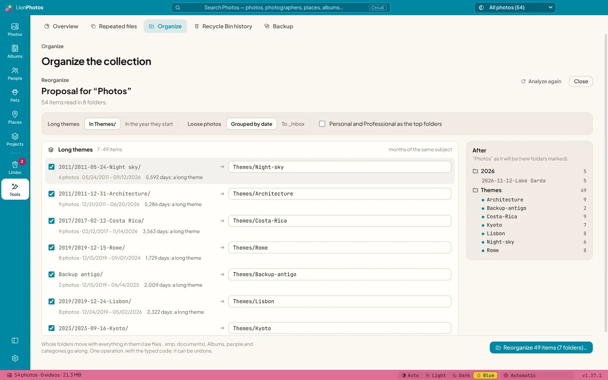
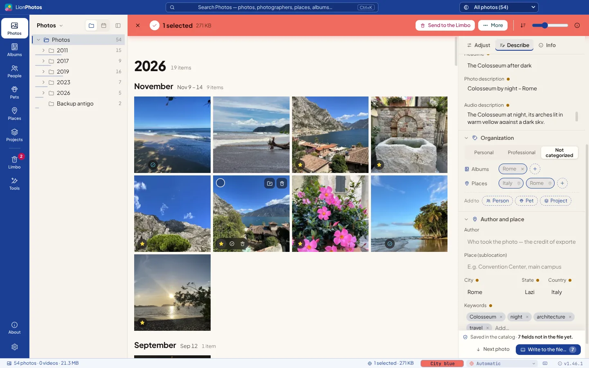

<div align="center">


# LionPhotos

**Navegue, pesquise e organize coleções de fotos e vídeos — com rapidez.**<br>
Trabalha com as suas pastas como elas são: miniaturas pequenas feitas uma vez, os metadados que importam e ferramentas seguras de organização.

<sub>pela <b>LionPhotos Team</b> · criado e idealizado por <b>Daniel Michelon De Carli</b> · irmão do <a href="https://github.com/danielcarli/lionorganizer">LionOrganizer</a></sub>

[English](../README.md) · **Português (Brasil)** · [Português (Portugal)](README.pt-PT.md) · [Español](README.es.md) · [Français](README.fr.md) · [Deutsch](README.de.md) · [Italiano](README.it.md) · [简体中文](README.zh-CN.md) · [日本語](README.ja.md) · [한국어](README.ko.md)


<p>
  <a href="https://github.com/danielcarli/lionphotos/releases/latest/download/LionPhotos-Setup.exe"></a>
  <a href="https://github.com/danielcarli/lionphotos/releases/latest/download/LionPhotos-mac-universal.dmg"></a>
  <a href="https://github.com/danielcarli/lionphotos/releases/latest/download/lionphotos_amd64.deb"></a>
  <a href="https://github.com/danielcarli/lionphotos/releases/latest/download/lionphotos.x86_64.rpm"></a>
  <a href="https://github.com/danielcarli/lionphotos/releases/latest/download/LionPhotos-x86_64.AppImage"></a>
</p>

<sub><a href="https://github.com/danielcarli/lionphotos/releases">Todas as versões</a> · <a href="#baixar">Como instalar</a></sub>


</div>

> **Teste beta.** O LionPhotos já serve para o uso diário e é testado numa coleção real de cerca de 15 mil fotos e vídeos, mas ainda está em beta: podem aparecer arestas, e é bom ter um backup da coleção antes de reorganizá-la pela primeira vez. [O que beta quer dizer aqui](#teste-beta).

## O que ele resolve

Coleções de fotos crescem mais rápido do que dá para organizar: anos de trabalhos espalhados em pastas e HDs externos, a mesma foto em três lugares, arquivos RAW que a maioria dos visualizadores não abre, e o trabalho de organizar preso num programa só, num computador só. O LionPhotos foi feito para essa situação:

- **"Não acho aquela foto."** Busca por nome, pasta, câmera, autor, descrição, álbum, projeto, pessoa, pet ou lugar. Rostos e pets são reconhecidos no seu computador, e os lugares se preenchem sozinhos pelo GPS ou pelo lugar escrito na foto.
- **"Abrir a coleção demora uma eternidade."** Sem importar e sem copiar suas fotos: o LionPhotos navega pelas pastas como elas estão, faz cada miniatura uma vez e só refaz quando o arquivo muda. 100 mil itens rolam como 100.
- **"Minhas pastas estão uma bagunça."** *Reorganizar a coleção* lê as pastas e propõe uma estrutura clara no disco (`2025/2025-12-24-Natal`, temas, uma entrada para triagem, testes de câmera), para revisar antes de qualquer coisa sair do lugar — e tudo pode ser desfeito.
- **"O disco está cheio de coisa que não preciso."** Marque os descartes enquanto olha e mande para o Limbo; ache arquivos repetidos pelo conteúdo. Tudo sai pela Lixeira, nunca apagado de vez.
- **"Meu trabalho fica preso num computador."** Álbuns, pessoas, marcações, descrições, ajustes e recortes também ficam numa pasta oculta dentro da coleção, e o mesmo HD externo abre com tudo isso em outro computador, com qualquer letra de unidade.
- **"Preciso entregar."** Edição rápida e recortes para cada rede social, legendas e audiodescrição para acessibilidade, e exportação com nomes de arquivo padronizados e os metadados que você escolher. Os originais nunca mudam.

## Para quem é

- **Fotógrafos profissionais e amadores** que guardam o trabalho em pastas e HDs externos, fotografam em RAW + JPEG e querem organizar, achar e entregar sem importar tudo para um catálogo.
- **Equipes de comunicação, redações e estúdios** que dividem uma coleção entre computadores e pessoas, precisam de nomes, autoria e descrições acessíveis padronizados e organizam o trabalho por projeto e cliente.
- **Famílias e qualquer pessoa com anos de fotos do celular** espalhadas em pastas, que quer reencontrar pessoas, lugares e momentos e liberar espaço com segurança.
- **Quem se preocupa com privacidade:** nada é enviado, não há conta e nada passa pela internet.

## Pontos fortes

- **Suas pastas, como estão.** Sem importação e sem biblioteca fechada: as fotos ficam onde você as colocou, e seus outros programas continuam funcionando com elas.
- **Local e privado.** Sem conta, sem telemetria; ele só vai à internet quando você pede para procurar uma nova versão. O reconhecimento de rostos e pets roda no seu computador. Ele lê só a pasta que você escolhe e as subpastas dela.
- **Rápido em qualquer tamanho.** A grade desenha só o que está na tela; as miniaturas são pequenas, ficam num único arquivo de cache e são feitas uma vez só. Coleções grandes em HD externo continuam fluidas.
- **Todos os formatos, com decodificadores próprios.** JPEG, HEIC/HEIF, TIFF, PSD/PSB, RAW das principais marcas (CR3, CR2, NEF, ARW, RAF, DNG…) e vídeos (MP4, MOV, MTS, AVI…).
- **Seguro por princípio.** Toda mudança em arquivos mostra o plano antes, pede um código de 3 caracteres digitado e pode ser desfeita; apagar sempre manda para a Lixeira.
- **O catálogo viaja com as fotos,** num formato JSON aberto e documentado, que outros programas podem ler.
- **Organiza de verdade.** Álbuns, projetos, pessoas, pets e lugares no catálogo — e, quando você quiser, pastas e nomes de arquivo no disco, com o RAW, o JPEG e os arquivos auxiliares da mesma foto sempre juntos.
- **Gratuito e de código aberto** (MIT), para Windows, macOS e Linux, em 10 idiomas.

## Teste beta

O LionPhotos está em **beta**. Isso quer dizer:

- Ele é usado todos os dias numa coleção real, e cada versão passa por mais de 100 verificações automáticas de ponta a ponta, mas ainda não foi usado em muitos computadores e coleções diferentes.
- Antes de organizar, renomear ou reorganizar uma coleção pela primeira vez, **tenha um backup dela** (a aba Backup faz um). Toda operação pode ser desfeita e nada é apagado de vez, mas o backup é a rede mais segura.
- Os instaladores ainda não são assinados com um certificado pago (veja [Baixar](#baixar)).
- Fotos RAW são editadas, por padrão, sobre o JPEG que a câmera guarda dentro delas (8 bits); o **modo revelação** (uma chave em Ajustes) edita os dados do sensor, revelados neste computador em 16 bits com a LibRaw — novo e ainda em ajuste (as cores não são as da câmera nem as do Lightroom). Precisa de placa de vídeo com WebGL 2.
- Achou um problema ou tem uma sugestão? Abra uma [issue](https://github.com/danielcarli/lionphotos/issues) com a versão (na barra de status) e o que você fez. O LionPhotos nunca envia nada sozinho.

## Baixar

Baixe o instalador do seu sistema. Todo instalador pega a **versão mais recente** no GitHub, e todo arquivo é conferido (SHA-256 e procedência de build assinada).

- **Windows 10/11** (x64, ARM): um assistente de instalação de cerca de 2 MB que baixa e confere o app durante a instalação. → [`LionPhotos-Setup.exe`](https://github.com/danielcarli/lionphotos/releases/latest/download/LionPhotos-Setup.exe)
- **macOS 11+** (Apple Silicon, Intel): abra o `.dmg` e arraste o LionPhotos para Aplicativos. → [`LionPhotos-mac-universal.dmg`](https://github.com/danielcarli/lionphotos/releases/latest/download/LionPhotos-mac-universal.dmg)
- **Linux** (x64): `.deb` para Ubuntu, Debian, Mint…, `.rpm` para Fedora, RHEL, openSUSE…, ou o AppImage para qualquer distribuição, sem instalar. → [`.deb`](https://github.com/danielcarli/lionphotos/releases/latest/download/lionphotos_amd64.deb) · [`.rpm`](https://github.com/danielcarli/lionphotos/releases/latest/download/lionphotos.x86_64.rpm) · [AppImage](https://github.com/danielcarli/lionphotos/releases/latest/download/LionPhotos-x86_64.AppImage)

> Os instaladores ainda não são assinados com um certificado pago. Na primeira vez, o Windows pode mostrar "O Windows protegeu o computador" (**Mais informações › Executar assim mesmo**) e o macOS pede para liberar o app em **Ajustes do Sistema › Privacidade e Segurança › Abrir Mesmo Assim**.

**Prefere o terminal?** Windows (PowerShell, sem administrador):

```powershell
irm https://github.com/danielcarli/lionphotos/releases/latest/download/install.ps1 | iex
```

macOS e Linux:

```bash
curl -fsSL https://github.com/danielcarli/lionphotos/releases/latest/download/install.sh | bash
```

[Todas as versões](https://github.com/danielcarli/lionphotos/releases) · [Guia de instalação](INSTALL.md) (em inglês): detalhes, como ele se mantém seguro, como atualizar e desinstalar.

## Recursos

| | |
|---|---|
| **Fotos** | Grade por mês ou lista com pasta, tipo, dimensões, tamanho, data e detalhes; seleção com clique, Ctrl e Shift; zoom; filtros por tipo, ano, marcação, categoria e subpastas, mostrados como etiquetas que saem com um clique. A árvore de pastas (ou os anos) à esquerda e o painel de informações à direita — os dois podem ser escondidos, ou tudo com o modo foco (`\`). **A busca na barra do título** (Ctrl+K ou Ctrl+F) procura em toda a coleção enquanto você digita — fotos, álbuns, projetos, pessoas, lugares, fotógrafos, câmeras, palavras-chave, pastas — e, quando os filtros escondem tudo, a página diz quais são, com um botão para tirar cada um. Dentro de um álbum, pessoa, pet, lugar ou projeto: mosaico, grade uniforme, lista ou destaques. |
| **Visualizador** | Tamanho real na hora (a miniatura primeiro), arquivos RAW em tamanho real pelo JPEG que a câmera guardou neles, ← → para navegar, `I` para informações, zoom em tamanho real; vídeos tocam com controles. O controle de zoom vai do tamanho da tela a 400 %; a roda do mouse aproxima onde está o ponteiro, arrastar move a foto, `Z` alterna entre ajustar e tamanho real. *Editar* (ou `H`) mostra ou recolhe o mesmo painel de edição do painel de informações — categoria, álbuns, ajustes, descrição, autor e local; uma foto levada para uma categoria fora do filtro continua à vista, em cinza, com um aviso dizendo onde ela está agora. HEIC, HEIF e HIF também abrem em tamanho real; fotos HDR (PQ, HLG) são convertidas para a tela comum, no visualizador e nas miniaturas. Duplo clique dá zoom de 100 % no ponto clicado, e volta. Delete envia a foto ao Limbo com uma confirmação simples. O painel mostra uma tarefa por vez — Ajustar, Descrever, Info — e, numa janela de 1680 px ou mais, Descrever e Info à esquerda e Ajustar à direita; arraste a borda de um painel para alargá-lo. |
| **Ajustes** | Exposição, contraste, sombras e saturação no painel de informações, para uma foto ou várias, com histograma e prévia na hora (na placa de vídeo, ou no processador quando não há); copie e cole em outras fotos. O arquivo nunca muda: os ajustes ficam no catálogo (desfeitos com Ctrl+Z), as miniaturas e o visualizador os mostram (segure `\` para ver o original), e *Salvar cópia editada* grava um novo JPEG ao lado do original, com os metadados. *Exportar fotos* (Ctrl+E) gera arquivos novos das fotos editadas em qualquer pasta — JPEG, PNG ou TIFF, no tamanho de uma rede social ou de uma impressão, com nitidez de saída, nomes como `2026-07-24-Formatura-Ana-Souza-001.jpg`, com todos os metadados ou sem a localização e uma assinatura opcional — com o perfil sRGB; os originais nunca mudam. |
| **Edição** | Realces, brancos, pretos, balanço de branco (temperatura, matiz e conta-gotas), vibração, preto e branco com mistura por cor, vinheta e — na placa de vídeo — nitidez, textura e clareza; *Automático*, predefinições e antes e depois no visualizador (`Y`). **Recortar e endireitar** (`C`): livre ou numa proporção — as comuns e as das redes sociais (Instagram 4:5 e 3:4, Stories/Reels/TikTok 9:16, YouTube 16:9, link 1,91:1, Pinterest, capas do X e do LinkedIn) —, giros de 90° e endireitar traçando uma linha sobre o horizonte. Tudo fica no catálogo; o arquivo nunca muda. |
| **Correção de lente** | Distorção, cantos escuros e franjas de cor da lente desfeitos pelo perfil dela — toda a base do [Lensfun](https://lensfun.github.io), cerca de 1.600 lentes, achada pelo nome que a câmera gravou ou escolhida numa lista com busca — e à mão: distorção, perspectiva vertical e horizontal (prédios que tombam para trás), escala, cantos e franjas. Na placa de vídeo; o arquivo nunca muda. |
| **Histórico da Lixeira** | Ferramentas › *Histórico da lixeira* (`Ctrl+5`) lista cada arquivo que o LionPhotos enviou para a Lixeira — quando, qual, o tamanho e de onde veio (Limbo, Arquivos repetidos, seleção) — e mostra o espaço que o Limbo liberou: no total, no mês e mês a mês. |
| **Painel de informações** | Todos os metadados da seleção, a categoria, os álbuns, pessoas, pets, lugares e projetos em que ela está — adicionados ou tirados ali mesmo. |
| **Descrição e metadados** | Título, descrição, audiodescrição, autor e cargo, local (sublocal, cidade, estado, país), palavras-chave e instruções, para uma foto ou várias de uma vez — só o catálogo muda. O que o arquivo já diz (EXIF, IPTC, XMP, o `.xmp` de um RAW) aparece como dica e é usado nas exportações. *Gravar nos arquivos* (com o código digitado) grava dentro do próprio JPEG, com a versão anterior indo para a Lixeira, ou num `.xmp` ao lado dos outros arquivos. O JPEG também ganha o mesmo `.xmp` ao lado: os dados seguem com a foto quando ela é enviada e ficam legíveis ao lado dela. Toda alteração pode ser desfeita (Ctrl+Z) e refeita (Ctrl+Shift+Z); a gravação nos arquivos se desfaz pelo aviso ou pelas operações recentes, e os arquivos voltam byte a byte. |
| **Álbuns** | Capa, descrição e período; *Adicionar a álbum…* em qualquer seleção, *Tirar do álbum*, *Usar como capa*; **álbuns a partir das pastas** (o primeiro nível, as pastas com fotos ou as que você escolher), ligados à pasta inteira; apresentação em tela cheia. **Sugerir álbuns**: as fotos agrupadas como foram tiradas e nomeadas pelo que são — a pasta, o que as fotos mostram (lido neste computador a partir das miniaturas: praia, montanha, bolo, vestido de noiva, comida…), feriados pela data, o lugar, a pessoa — e álbuns de um assunto ao longo dos anos, para revisar antes de criar. **Juntar dois álbuns** em um (as fotos dos dois, com o nome que escolher; só o catálogo muda, e dá para desfazer). Exibidos em mosaico, grade uniforme (todas as capas do mesmo tamanho), lista ou destaques. |
| **Projetos, pessoas, pets, lugares** | Cada um na sua aba, em grade ou lista agrupada por ano. Abrir um mostra as fotos dele, na aba dele; uma foto pode ser tirada dele com um clique. O marcador de uma pasta vale para tudo dentro dela. Um projeto agrupa álbuns e tem uma ficha (situação, para quem, lugar, equipe, prazo) e um painel com o andamento: triadas, editadas, escolhidas nos álbuns, audiodescrições. Os lugares se preenchem sozinhos a partir das fotos (a posição do GPS ou o lugar escrito nelas) e aparecem num **mapa-múndi**, desenhado no próprio computador. |
| **Rostos e pets** | face-api (TensorFlow.js) para rostos, COCO-SSD e MobileNet para animais, na placa de vídeo (WebGL). Grupos de rostos parecidos, sugestões que você confirma ou recusa, "não é" lembrado. Desligado por padrão; *Indexar agora* ou depois de cada varredura. |
| **Marcações e Limbo** | Ótima, OK, candidata a apagar — na miniatura, na lista, no visualizador e no painel de informações; teclas `1` `2` `3` `0`. O Limbo mostra todas as candidatas e quanto espaço ocupam, e as manda para a Lixeira de uma vez. **Destaques**: álbuns, pessoas, pets e projetos só com as fotos marcadas com estrela ou OK, um por linha — o nome grande, uma foto escolhida em destaque — como uma página de portfólio. Lugares também; e dentro de cada um, as fotos escolhidas em tamanho grande, uma por linha. |
| **Abrir com** | Os programas de fotos e vídeos do computador para os arquivos selecionados (Photoshop, Lightroom Classic, Bridge, Premiere Pro, Capture One, DxO PhotoLab, Affinity, darktable, GIMP, VLC…), os usados por último primeiro; no Windows, também todo programa registrado para o tipo de arquivo. |
| **Plugins** | Instale pacotes `.lionplugin` que exportam álbuns e projetos como uma página (HTML, CSS e JavaScript), com os nomes dos arquivos, as descrições e as audiodescrições; nada deles roda dentro do LionPhotos. Veja [PLUGINS.md](PLUGINS.md) (em inglês). Cada plugin ligado ganha uma aba depois de Projetos, com a página dele: escolha os álbuns e projetos e exporte. |
| **Visão geral** | Itens, fotos, vídeos, tamanho e período; arquivos por tipo, por ano, formatos, câmeras, codecs; o cache de miniaturas. |
| **Organizar** | Pastas por data (`2024/2024-07`, `2024-07`, `2024`, `2024/2024-07-14` ou `2024-07-14-tema`), pastas por álbum (`2024/2024-07-14-álbum`), com `Raw/` e `Img/` dentro se quiser; *Mover para pasta* com subpastas por tipo; os arquivos do mesmo clique vão junto; operações recentes com desfazer. Os arquivos mudam de lugar de verdade no disco e também podem ser **renomeados** (`{data}-{álbum}-{fotógrafo}-{nº}` por padrão, numerados pela data; o RAW, o JPEG e o `.xmp` da mesma foto ficam com o mesmo nome), ou só renomeados onde estão. **Reorganizar a coleção** lê as pastas como estão e propõe uma estrutura única no disco — `2025/2025-12-24-Natal`, temas longos em `Temas/`, o que espera triagem em `_Entrada/`, testes de câmera em `_Equipamento/` — para revisar (renomear ou deixar de fora qualquer pasta, ver a árvore como vai ficar) antes de as pastas inteiras mudarem de lugar, com desfazer. **Arquivos relacionados soltos** (um `.xmp` ou `.dop` que ficou sozinho depois que a foto mudou de lugar) voltam para junto da foto, com o nome dela. **Duplicar** (Ctrl+D): uma cópia ao lado da foto, com os ajustes, o recorte, as marcações e os álbuns, com código digitado e desfazer. |
| **Arquivos repetidos** | SHA-256 em três etapas (tamanho → primeiros/últimos 64 KB → arquivo inteiro), lado a lado com as miniaturas. |
| **Backup** | Uma pasta mestre e uma de backup comparadas pelo conteúdo; cópias conferidas do que falta, nas mesmas subpastas ou em pastas por data. |
| **Converter** | HEIC/HEIF → JPG ou PNG em resolução total, mantendo o EXIF e o perfil de cor, ao lado do original. |
| **Formatos** | Fotos: JPEG, PNG, GIF, WebP, AVIF, BMP, HEIC/HEIF, TIFF, PSD/PSB, RAW de câmera (CR3, CR2, NEF, NRW, ARW, SR2, ORF, RW2, RAF, SRW, PEF, DNG, 3FR, IIQ, ERF, RWL). Vídeos: MP4, MOV, M4V, 3GP, WebM, MKV, MTS/M2TS, AVI. |
| **10 idiomas** | English, Português (Brasil), Português (Portugal), Español, Français, Deutsch, Italiano, 简体中文, 日本語, 한국어 — detectado do sistema, trocável na barra de status. |
| **Temas** | Melancia (o azul-petróleo do logo, rosa e branco ), Azul cidade (azul cobalto, coral e branco, como uma planta urbana — o padrão), claro, escuro e automático. |

## Segurança em primeiro lugar

As mesmas regras do LionOrganizer:

- **Código de confirmação digitado.** Toda mudança em arquivos — Lixeira, organizar, mover, renomear, converter, desfazer, limpar o cache — mostra um código de 3 caracteres que precisa ser **digitado** (colar está desativado). O código é gerado e conferido pelo processo principal; cinco tentativas erradas cancelam.
- **Lixeira, não exclusão definitiva.**
- **Escopo limitado.** A interface chega aos arquivos só pelos identificadores da biblioteca da pasta aberta, nunca pelo caminho.
- **Só leitura por padrão.** Navegar, metadados, miniaturas, prévias, a busca de repetidos e o "Abrir com" nunca alteram seus arquivos. Álbuns, marcadores, marcações e rostos mudam só o catálogo do próprio LionPhotos. A única exceção: o que você faz com as fotos também é gravado, em JSON, numa pasta oculta `.lionphotos` dentro da coleção (só depois que algo foi feito; dá para desligar em Backup).

<div align="center">

</div>

## Capturas de tela

| | |
|---|---|
|  **Álbuns** — mosaico por ano, com descrições |  **Destaques** — só as fotos com estrela ou OK, como um portfólio |
|  **Dentro de um álbum** — mosaico, grade uniforme, lista ou destaques |  **Busca** — na barra do título, em toda a coleção |
|  **Lugares** — num mapa-múndi desenhado no computador |  **Visualizador** — com o painel de edição (preto e branco) |
|  **Correção de lente** — perspectiva endireitada à mão |  **Recorte** — para Instagram, Stories, YouTube… |
|  **Descrição** — metadados IPTC, salvos enquanto você digita |  **Exportar fotos** — nomes padronizados, tamanhos de cada rede |
|  **Lista** — pasta, tipo, dimensões, tamanho, data |  **Arquivos repetidos** — achados pelo conteúdo |

## Primeiros passos

### Rodar a partir do código-fonte (Windows)

1. Instale o [Node.js LTS](https://nodejs.org).
2. Baixe ou clone este repositório.
3. Dê dois cliques em **`start.bat`** — a primeira execução instala as dependências.

Ou pelo terminal:

```powershell
npm install
npm start
```

### Gerar um instalador

Dê dois cliques em **`build-installer.bat`** (ou rode `npm run dist`). Os instaladores são criados em `dist/`. As versões publicadas são geradas pelo GitHub Actions quando uma tag `vX.Y.Z` é enviada.

## Atalhos de teclado

| Atalho | Ação |
|---|---|
| `Ctrl+O` | Abrir uma pasta |
| `F5` | Procurar arquivos novos e alterados |
| `Ctrl+K` · `Ctrl+F` | Buscar em toda a coleção (barra do título) |
| `Ctrl+1` · `Ctrl+Shift+A` | Fotos · Álbuns |
| `Ctrl+6` … `Ctrl+9` | Projetos · Pessoas · Pets · Lugares |
| `Ctrl+L` | Limbo |
| `Ctrl+2` · `Ctrl+3` · `Ctrl+4` · `Ctrl+0` | Visão geral · Arquivos repetidos · Organizar · Backup |
| `Alt+←` · `Alt+Home` | Voltar de um álbum, projeto ou pessoa · a coleção inteira, sem filtros |
| `Ctrl+B` · `\` | Mostrar/esconder a barra lateral · modo foco (só as fotos) |
| `1` `2` `3` · `0` | Marcar a seleção como ótima · OK · candidata a apagar · limpar |
| `Ctrl+A` · `Enter` · `H` · `Delete` · `F2` · `Esc` | Selecionar tudo · abrir · painel de informações · Lixeira · renomear · limpar a seleção |
| `E` · `D` · `I` | Painel lateral em Ajustar · Descrever · Info (a mesma tecla de novo o recolhe) |
| `V` · `?` | Comparar lado a lado · Atalhos de teclado |
| `Ctrl+E` | Exportar fotos (a seleção, ou as fotos mostradas) |
| `←` `→` · `Espaço` · `Esc` | Visualizador: anterior/próxima · tocar/pausar · fechar |
| `P` · `F` · `A` | Visualizador: apresentação · tela cheia · adicionar a álbum |

## Idiomas

| Idioma | Código | | Idioma | Código |
|---|---|---|---|---|
| English | `en` | | Deutsch | `de` |
| Português (Brasil) | `pt-BR` | | Italiano | `it` |
| Português (Portugal) | `pt-PT` | | 简体中文 | `zh-CN` |
| Español | `es` | | 日本語 | `ja` |
| Français | `fr` | | 한국어 | `ko` |

O idioma segue o do sistema e pode ser trocado na barra de status. Números e datas seguem o idioma escolhido. Os catálogos de textos são gerados de `tools/nls/*.py` para `src/nls/*.json`.

## Privacidade

O LionPhotos só se conecta à rede quando você pede: clicar na versão, no canto inferior direito, verifica se há uma nova versão no GitHub, e atualizar baixa o instalador do seu sistema, conferido (SHA-256) antes de ser usado. Sem conta, sem telemetria, nada sobre você ou suas fotos é enviado. O reconhecimento de rostos e de pets roda neste computador, com modelos que vêm dentro do app.

O catálogo e as miniaturas ficam num único arquivo no seu computador:

```
%APPDATA%\LionPhotos\library.sqlite
```

*Visão geral › Limpar cache* apaga as miniaturas. Suas fotos nunca são tocadas por isso.

## Como as miniaturas continuam rápidas

1. **Varredura** — só a pasta escolhida e as subpastas dela, apenas `readdir` + `stat`; o conteúdo de um arquivo nunca é aberto para listá-lo. 20 000 arquivos levam cerca de um segundo.
2. **Validade** — a miniatura é guardada com o tamanho e a data de modificação do arquivo; enquanto eles batem, ela é reaproveitada. Um arquivo movido ou renomeado fora do app mantém a miniatura.
3. **Ordem** — o que está na tela primeiro, depois o resto, do mais novo ao mais antigo; prévias só depois de todas as miniaturas.
4. **Motor** — uma página oculta, com prioridade menor, decodifica tudo com código do próprio LionPhotos: imagens em Web Workers, arquivos RAW pela prévia JPEG embutida, TIFF e PSD lendo só uma linha a cada n, HEIC com libheif em WebAssembly, vídeos com WebCodecs. O gerador de miniaturas do sistema nunca é chamado.
5. **Armazenamento** — miniaturas WebP de 320 px (8–25 KB) num único arquivo SQLite, sem arquivos órfãos.

## Arquitetura

As mesmas camadas do [LionOrganizer](https://github.com/danielcarli/lionorganizer) e do [Visual Studio Code](https://github.com/microsoft/vscode): `base` não conhece nada acima dela, `platform` oferece os serviços do processo principal, `workbench` monta a interface; a interface isolada (sandbox) só fala com o processo principal pela ponte `preload`.

```
src/
  base/            eventos, formatação, i18n, utilitários de DOM, ícones, gráficos
  platform/
    library/       catálogo SQLite, varredura de pastas, leitores de metadados (EXIF, PNG, MP4/MOV, Matroska)
    thumbs/        motor de miniaturas e prévias + a página oculta (workers, muxer WebM)
    media/         lionthumb:// e lionmedia:// (por id da biblioteca, com intervalos de bytes)
    faces/         reconhecimento de rostos e pets (página oculta na placa de vídeo, quem-é-quem no principal)
    labels/        álbuns, projetos, pessoas, pets, lugares, pessoal/profissional
    operations/    operações com código digitado: Lixeira, organizar, mover, renomear, desfazer, limpar cache
    openWith/      os programas de fotos e vídeos do computador
    duplicates/    busca por SHA-256 (compartilhada com o LionOrganizer)
  code/            ponto de entrada electron-main, ponte preload
  nls/             en.json … ko.json (gerados de tools/nls)
  workbench/       partes do layout, serviços e telas
```

Segurança: `contextIsolation` e `sandbox` ligados, sem `nodeIntegration`, uma Content Security Policy rígida, e todo pedido que altera arquivos é validado no processo principal.

## Desenvolvimento

| Comando | O que faz |
|---|---|
| `npm start` | Roda o app |
| `npm run dist` | Gera os instaladores |
| `npm run test:e2e` | Teste de ponta a ponta numa pasta **descartável** (`npm run fixtures` cria uma) |
| `npm run test:i18n` | Toda chave usada existe, todo idioma está completo, os marcadores batem |
| `npm run test:faces` | Quem-é-quem com rostos sintéticos |
| `npm run test:openwith` | "Abrir com": registro do Windows, arquivos `.desktop`, execução |
| `npm run test:plugins` | Pacotes de plugin (o que é recusado) e exportações |
| `npm run nls` | Gera `src/nls/*.json` a partir de `tools/nls/*.py` |
| `npm run release:assets` | Gera em `dist-release/` os arquivos de versão usados pelos instaladores |

```powershell
# o teste de ponta a ponta altera arquivos: aponte sempre para uma cópia descartável
$env:LIONPHOTOS_FOLDER="C:\temp\copia-fotos"; npm run test:e2e
```

## Histórico de versões

Veja o [CHANGELOG.md](../CHANGELOG.md) (em inglês) — versão atual: **1.42.4**.

## Créditos

O LionPhotos foi **criado e idealizado por Daniel Michelon De Carli**, estudante de arquitetura e urbanismo, e é mantido pela **LionPhotos Team** com seus colaboradores e tradutores.

## Licença

Copyright © 2026 LionPhotos Team.

O LionPhotos é código aberto sob a **[Licença MIT](../LICENSE)**: use, copie, modifique e distribua livremente, mantendo o aviso de copyright. Ele é fornecido **"como está", sem garantia** de qualquer tipo.

Os componentes de terceiros incluídos mantêm suas próprias licenças:

| Componente | Licença | Onde |
|---|---|---|
| [libheif](https://github.com/strukturag/libheif) com libde265 (build WebAssembly do [libheif-js](https://github.com/catdad-experiments/libheif-js)) | GNU LGPL v3, sem modificações | `src/platform/thumbs/electron-sandbox/vendor/libheif` |
| [face-api](https://github.com/vladmandic/face-api) com TensorFlow.js e seus modelos de rostos | MIT | `src/platform/faces/electron-sandbox/vendor/face-api` |
| Modelos [COCO-SSD e MobileNet](https://github.com/tensorflow/tfjs-models) | Apache 2.0 | `src/platform/faces/electron-sandbox/vendor/pets` |
| Fronteiras e nomes dos países do [Natural Earth](https://www.naturalearthdata.com) (1:50m) | Domínio público | `src/platform/geo` |
| [GeoNames](https://www.geonames.org) — cities15000 | CC BY 4.0 | `src/platform/geo/node/cities.json` |
| [LibRaw](https://www.libraw.org) 0.22 (raw development), in WebAssembly via [libraw-wasm](https://github.com/colorhythm/libraw-wasm) and [typed-cstruct](https://github.com/ssssota/typed-cstruct) | LGPL-2.1 or CDDL-1.0 · MIT · MIT | `src/platform/raw/electron-sandbox/vendor` |
| [Lensfun](https://lensfun.github.io) lens database (lens correction profiles), converted by `tools/lensfun/build.py` | CC BY-SA 3.0 (data only; none of Lensfun’s code) | `src/workbench/services/adjust/common/lensfun.json` |
| [Plus Jakarta Sans](https://github.com/tokotype/PlusJakartaSans), [JetBrains Mono](https://github.com/JetBrains/JetBrainsMono) | SIL Open Font License 1.1 | fontes |

## Fotos das capturas de tela

As fotos das capturas de tela vêm do [WordPress Photo Directory](https://wordpress.org/photos/) e estão em domínio público ([CC0](https://creativecommons.org/publicdomain/zero/1.0/)): não exigem crédito, e são creditadas aqui com agradecimento. As descrições, câmeras e datas são dos próprios fotógrafos; os lugares no mapa foram acrescentados para a demonstração.

- **Roma:** [Isabel Gutierrez](https://wordpress.org/photos/photo/53469e1c45/), [salsel](https://wordpress.org/photos/photo/2456557419/), [Jupa](https://wordpress.org/photos/photo/3816aaf093/), Bigul Malayi ([1](https://wordpress.org/photos/photo/17168efb07/), [2](https://wordpress.org/photos/photo/616857a90c/), [3](https://wordpress.org/photos/photo/33768dc862/), [4](https://wordpress.org/photos/photo/42268dc85f/)), [karolishostinger](https://wordpress.org/photos/photo/35766e9c63/)
- **Lisboa:** [Isabel Gutierrez](https://wordpress.org/photos/photo/35669e1d6f/), [MelissaH](https://wordpress.org/photos/photo/31968ae275/), KafleG ([1](https://wordpress.org/photos/photo/687685d279/), [2](https://wordpress.org/photos/photo/852685d283/), [3](https://wordpress.org/photos/photo/468685d28f/), [4](https://wordpress.org/photos/photo/667685d2c4/), [5](https://wordpress.org/photos/photo/501685d2ca/)), [Jeff Golenski](https://wordpress.org/photos/photo/3016a7fb59/)
- **Costa Rica:** [Harlyn Luna Brenes](https://wordpress.org/photos/photo/626af3dce8/), [Francisco Herrera](https://wordpress.org/photos/photo/18764e77d3/), wenmirandav ([1](https://wordpress.org/photos/photo/2786aefef5/), [2](https://wordpress.org/photos/photo/2776aefeba/), [3](https://wordpress.org/photos/photo/2016aeffe6/)), [alexandrachacaltana2303](https://wordpress.org/photos/photo/3846aeeac8/), [dmoreno2003](https://wordpress.org/photos/photo/4466af376b/), [dangrijal](https://wordpress.org/photos/photo/3516af7648/), [xbullscm](https://wordpress.org/photos/photo/7066af7fae/)
- **Lago de Garda:** xbullscm ([1](https://wordpress.org/photos/photo/836af4b8d6/), [2](https://wordpress.org/photos/photo/716af4b7c7/), [3](https://wordpress.org/photos/photo/1046af4b83/), [4](https://wordpress.org/photos/photo/8286af4b88/), [5](https://wordpress.org/photos/photo/3966af4b78/))
- **Arquitetura:** Joel Peralta ([1](https://wordpress.org/photos/photo/9656a6d336/), [2](https://wordpress.org/photos/photo/1866a70aeb/), [3](https://wordpress.org/photos/photo/8766a7044c/), [4](https://wordpress.org/photos/photo/9866a6d32f/), [5](https://wordpress.org/photos/photo/766a2f39b8/)), [Silvia Fernanda Marin Giraldo](https://wordpress.org/photos/photo/1656a972f2/), [dumanag](https://wordpress.org/photos/photo/7806a66cad/), [Manjil Aryal](https://wordpress.org/photos/photo/416a282c7f/), [Anup Kankale](https://wordpress.org/photos/photo/966a390efb/)
- **Céu noturno:** [shirishpoudel07](https://wordpress.org/photos/photo/8606a28c17/), Jeff Golenski ([1](https://wordpress.org/photos/photo/544620fdb6/), [2](https://wordpress.org/photos/photo/92361d465c/)), [vanessartavia](https://wordpress.org/photos/photo/3036ae9774/), [Natcha Boonroj](https://wordpress.org/photos/photo/512693d15a/), [Faisal Ahammad](https://wordpress.org/photos/photo/816ae8da24/)
- **Kyoto:** [Maruti Mohanty](https://wordpress.org/photos/photo/4746570441/), [Timi Wahalahti](https://wordpress.org/photos/photo/14766bbb55/), Wajari Velasquez ([1](https://wordpress.org/photos/photo/506a214832/), [2](https://wordpress.org/photos/photo/5236a216f0/), [3](https://wordpress.org/photos/photo/8366a216e4/), [4](https://wordpress.org/photos/photo/8976a21449/), [5](https://wordpress.org/photos/photo/296a2182a4/))
