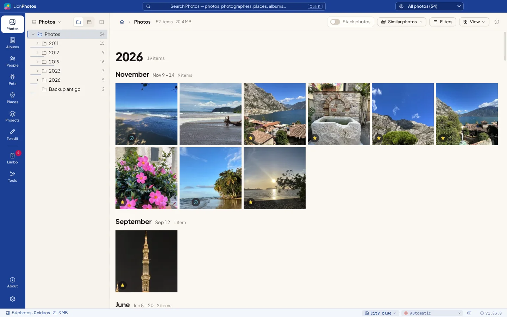
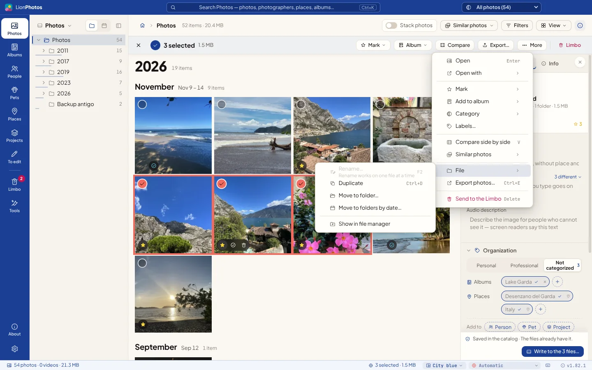
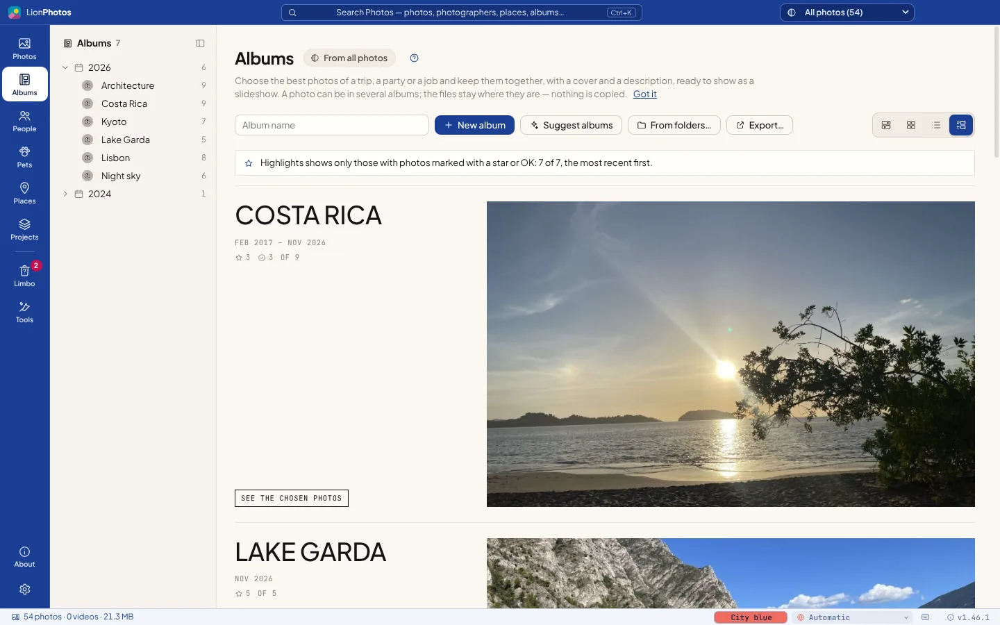
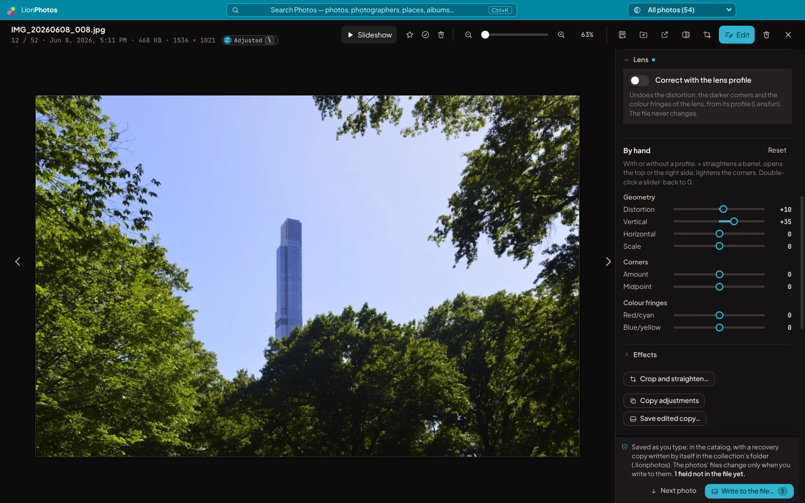
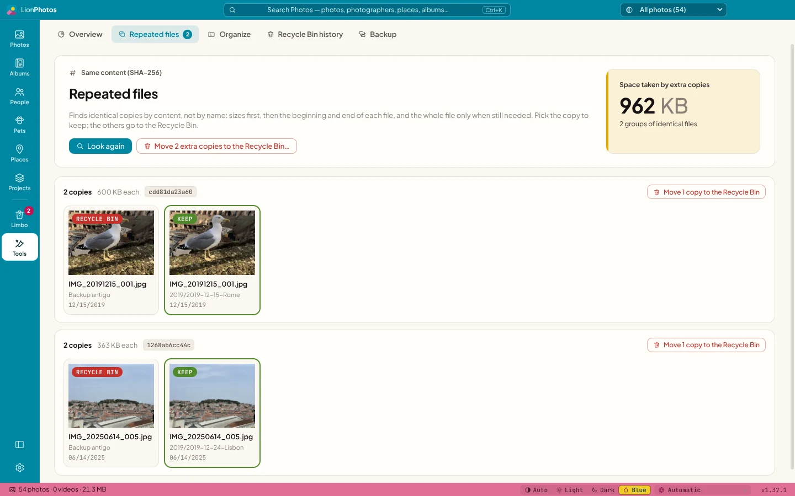

<div align="center">


# LionPhotos

### Todas as fotografias que já tirou, encontradas em segundos.

O LionPhotos abre as pastas onde as suas fotografias e vídeos já estão (o seu disco, um disco externo, uma pasta na nuvem) e deixa-o encontrar, selecionar, descrever e entregar. Nada é importado, nada sai do seu computador, e é gratuito.

<sub>pela <b>LionPhotos Team</b> · criado e idealizado por <b>Daniel Michelon De Carli</b> · irmão do <a href="https://github.com/danielcarli/lionorganizer">LionOrganizer</a></sub>

[English](../README.md) · [Português (Brasil)](README.pt-BR.md) · **Português (Portugal)** · [Español](README.es.md) · [Français](README.fr.md) · [Deutsch](README.de.md) · [Italiano](README.it.md) · [简体中文](README.zh-CN.md) · [日本語](README.ja.md) · [한국어](README.ko.md)

<p>
  <a href="https://github.com/danielcarli/lionphotos/releases/latest/download/LionPhotos-Setup.exe"></a>
  <a href="https://github.com/danielcarli/lionphotos/releases/latest/download/LionPhotos-mac-universal.dmg"></a>
  <a href="https://github.com/danielcarli/lionphotos/releases/latest/download/lionphotos_amd64.deb"></a>
  <a href="https://github.com/danielcarli/lionphotos/releases/latest/download/lionphotos.x86_64.rpm"></a>
  <a href="https://github.com/danielcarli/lionphotos/releases/latest/download/LionPhotos-x86_64.AppImage"></a>
</p>

<a href="https://github.com/danielcarli/lionphotos/releases/latest"></a>

<sub><a href="https://github.com/danielcarli/lionphotos/releases">Todas as versões</a> · <a href="#transferir">Como instalar</a></sub>


**Sem importar nada** · **Nada sai do seu computador** · **100 mil fotografias deslizam como 100** · **Gratuito e de código aberto**


</div>

> **Teste beta.** O LionPhotos já serve para o uso diário e é testado numa coleção real de cerca de 15 mil fotografias e vídeos, mas ainda está em beta: podem surgir arestas por limar, e convém ter uma cópia de segurança da coleção antes de a reorganizar pela primeira vez. [O que beta quer dizer aqui](#teste-beta).

## O LionPhotos num minuto

**Um organizador e um catálogo para quem fotografa muito.** Reúne o essencial de uma biblioteca de fotografias (marcações, álbuns, descrições IPTC, RAW + JPEG, ajustes que nunca tocam no ficheiro) e o que se espera de uma galeria moderna (pessoas, animais, locais, pesquisa pelo que a fotografia mostra, pilhas de fotografias parecidas).

**Feito a partir do uso real.** As funções nasceram de problemas reais: uma pasta na nuvem lenta, pares RAW + JPEG, a mesma fotografia em três sítios, comparar duas fotografias antes de descartar uma.

**Testado numa coleção grande.** Mais de 70 mil fotografias num disco externo USB 3.1 continuam fluidas de percorrer; só as primeiras miniaturas da coleção inteira demoram.

## O que faz com ele

As coleções crescem mais depressa do que alguém consegue organizar. Estas são as tarefas para as quais o LionPhotos foi feito.

### Abrir as suas pastas tal como estão

Sem importar e sem copiar: o LionPhotos lê as pastas tal como estão, faz cada miniatura uma vez e só a refaz quando o ficheiro muda. 100 mil itens deslizam como 100. O que faz com as fotografias (álbuns, pessoas, marcações, descrições, ajustes, recortes) também fica numa pasta oculta dentro da coleção, por isso o mesmo disco externo abre com tudo noutro computador.

<p align="center"><br><sub><b>Fotos</b>: grelha por mês, com os anos à mão na lateral</sub></p>

<p align="center"> <br><sub><b>Lista</b>: pasta, tipo, tamanho, data · <b>Mais</b>: um só menu, o mesmo do clique direito</sub></p>

### Encontrar qualquer fotografia

Pesquise por nome, pasta, câmara, autor, descrição, álbum, etiqueta, projeto, pessoa, animal ou local, ou pelo que a fotografia mostra: escreva *praia*, *cão* ou *aniversário*. Rostos, animais e cenas são reconhecidos no seu computador.

<p align="center"><br><sub><b>Pesquisa</b>: na barra de título, em toda a coleção</sub></p>

### Selecionar uma sessão em minutos

Marque enquanto percorre: `1` ótima, `2` OK, `3` para o Limbo. *Empilhar fotografias* junta as que, na prática, são a mesma imagem e mostra a melhor de cada pilha; *Comparar* põe duas ou mais lado a lado. O que descarta espera no Limbo, e só o Limbo envia ficheiros para a Reciclagem.

<p align="center"><br><sub><b>Destaques</b>: só as fotografias marcadas como ótimas ou OK, como um portefólio</sub></p>

### Organizar sem mover um ficheiro

Álbuns, as suas próprias etiquetas, pessoas, animais, locais e projetos ficam no catálogo: uma fotografia pode estar em vários, e os ficheiros continuam onde estão. *Sugerir álbuns* agrupa as fotografias como foram tiradas e dá-lhes nome pelo que mostram; os locais preenchem-se pelo GPS e aparecem num mapa-múndi desenhado no seu computador.

<p align="center"> <br><sub><b>Álbuns</b>: mosaico por ano · <b>Dentro de um álbum</b>: mosaico, grelha uniforme, lista ou destaques</sub></p>

<p align="center"><br><sub><b>Locais</b>: num mapa-múndi desenhado neste computador</sub></p>

### Um painel, quatro tarefas

Ao lado das fotografias, um painel com quatro separadores numa régua estreita: **Organização** (marcação, categoria, etiquetas, álbuns, pessoas, locais), **Ajustar**, **Descrever** e **Info** (o ficheiro e a câmara). As teclas `O`, `E`, `D` e `I` abrem cada um, e `H` recolhe o painel.

### Editar depressa, sem tocar no original

Exposição, cor, preto e branco, recorte, nivelamento, correções de lente e de perspetiva e revelação de RAW, ao vivo, na placa gráfica. Tudo fica no catálogo: o ficheiro nunca muda, e `\` mostra o original a qualquer momento. Num ficheiro RAW, o interruptor **Revelar o RAW (16 bits)** passa os ajustes do JPG de 8 bits da câmara para os dados do sensor.

<p align="center"> <br><sub><b>Visualizador</b>: com o painel de edição · <b>Correção de lente</b>: perspetiva corrigida à mão</sub></p>

### Descrever e entregar

Título, descrição, audiodescrição, autor, local e palavras-chave para uma fotografia ou cem, guardados enquanto escreve e legíveis por outros programas (IPTC e XMP). Só são gravados nos ficheiros quando o pede, depois de ver o que vai ser gravado. Os recortes vêm nos formatos de cada rede social, e as exportações têm nomes consistentes, tamanhos e os metadados que escolher.

<p align="center"><br><sub><b>Descrição</b>: metadados IPTC, guardados enquanto escreve</sub></p>

<p align="center"> <br><sub><b>Recorte</b>: para Instagram, Stories, YouTube… · <b>Exportar fotografias</b>: nomes consistentes, tamanhos para cada rede</sub></p>

### Libertar espaço e arrumar o disco, com anular

Os ficheiros repetidos são encontrados pelo conteúdo, e as cópias a mais vão para o Limbo. *Reorganizar a coleção* propõe uma estrutura de pastas clara (`2025/2025-12-24-Natal`) para rever antes de alguma coisa se mover. Qualquer alteração a ficheiros mostra o plano, pede um código de 3 caracteres escrito à mão e pode ser anulada.

<p align="center"><br><sub><b>Ficheiros repetidos</b>: encontrados pelo conteúdo</sub></p>

<p align="center"></p>

**Pronto para reencontrar as suas fotografias?** [Transfira o LionPhotos](#transferir) para Windows, macOS ou Linux: gratuito, sem conta, em 10 idiomas.

## Porquê o LionPhotos

- **As suas pastas, tal como estão.** Sem importar e sem biblioteca fechada: as fotografias ficam onde as pôs, e os seus outros programas continuam a funcionar com elas.
- **Local e privado.** Sem conta e sem telemetria; só vai à internet quando lhe pede para procurar uma versão nova. Rostos, animais e cenas são reconhecidos no seu computador.
- **Rápido em qualquer tamanho.** A grelha desenha só o que está no ecrã, e cada miniatura é feita uma vez. Coleções grandes em discos externos continuam fluidas.
- **Todos os formatos.** JPEG, HEIC/HEIF, TIFF, PSD/PSB, RAW das principais marcas (CR3, CR2, NEF, ARW, RAF, DNG…) e vídeos (MP4, MOV, MTS, AVI…).
- **Seguro de raiz.** Qualquer alteração a ficheiros mostra primeiro o plano, pede um código de 3 caracteres escrito à mão e pode ser anulada. Eliminar passa pelo Limbo e depois pela Reciclagem, nunca de vez.
- **O catálogo viaja com as fotografias,** num formato JSON aberto e documentado que outros programas conseguem ler.
- **Organiza a sério.** Álbuns, etiquetas, projetos, pessoas, animais e locais no catálogo e, quando quiser, pastas e nomes de ficheiro no disco, com o RAW, o JPEG e os ficheiros auxiliares de uma fotografia sempre juntos.
- **Gratuito e de código aberto** (MIT), para Windows, macOS e Linux, em 10 idiomas.

## Para quem é

- **Fotógrafos, profissionais e entusiastas,** que guardam o trabalho em pastas e discos externos, fotografam em RAW + JPEG e querem selecionar, encontrar e entregar sem importar tudo para um catálogo.
- **Equipas de comunicação e estúdios** que partilham uma coleção entre computadores e pessoas, precisam de nomes consistentes, autoria e descrições acessíveis, e organizam o trabalho por projeto e cliente.
- **Famílias e quem tem anos de fotografias de telemóvel** espalhadas por pastas, e quer reencontrar pessoas, locais e momentos e libertar espaço com segurança.
- **Quem se preocupa com a privacidade:** nada é enviado, não há conta e nada passa pela rede.

## O que é, e o que não é

O LionPhotos é um **organizador e um catálogo**. O seu trabalho principal é pôr tudo em ordem: encontrar uma fotografia, selecionar uma sessão, montar álbuns e projetos e entregar o resultado.

Também **edita e corrige**, para o trabalho rápido e leve de que a maioria das fotografias precisa: exposição, cor, preto e branco, recorte e nivelamento, correções de lente, revelação de RAW.

**Não pretende substituir o Lightroom, o Photoshop ou outros editores dedicados à revelação de fotografias.** Camadas, retoque local e composição ficam com esses programas; o LionPhotos abre a fotografia neles (*Abrir com*) e traz o resultado de volta para o catálogo.

## Transferir

Transfira o instalador do seu sistema. As ligações apontam sempre para a **versão mais recente**, e cada ficheiro é verificado (SHA-256 e proveniência de compilação assinada).

- **Windows 10/11** (x64, ARM): um instalador com a aplicação completa lá dentro (cerca de 150 MB): nada é transferido durante a instalação, que demora segundos. → [`LionPhotos-Setup.exe`](https://github.com/danielcarli/lionphotos/releases/latest/download/LionPhotos-Setup.exe) · [ARM](https://github.com/danielcarli/lionphotos/releases/latest/download/LionPhotos-Setup-arm64.exe) · [`.zip` portátil, sem instalar](https://github.com/danielcarli/lionphotos/releases/latest/download/LionPhotos-win-x64.zip)
- **macOS 11+** (Apple Silicon, Intel): abra o `.dmg` e arraste o LionPhotos para Aplicações. → [`LionPhotos-mac-universal.dmg`](https://github.com/danielcarli/lionphotos/releases/latest/download/LionPhotos-mac-universal.dmg)
- **Linux** (x64): `.deb` para Ubuntu, Debian, Mint…, `.rpm` para Fedora, RHEL, openSUSE…, ou o AppImage para qualquer distribuição, sem instalação. → [`.deb`](https://github.com/danielcarli/lionphotos/releases/latest/download/lionphotos_amd64.deb) · [`.rpm`](https://github.com/danielcarli/lionphotos/releases/latest/download/lionphotos.x86_64.rpm) · [AppImage](https://github.com/danielcarli/lionphotos/releases/latest/download/LionPhotos-x86_64.AppImage)

> Os instaladores ainda não estão assinados com um certificado pago. Na primeira execução, o Windows pode mostrar "O Windows protegeu o computador" (**Mais informações › Executar mesmo assim**) e o macOS pede para permitir a aplicação em **Definições do Sistema › Privacidade e segurança › Abrir mesmo assim**.

**Prefere o terminal?** macOS e Linux:

```bash
curl -fsSL https://github.com/danielcarli/lionphotos/releases/latest/download/install.sh | bash
```

[Todas as versões](https://github.com/danielcarli/lionphotos/releases) · [Guia de instalação](INSTALL.md) (em inglês): detalhes, como se mantém seguro, como atualizar e desinstalar.

## Teste beta

O LionPhotos está em **beta**. Isso quer dizer:

- É usado todos os dias numa coleção real, e cada versão passa em mais de 100 verificações automáticas de ponta a ponta, mas ainda não foi usado em muitos computadores e coleções diferentes.
- **Testado com uma coleção grande num disco comum:** mais de 70 mil ficheiros num disco rígido externo USB 3.1 — um disco comum, não um SSD. Neste teste, o desempenho tem-se mostrado satisfatório.
- Antes de organizar, mudar o nome ou reorganizar uma coleção pela primeira vez, **tenha uma cópia de segurança dela** (o separador Cópia de segurança faz uma). Todas as operações podem ser anuladas e nada é eliminado de vez, mas a cópia de segurança é a rede mais segura.
- Os instaladores ainda não estão assinados com um certificado pago (ver [Transferir](#transferir)).
- Um ficheiro RAW é editado, por omissão, sobre o JPG que a câmara guardou dentro dele (8 bits), que abre de imediato. O interruptor **Revelar o RAW (16 bits)**, em Ajustes, edita os dados do sensor, revelados neste computador com a LibRaw, com mais margem em altas luzes e sombras. É novo e ainda está em afinação (as cores não são as da câmara nem as do Lightroom) e precisa de placa gráfica com WebGL 2. O **?** ao lado do interruptor explica as duas formas ali mesmo.
- Encontrou um problema ou tem uma sugestão? Abra uma [issue](https://github.com/danielcarli/lionphotos/issues) com a versão (na barra de estado) e o que fez. O LionPhotos nunca envia nada por si.

## Funcionalidades

| | |
|---|---|
| **Fotografias** | Grelha por mês ou lista com pasta, tipo, dimensões, tamanho, data e detalhes; seleção com clique, Ctrl e Shift; zoom; filtros por tipo, ano, marcação, categoria e subpastas, mostrados como etiquetas que saem com um clique. A árvore de pastas (ou os anos) à esquerda e o painel de informações à direita — ambos podem ser ocultados, ou tudo com o modo foco (`\`). **A pesquisa na barra do título** (Ctrl+K ou Ctrl+F) procura em toda a coleção enquanto escreve — fotografias, álbuns, projetos, pessoas, lugares, fotógrafos, câmaras, palavras-chave, pastas — e, quando os filtros escondem tudo, a página diz quais são, com um botão para retirar cada um. Dentro de um álbum, pessoa, animal, lugar ou projeto: mosaico, grelha uniforme, lista ou destaques. Grelha ou lista, tamanho e ordem ficam em **Visualização**; com fotografias selecionadas, uma faixa oferece Marcar, Álbum, Comparar, Exportar, **Mais** (o mesmo menu do clique direito, com *Ficheiro* ▸ para o que mexe no disco) e o Limbo por último. |
| **Visualizador** | Tamanho real de imediato (a miniatura primeiro), ficheiros RAW em tamanho real através do JPEG que a câmara guardou neles, ← → para navegar, `I` para informações, zoom ao tamanho real; os vídeos reproduzem com controlos. O controlo de zoom vai do tamanho do ecrã a 400 %; a roda do rato aproxima onde está o ponteiro, arrastar move a fotografia, `Z` alterna entre ajustar e tamanho real. *Editar* (ou `H`) mostra ou recolhe o mesmo painel de edição do painel de informações — categoria, álbuns, ajustes, descrição, autor e local; uma fotografia levada para uma categoria fora do filtro continua visível, a cinzento, com um aviso a dizer onde está agora. HEIC, HEIF e HIF também abrem em tamanho real; fotografias HDR (PQ, HLG) são convertidas para o ecrã comum, no visualizador e nas miniaturas. Duplo clique faz zoom a 100 % no ponto clicado, e volta. Delete envia a fotografia para o Limbo com uma confirmação simples. O painel mostra uma tarefa de cada vez — Ajustar, Descrever, Info — e, numa janela com 1680 px ou mais, Descrever e Info à esquerda e Ajustar à direita; arraste a margem de um painel para o alargar. |
| **Ajustes** | Exposição, contraste, sombras e saturação no painel de informações, para uma fotografia ou várias, com histograma e pré-visualização imediata (na placa gráfica, ou no processador quando não há); copie e cole noutras fotografias. O ficheiro nunca muda: os ajustes ficam no catálogo (anulados com Ctrl+Z), as miniaturas e o visualizador mostram-nos (mantenha `\` para ver o original), e *Guardar cópia editada* grava um novo JPEG ao lado do original, com os metadados. *Exportar fotografias* (Ctrl+E) cria ficheiros novos das fotografias editadas em qualquer pasta — JPEG, PNG ou TIFF, no tamanho de uma rede social ou de uma impressão, com nitidez de saída, nomes como `2026-07-24-Formatura-Ana-Souza-001.jpg`, com todos os metadados ou sem a localização e uma assinatura opcional — com o perfil sRGB; os originais nunca mudam. |
| **Edição** | Realces, brancos, pretos, equilíbrio de brancos (temperatura, matiz e conta-gotas), vibração, preto e branco com mistura por cor, vinheta e — na placa gráfica — nitidez, textura e clareza; *Automático*, predefinições e antes e depois no visualizador (`Y`). **Recortar e endireitar** (`C`): livre ou numa proporção — as comuns e as das redes sociais (Instagram 4:5 e 3:4, Stories/Reels/TikTok 9:16, YouTube 16:9, ligação 1,91:1, Pinterest, capas do X e do LinkedIn) —, rotações de 90° e endireitar traçando uma linha sobre o horizonte. Tudo fica no catálogo; o ficheiro nunca muda. |
| **Correção da objetiva** | Distorção, cantos escuros e franjas de cor da objetiva desfeitos pelo perfil dela — toda a base do [Lensfun](https://lensfun.github.io), cerca de 1600 objetivas, encontrada pelo nome que a câmara gravou ou escolhida numa lista com pesquisa — e à mão: distorção, perspetiva vertical e horizontal (edifícios que tombam para trás), escala, cantos e franjas. Na placa gráfica; o ficheiro nunca muda. |
| **Histórico da Reciclagem** | Ferramentas › *Histórico do lixo* (`Ctrl+5`) lista cada ficheiro que o LionPhotos enviou para a Reciclagem — quando, qual, o tamanho e de onde veio (Limbo, Ficheiros repetidos, seleção) — e mostra o espaço que o Limbo libertou: no total, no mês e mês a mês. |
| **Painel de informações** | Todos os metadados da seleção, a categoria, os álbuns, pessoas, animais, locais e projetos em que está — adicionados ou retirados ali mesmo. |
| **Descrição e metadados** | Título, descrição, audiodescrição, autor e cargo, local (sublocal, cidade, distrito/estado, país), palavras-chave e instruções, para uma fotografia ou várias de uma vez — só o catálogo muda. O que o ficheiro já diz (EXIF, IPTC, XMP, o `.xmp` de um RAW) aparece como sugestão e é usado nas exportações. *Gravar nos ficheiros* (com o código digitado) grava dentro do próprio JPEG, com a versão anterior a ir para a Reciclagem, ou num `.xmp` ao lado dos outros ficheiros. O JPEG também recebe o mesmo `.xmp` ao lado: os dados seguem com a fotografia quando é enviada e ficam legíveis ao lado dela. Qualquer alteração pode ser anulada (Ctrl+Z) e refeita (Ctrl+Shift+Z); a gravação nos ficheiros anula-se pelo aviso ou pelas operações recentes, e os ficheiros voltam byte a byte. **Sincronizado com os ficheiros `.xmp`** (página Cópia de segurança, ligado com o código digitado): o que é escrito no LionPhotos — descrição, local, palavras-chave, a marcação como estrelas — vai automaticamente para o `.xmp` ao lado de cada fotografia, e o que o Lightroom, o digiKam ou o darktable lá gravarem volta; um campo alterado dos dois lados espera que escolha. Só os campos que o LionPhotos conhece são alterados num sidecar, e as fotografias em si nunca são tocadas. |
| **Álbuns** | Capa, descrição e período; *Adicionar a álbum…* em qualquer seleção, *Retirar do álbum*, *Usar como capa*; **álbuns a partir das pastas** (o primeiro nível, as pastas com fotografias ou as que escolher), ligados à pasta inteira; apresentação em ecrã inteiro. **Sugerir álbuns**: as fotografias agrupadas como foram tiradas e com nomes pelo que são — a pasta, o que as fotografias mostram (lido neste computador a partir das miniaturas: praia, montanha, bolo, vestido de noiva, comida…), feriados pela data, o local, a pessoa — e álbuns de um assunto ao longo dos anos, para rever antes de criar. **Juntar dois álbuns** num só (as fotografias dos dois, com o nome que escolher; só o catálogo muda, e pode anular). Mostrados em mosaico, grelha uniforme (todas as capas do mesmo tamanho), lista ou destaques. |
| **Projetos, pessoas, animais, locais** | Cada um no seu separador, em grelha ou lista agrupada por ano. Abrir um mostra as respetivas fotografias, no seu separador; uma fotografia pode ser retirada com um clique. A etiqueta de uma pasta aplica-se a tudo o que está dentro dela. Um projeto agrupa álbuns e tem uma ficha (estado, para quem, local, equipa, prazo) e um painel com o andamento: triadas, editadas, escolhidas nos álbuns, audiodescrições. Os locais preenchem-se sozinhos a partir das fotografias (a posição de GPS ou o local escrito nelas) e aparecem num **mapa-múndi**, desenhado no próprio computador. |
| **Por editar** | O lápis na capa de um álbum ou projeto coloca-o no separador **Por editar** (Ctrl+Shift+E), uma lista pela ordem em que as coisas devem ser feitas: arraste as linhas, ou use as setas ou Alt+↑ ↓, para pôr primeiro o que vem primeiro. A posição na lista aparece na capa, um projeto mostra a data de entrega (a vermelho quando atrasado) e *Pronto* tira o lápis. Só o catálogo muda, e a lista acompanha a coleção. |
| **Nome e logótipo** | *Definições › Nome e logótipo* coloca o seu próprio nome e logótipo (de uma agência, um estúdio, um curso) na barra de título, na página inicial e no título da janela, com pré-visualização. Um nome seu mostra sempre **Powered by LionPhotos** ao lado; Acerca de mantém os créditos. O logótipo (PNG, JPG, WebP, SVG) fica inteiro num quadrado; *Voltar ao LionPhotos* desfaz. Fica guardado neste computador. Um plugin também os pode definir enquanto estiver ligado (`brand` no seu `plugin.json`); os seus passam à frente. |
| **Rostos e animais** | face-api (TensorFlow.js) para rostos, COCO-SSD e MobileNet para animais, na placa gráfica (WebGL). Grupos de rostos semelhantes, sugestões que confirma ou recusa, "não é" memorizado. Desligado por predefinição; *Indexar agora* ou após cada análise. |
| **Marcações e Limbo** | Ótima, OK, candidata a eliminar — na miniatura, na lista, no visualizador e no painel de informações; teclas `1` `2` `3` `0`. O Limbo mostra todas as candidatas e o espaço que ocupam, e envia-as para a Reciclagem de uma vez. **Destaques**: álbuns, pessoas, animais e projetos só com as fotografias marcadas com estrela ou OK, um por linha — o nome grande, uma fotografia escolhida em destaque — como uma página de portefólio. Locais também; e dentro de cada um, as fotografias escolhidas em grande, uma por linha. |
| **Abrir com** | Os programas de fotografia e vídeo do computador para os ficheiros selecionados (Photoshop, Lightroom Classic, Bridge, Premiere Pro, Capture One, DxO PhotoLab, Affinity, darktable, GIMP, VLC…), os últimos usados primeiro; no Windows, também todos os programas registados para o tipo de ficheiro. |
| **Plugins** | Instale pacotes `.lionplugin` que exportam álbuns e projetos como uma página (HTML, CSS e JavaScript), com os nomes dos ficheiros, as descrições e as audiodescrições; nada deles é executado dentro do LionPhotos. Veja [PLUGINS.md](PLUGINS.md) (em inglês). Cada plugin ativo ganha um separador depois de Por editar, com a sua página: escolha os álbuns e projetos e exporte. |
| **Visão geral** | Itens, fotografias, vídeos, tamanho e período; ficheiros por tipo, por ano, formatos, câmaras, codecs; a cache de miniaturas. |
| **Organizar** | Pastas por data (`2024/2024-07`, `2024-07`, `2024`, `2024/2024-07-14` ou `2024-07-14-tema`), pastas por álbum (`2024/2024-07-14-álbum`), com `Raw/` e `Img/` dentro se quiser; *Mover para pasta* com subpastas por tipo; os ficheiros do mesmo disparo vão junto; operações recentes com anular. Os ficheiros mudam de lugar no disco e também podem mudar de **nome** (`{data}-{álbum}-{fotógrafo}-{nº}` por omissão, numerados pela data; o RAW, o JPEG e o `.xmp` da mesma fotografia ficam com o mesmo nome), ou só mudar de nome onde estão. **Reorganizar a coleção** lê as pastas como estão e propõe uma estrutura única no disco — `2025/2025-12-24-Natal`, temas longos em `Temas/`, o que espera triagem em `_Entrada/`, testes de câmara em `_Equipamento/` — para rever (mudar o nome ou deixar de fora qualquer pasta, ver a árvore como vai ficar) antes de as pastas inteiras mudarem de lugar, com anular. **Ficheiros relacionados soltos** (um `.xmp` ou `.dop` que ficou sozinho depois de a fotografia mudar de lugar) voltam para junto da fotografia, com o nome dela. **Duplicar** (Ctrl+D): uma cópia ao lado da fotografia, com os ajustes, o recorte, as marcações e os álbuns, com código digitado e anular. Pastas por data e *Mover* agem só sobre as fotografias selecionadas; a coleção inteira tem um caminho, **Reorganizar**, revisto antes de qualquer coisa mudar de sítio. Quando pastas por data esvaziariam pastas de evento em pastas de mês, o LionPhotos pergunta antes e oferece Reorganizar. |
| **Ficheiros repetidos** | SHA-256 em três etapas (tamanho → primeiros/últimos 64 KB → ficheiro inteiro), lado a lado com as miniaturas. Cada cópia mostra a pasta onde está gravada, abre no LionPhotos ou no programa do computador, aparece na pasta ou tem o caminho copiado; *Comparar lado a lado* põe a cópia mantida ao lado de outra (os vídeos abrem no programa do computador). Escolher outra cópia muda a marcação, não a ordem das cópias. Pastas que se repetem aparecem por inteiro, com *Manter aqui* para todos os seus ficheiros. Selecione ficheiros repetidos (um a um, um conjunto de pastas ou todos) e envie as cópias extra para o Limbo, pela barra no topo ou pelo botão no fim. |
| **Fotografias parecidas** | Em qualquer dia, as fotografias que na prática são a mesma imagem (uma sequência, a mesma pose algumas vezes) são agrupadas a partir das miniaturas, no próprio computador, com a mais nítida e mais bem exposta sugerida para ficar. Um clique mantém ou deixa ir cada fotografia; as outras vão juntas para o Limbo, o RAW e o JPG como uma só. Três níveis: quase iguais, parecidas, mesma cena. Também pela barra de Fotos, ao lado de *Fotografias sem álbum*: as fotografias mostradas — uma pasta, um ano, um álbum — entre vários dias. |
| **Pesquisa pelo que a foto mostra** | Escreva *praia*, *cão*, *aniversário* ou *pôr do sol* e encontre as fotos que o mostram, seja qual for o nome do ficheiro. Um modelo pequeno (TinyCLIP, MIT) lê cada miniatura no computador, pelo processador, enquanto “o que as fotos mostram” é analisado, e compara-a com 605 tipos de cenas, eventos, objetos e lugares, com nomes nas dez línguas da aplicação. O painel de informações mostra o que a foto mostra; cada nome pesquisa-o. Nada é transferido nem enviado. |
| **Cópia de segurança** | Uma pasta principal e uma de cópia comparadas pelo conteúdo; cópias verificadas do que falta, nas mesmas subpastas ou em pastas por data. |
| **Converter** | HEIC/HEIF → JPG ou PNG em resolução total, mantendo o EXIF e o perfil de cor, ao lado do original. |
| **Formatos** | Fotografias: JPEG, PNG, GIF, WebP, AVIF, BMP, HEIC/HEIF, TIFF, PSD/PSB, RAW de câmara (CR3, CR2, NEF, NRW, ARW, SR2, ORF, RW2, RAF, SRW, PEF, DNG, 3FR, IIQ, ERF, RWL). Vídeos: MP4, MOV, M4V, 3GP, WebM, MKV, MTS/M2TS, AVI. |
| **10 idiomas** | English, Português (Brasil), Português (Portugal), Español, Français, Deutsch, Italiano, 简体中文, 日本語, 한국어 — detetado a partir do sistema, alterável na barra de estado. |
| **Temas** | Melancia (o azul-petróleo do logótipo, rosa e branco ), Azul cidade (azul cobalto, coral e branco, como uma planta urbana — o predefinido), claro, escuro e automático. |

## Segurança em primeiro lugar

As mesmas regras do LionOrganizer:

- **Código de confirmação escrito.** Cada alteração a ficheiros — Reciclagem, organizar, mover, mudar o nome, converter, anular, limpar a cache — mostra um código de 3 caracteres que tem de ser **escrito** (colar está desativado). O código é gerado e verificado pelo processo principal; cinco tentativas erradas cancelam.
- **Reciclagem, não eliminação definitiva.**
- **Escopo limitado.** A interface chega aos ficheiros apenas pelos identificadores da biblioteca da pasta aberta, nunca pelo caminho.
- **Só leitura por padrão.** Explorar, metadados, miniaturas, pré-visualizações, a procura de repetidos e o "Abrir com" nunca alteram os seus ficheiros. Álbuns, etiquetas, marcações e rostos alteram apenas o catálogo do próprio LionPhotos. A única exceção: o que faz com as fotografias também é gravado, em JSON, numa pasta oculta `.lionphotos` dentro da coleção (só depois de algo feito; pode desligar em Backup).

## Atalhos de teclado

| Atalho | Ação |
|---|---|
| `Ctrl+O` | Abrir uma pasta |
| `F5` | Procurar ficheiros novos e alterados |
| `Ctrl+K` · `Ctrl+F` | Pesquisar em toda a coleção (barra do título) |
| `Ctrl+1` · `Ctrl+Shift+A` | Fotografias · Álbuns |
| `Ctrl+Shift+E` | Por editar |
| `Ctrl+6` … `Ctrl+9` | Projetos · Pessoas · Animais · Locais |
| `Ctrl+L` | Limbo |
| `Ctrl+2` · `Ctrl+3` · `Ctrl+4` · `Ctrl+0` | Visão geral · Ficheiros repetidos · Organizar · Cópia de segurança |
| `Alt+←` · `Alt+Home` | Voltar de um álbum, projeto ou pessoa · a coleção inteira, sem filtros |
| `Ctrl+B` · `\` | Mostrar/ocultar a barra lateral · modo foco (só as fotografias) |
| `1` `2` `3` · `0` | Marcar a seleção como ótima · OK · candidata a eliminar · limpar |
| `Ctrl+A` · `Enter` · `H` · `Delete` · `F2` · `Esc` | Selecionar tudo · abrir · painel de informações · Reciclagem · mudar o nome · limpar a seleção |
| `O` · `E` · `D` · `I` | Painel lateral em Organização · Ajustar · Descrever · Info (a mesma tecla de novo recolhe-o) |
| `Ctrl+G` · `Ctrl+Shift+G` | Empilhar · desempilhar a seleção |
| `V` · `?` | Comparar lado a lado · Atalhos de teclado |
| `Ctrl+E` | Exportar fotografias (a seleção, ou as fotografias mostradas) |
| `←` `→` · `Espaço` · `Esc` | Visualizador: anterior/seguinte · reproduzir/pausa · fechar |
| `↑` `↓` · `B` | Visualizador: as fotografias de uma pilha (a faixa de baixo): seguinte/anterior · definir como a melhor |
| `P` · `F` · `A` | Visualizador: apresentação · ecrã inteiro · adicionar a álbum |

## Idiomas

| Idioma | Código | | Idioma | Código |
|---|---|---|---|---|
| English | `en` | | Deutsch | `de` |
| Português (Brasil) | `pt-BR` | | Italiano | `it` |
| Português (Portugal) | `pt-PT` | | 简体中文 | `zh-CN` |
| Español | `es` | | 日本語 | `ja` |
| Français | `fr` | | 한국어 | `ko` |

O idioma segue o do sistema e pode ser alterado na barra de estado. Números e datas seguem o idioma escolhido. Os catálogos de textos são criados a partir de `tools/nls/*.py` em `src/nls/*.json`.

## Privacidade

O LionPhotos só se liga à rede quando o pede: clicar na versão, no canto inferior direito, procura uma nova versão no GitHub, e atualizar transfere o instalador do seu sistema, verificado (SHA-256) antes de ser usado. Sem conta, sem telemetria, nada sobre si ou as suas fotografias é enviado. O reconhecimento de rostos e de animais corre neste computador, com modelos incluídos na aplicação.

O catálogo e as miniaturas ficam num único ficheiro no seu computador:

```
%APPDATA%\LionPhotos\library.sqlite
```

*Visão geral › Limpar cache* apaga as miniaturas. As suas fotografias nunca são afetadas.

## Primeiros passos

### Executar a partir do código-fonte (Windows)

1. Instale o [Node.js LTS](https://nodejs.org).
2. Transfira ou clone este repositório.
3. Faça duplo clique em **`start.bat`** — a primeira execução instala as dependências.

Ou pelo terminal:

```powershell
npm install
npm start
```

### Criar um instalador

Faça duplo clique em **`build-installer.bat`** (ou execute `npm run dist`). Os instaladores são criados em `dist/`. As versões publicadas são criadas pelo GitHub Actions quando é enviada uma tag `vX.Y.Z`.

## Como as miniaturas continuam rápidas

1. **Análise** — só a pasta escolhida e as respetivas subpastas, apenas `readdir` + `stat`; o conteúdo de um ficheiro nunca é aberto para o listar. 20 000 ficheiros demoram cerca de um segundo.
2. **Validade** — a miniatura é guardada com o tamanho e a data de modificação do ficheiro; enquanto coincidirem, é reutilizada. Um ficheiro movido ou com o nome mudado fora da aplicação mantém a miniatura.
3. **Ordem** — o que está no ecrã primeiro, depois o resto, do mais recente ao mais antigo; pré-visualizações só depois de todas as miniaturas.
4. **Motor** — uma página oculta, com prioridade mais baixa, descodifica tudo com código do próprio LionPhotos: imagens em Web Workers, ficheiros RAW pela pré-visualização JPEG incorporada, TIFF e PSD lendo só uma linha em cada n, HEIC com libheif em WebAssembly, vídeos com WebCodecs. O gerador de miniaturas do sistema nunca é chamado.
5. **Armazenamento** — miniaturas WebP de 320 px (8–25 KB) num único ficheiro SQLite, sem ficheiros órfãos.

## Arquitetura

As mesmas camadas do [LionOrganizer](https://github.com/danielcarli/lionorganizer) e do [Visual Studio Code](https://github.com/microsoft/vscode): `base` não conhece nada acima dela, `platform` fornece os serviços do processo principal, `workbench` constrói a interface; a interface isolada (sandbox) só comunica com o processo principal através da ponte `preload`.

```
src/
  base/            eventos, formatação, i18n, utilitários de DOM, ícones, gráficos
  platform/
    library/       catálogo SQLite, análise de pastas, leitores de metadados (EXIF: JPEG, raw, HEIC, AVIF; PNG, MP4/MOV, Matroska)
    thumbs/        motor de miniaturas e pré-visualizações + a página oculta (workers, muxer WebM)
    media/         lionthumb:// e lionmedia:// (por id da biblioteca, com intervalos de bytes)
    faces/         reconhecimento de rostos e animais (página oculta na placa gráfica, quem-é-quem no principal)
    labels/        álbuns, projetos, pessoas, animais, locais, pessoal/profissional
    operations/    operações com código escrito: Reciclagem, organizar, mover, mudar o nome, anular, limpar cache
    openWith/      os programas de fotografia e vídeo do computador
    duplicates/    busca por SHA-256 (compartilhada com o LionOrganizer)
  code/            ponto de entrada electron-main, ponte preload
  nls/             en.json … ko.json (criados a partir de tools/nls)
  workbench/       partes do layout, serviços e vistas
```

Segurança: `contextIsolation` e `sandbox` ligados, sem `nodeIntegration`, uma Content Security Policy rígida, e cada pedido que altera ficheiros é validado no processo principal.

## Desenvolvimento

| Comando | O que faz |
|---|---|
| `npm start` | Executa a aplicação |
| `npm run dist` | Cria os instaladores |
| `npm run test:e2e` | Teste de ponta a ponta numa pasta **descartável** (`npm run fixtures` cria uma) |
| `npm run test:i18n` | Cada chave usada existe, cada idioma está completo, os marcadores coincidem |
| `npm run test:faces` | Quem-é-quem com rostos sintéticos |
| `npm run test:openwith` | "Abrir com": registo do Windows, ficheiros `.desktop`, execução |
| `npm run test:plugins` | Plugins |
| `npm run nls` | Cria `src/nls/*.json` a partir de `tools/nls/*.py` |
| `npm run release:assets` | Cria em `dist-release/` os ficheiros de versão usados pelos instaladores |

```powershell
# o teste de ponta a ponta altera ficheiros: aponte sempre para uma cópia descartável
$env:LIONPHOTOS_FOLDER="C:\temp\copia-fotografias"; npm run test:e2e
```

## Histórico de versões

Veja o [CHANGELOG.md](../CHANGELOG.md) (em inglês) — versão atual: **1.89.0**.

## Créditos

O LionPhotos foi **criado e idealizado por Daniel Michelon De Carli**, estudante de arquitetura e urbanismo, e é mantido pela **LionPhotos Team** com os seus colaboradores e tradutores.

## Licença

Copyright © 2026 LionPhotos Team.

O LionPhotos é código aberto sob a **[Licença MIT](../LICENSE)**: utilize, copie, modifique e distribua livremente, mantendo o aviso de direitos de autor. É fornecido **"tal como está", sem garantia** de qualquer tipo.

Os componentes de terceiros incluídos mantêm as suas próprias licenças:

| Componente | Licença | Onde |
|---|---|---|
| [libheif](https://github.com/strukturag/libheif) com libde265 (build WebAssembly do [libheif-js](https://github.com/catdad-experiments/libheif-js)) | GNU LGPL v3, sem modificações | `src/platform/thumbs/electron-sandbox/vendor/libheif` |
| [face-api](https://github.com/vladmandic/face-api) com TensorFlow.js e os respetivos modelos de rostos | MIT | `src/platform/faces/electron-sandbox/vendor/face-api` |
| Modelos [COCO-SSD e MobileNet](https://github.com/tensorflow/tfjs-models) | Apache 2.0 | `src/platform/faces/electron-sandbox/vendor/pets` |
| [ONNX Runtime Web](https://github.com/microsoft/onnxruntime) 1.22 and the [TinyCLIP ViT-61M/32](https://huggingface.co/wkcn/TinyCLIP-ViT-61M-32-Text-29M-LAION400M) model (Microsoft; built by `tools/models/build.py`) | MIT · MIT | `src/platform/faces/electron-sandbox/vendor/onnxruntime-web` · `models/tinyclip` |
| Fronteiras e nomes dos países do [Natural Earth](https://www.naturalearthdata.com) (1:50m) | Domínio público | `src/platform/geo` |
| [GeoNames](https://www.geonames.org) — cities15000 | CC BY 4.0 | `src/platform/geo/node/cities.json` |
| [LibRaw](https://www.libraw.org) 0.22 (raw development), in WebAssembly via [libraw-wasm](https://github.com/colorhythm/libraw-wasm) and [typed-cstruct](https://github.com/ssssota/typed-cstruct) | LGPL-2.1 or CDDL-1.0 · MIT · MIT | `src/platform/raw/electron-sandbox/vendor` |
| [Lensfun](https://lensfun.github.io) lens database (lens correction profiles), converted by `tools/lensfun/build.py` | CC BY-SA 3.0 (data only; none of Lensfun’s code) | `src/workbench/services/adjust/common/lensfun.json` |
| [Plus Jakarta Sans](https://github.com/tokotype/PlusJakartaSans), [JetBrains Mono](https://github.com/JetBrains/JetBrainsMono) | SIL Open Font License 1.1 | fontes |

## Fotografias das capturas de ecrã

As fotografias das capturas de ecrã vêm do [WordPress Photo Directory](https://wordpress.org/photos/) e estão no domínio público ([CC0](https://creativecommons.org/publicdomain/zero/1.0/)): não exigem atribuição e são creditadas aqui com agradecimento. As descrições, câmaras e datas são dos próprios fotógrafos; os lugares no mapa foram acrescentados para a demonstração.

- **Roma:** [Isabel Gutierrez](https://wordpress.org/photos/photo/53469e1c45/), [salsel](https://wordpress.org/photos/photo/2456557419/), [Jupa](https://wordpress.org/photos/photo/3816aaf093/), Bigul Malayi ([1](https://wordpress.org/photos/photo/17168efb07/), [2](https://wordpress.org/photos/photo/616857a90c/), [3](https://wordpress.org/photos/photo/33768dc862/), [4](https://wordpress.org/photos/photo/42268dc85f/)), [karolishostinger](https://wordpress.org/photos/photo/35766e9c63/)
- **Lisboa:** [Isabel Gutierrez](https://wordpress.org/photos/photo/35669e1d6f/), [MelissaH](https://wordpress.org/photos/photo/31968ae275/), KafleG ([1](https://wordpress.org/photos/photo/687685d279/), [2](https://wordpress.org/photos/photo/852685d283/), [3](https://wordpress.org/photos/photo/468685d28f/), [4](https://wordpress.org/photos/photo/667685d2c4/), [5](https://wordpress.org/photos/photo/501685d2ca/)), [Jeff Golenski](https://wordpress.org/photos/photo/3016a7fb59/)
- **Costa Rica:** [Harlyn Luna Brenes](https://wordpress.org/photos/photo/626af3dce8/), [Francisco Herrera](https://wordpress.org/photos/photo/18764e77d3/), wenmirandav ([1](https://wordpress.org/photos/photo/2786aefef5/), [2](https://wordpress.org/photos/photo/2776aefeba/), [3](https://wordpress.org/photos/photo/2016aeffe6/)), [alexandrachacaltana2303](https://wordpress.org/photos/photo/3846aeeac8/), [dmoreno2003](https://wordpress.org/photos/photo/4466af376b/), [dangrijal](https://wordpress.org/photos/photo/3516af7648/), [xbullscm](https://wordpress.org/photos/photo/7066af7fae/)
- **Lago de Garda:** xbullscm ([1](https://wordpress.org/photos/photo/836af4b8d6/), [2](https://wordpress.org/photos/photo/716af4b7c7/), [3](https://wordpress.org/photos/photo/1046af4b83/), [4](https://wordpress.org/photos/photo/8286af4b88/), [5](https://wordpress.org/photos/photo/3966af4b78/))
- **Arquitetura:** Joel Peralta ([1](https://wordpress.org/photos/photo/9656a6d336/), [2](https://wordpress.org/photos/photo/1866a70aeb/), [3](https://wordpress.org/photos/photo/8766a7044c/), [4](https://wordpress.org/photos/photo/9866a6d32f/), [5](https://wordpress.org/photos/photo/766a2f39b8/)), [Silvia Fernanda Marin Giraldo](https://wordpress.org/photos/photo/1656a972f2/), [dumanag](https://wordpress.org/photos/photo/7806a66cad/), [Manjil Aryal](https://wordpress.org/photos/photo/416a282c7f/), [Anup Kankale](https://wordpress.org/photos/photo/966a390efb/)
- **Céu noturno:** [shirishpoudel07](https://wordpress.org/photos/photo/8606a28c17/), Jeff Golenski ([1](https://wordpress.org/photos/photo/544620fdb6/), [2](https://wordpress.org/photos/photo/92361d465c/)), [vanessartavia](https://wordpress.org/photos/photo/3036ae9774/), [Natcha Boonroj](https://wordpress.org/photos/photo/512693d15a/), [Faisal Ahammad](https://wordpress.org/photos/photo/816ae8da24/)
- **Quioto:** [Maruti Mohanty](https://wordpress.org/photos/photo/4746570441/), [Timi Wahalahti](https://wordpress.org/photos/photo/14766bbb55/), Wajari Velasquez ([1](https://wordpress.org/photos/photo/506a214832/), [2](https://wordpress.org/photos/photo/5236a216f0/), [3](https://wordpress.org/photos/photo/8366a216e4/), [4](https://wordpress.org/photos/photo/8976a21449/), [5](https://wordpress.org/photos/photo/296a2182a4/))
